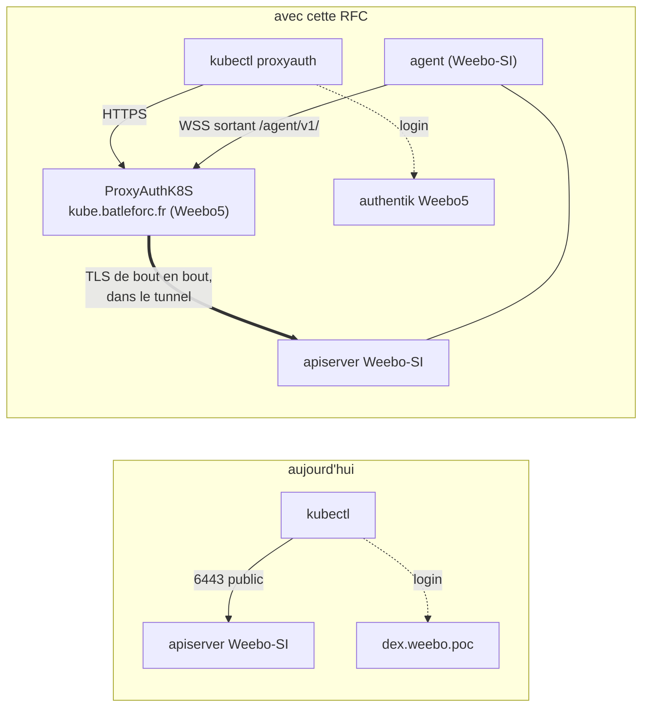
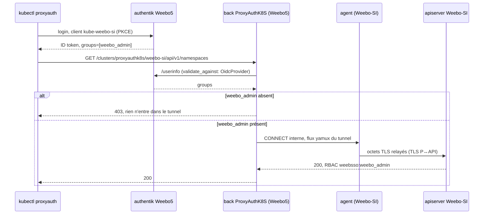
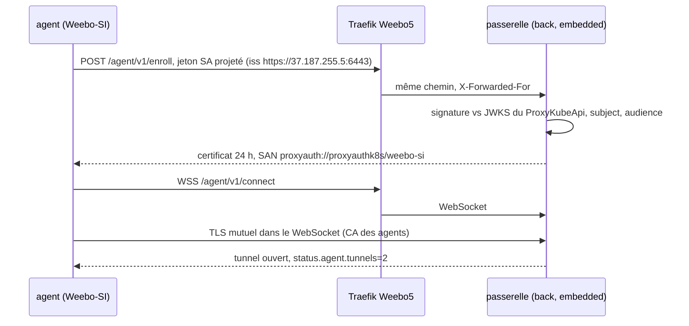
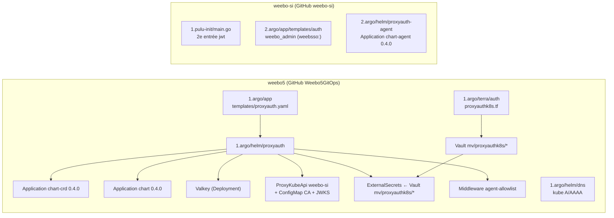
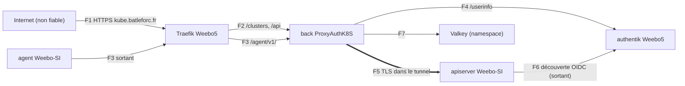

# RFC 0005 — ProxyAuthK8S sur Weebo5, un agent dans Weebo-SI

| Champ      | Valeur |
| ---------- | ------ |
| Statut     | Draft |
| Court      | ProxyAuthK8S, agent Weebo-SI |
| Tranche    | Comment l'API kube de Weebo-SI devient joignable en SSO depuis l'extérieur, sans route entrante, avec ProxyAuthK8S v0.4.0 hébergé sur Weebo5 |
| Auteur     | Max Batleforc <maxleriche.60@gmail.com> |
| Co-auteur  | Claude Opus 5.5 |
| Créée      | 2026-10-25 |
| Remplace   | — |
| Touche     | weebo5 : `1.argo/app`, `1.argo/helm/proxyauth` (nouveau), `1.argo/helm/dns`, `1.argo/terra/auth`, `1.argo/terra/vault` · weebo-si : `1.pulu-init/main.go`, `2.argo/app`, `2.argo/helm/proxyauth-agent` (nouveau), `0.docs` |
| Risque     | high (§7) |

> Document de référence (~7 000 mots) : §1 à §3 et §15 suffisent pour décider,
> le reste sert à construire et à relire.
>
> Numérotée 0005 et non 0004 : `.rfc/0004-dev-air-gapped.md` existe déjà dans
> les brouillons hors git, et une RFC acceptée y passe dans `0.docs`. Un même
> numéro pour deux RFC prêterait à confusion.

---

## 1. Résumé

ProxyAuthK8S v0.4.0 (release du 2026-10-25) apporte le **mode agent**
(RFC 0012 du projet). Un agent tourne dans le cluster privé, ouvre un
WebSocket sortant vers le proxy, y négocie un TLS mutuel et relaie le TLS que
le proxy établit de bout en bout avec l'apiserver. Cette RFC installe le
serveur sur **Weebo5** (`kube.batleforc.fr`), avec l'**authentik de Weebo5**
comme IdP central, et un agent dans **Weebo-SI**. Après coup, un membre de
`weebo_admin` lance `kubectl proxyauth login`, se connecte sur
`auth.batleforc.fr` et atteint l'API de Weebo-SI. Aucun port n'a été ouvert
vers Weebo-SI. L'accès direct actuel (`37.187.255.5:6443`, dex,
`labsso:`) reste en place.

### Avant / après

```text
# aujourd'hui : kubeconfig direct, dex du lab, apiserver public
server: https://37.187.255.5:6443        # 0.config/kubeconfig.yaml
oidc-issuer-url: https://dex.weebo.poc   # privé, PKI Vault de Weebo-SI

# avec cette RFC : un second chemin, par le proxy de Weebo5
server: https://kube.batleforc.fr/clusters/proxyauthk8s/weebo-si
# jeton émis par https://auth.batleforc.fr/application/o/kube-weebo-si/
# l'apiserver de Weebo-SI le reconnaît : utilisateur et groupes en weebsso:
```



La nouveauté de confiance est l'émetteur `auth.batleforc.fr`, que l'apiserver de
Weebo-SI accepte désormais. Un jeton refusé par le proxy (mauvais groupe,
signature invalide) n'entre jamais dans le tunnel.

---

## 2. Motivation

1. **Weebo-SI n'a aucun accès SSO joignable depuis l'extérieur du lab.**
   L'émetteur que l'apiserver accepte, `dex.weebo.poc`
   (`1.pulu-init/main.go:32`), est un nom privé signé par la PKI Vault du lab.
   Hors NetBird, il ne reste que le kubeconfig admin Talos. C'est le premier
   point non coché de `left-todo.md:25-29` (« Point d'accès externe au cluster
   Kubernetes pour l'authentification OIDC »).
2. **Le seul chemin vers l'API est un port 6443 public sur l'IP du nœud.**
   `0.config/kubeconfig.yaml` vise `https://37.187.255.5:6443`. Le jour où on
   voudra le fermer (« Rejeter toutes requêtes qui ne viendraient pas de
   ProxyAuthK8S ? », `left-todo.md:27`), il faudra un autre chemin déjà en
   service. Cette RFC le construit sans encore fermer le port.
3. **Plusieurs clusters arrivent.** Weebo5, puis un cluster maison, puis des
   expositions par équipe. Sans point d'entrée unique, chaque cluster ajoute
   un apiserver public et son propre IdP. ProxyAuthK8S est conçu pour être ce
   point d'entrée (`ProxyKubeApi` par cluster, `proxy_group` par équipe).

---

## 3. Objectifs / non-objectifs

**Objectifs**

- Un membre de `weebo_admin` atteint l'API de Weebo-SI depuis Internet par
  `kube.batleforc.fr`, en SSO authentik Weebo5, avec le plugin kubectl ou le
  dashboard.
- Weebo-SI n'accepte aucune connexion entrante supplémentaire : l'agent sort.
- Un jeton authentik émis pour un autre client (par exemple `che-cluster`) est
  refusé par l'apiserver de Weebo-SI.
- Un utilisateur hors de `weebo_admin` est refusé par le proxy (`403`) avant le
  tunnel.
- Une allowlist IP sur `/agent/v1/` est prête, mais pas active.

**Non-objectifs**

- **Fermer l'accès direct `37.187.255.5:6443`** : trop dangereux tant que le
  proxy n'a pas fait ses preuves. C'est l'accès de secours, avec `talosctl`.
- **Retirer dex ou `labsso:`** : ce chemin sert aussi à d'autres usages
  (workspaces Che, `kubectl oidc-login` sur le VPN). Il reste intact.
- **Exposer Weebo5 ou un troisième cluster** : ce sera la prochaine étape. Le
  chart est posé pour accueillir d'autres `ProxyKubeApi`.
- **Gérer plusieurs équipes** : un seul groupe, `weebo_admin`. Le passage à
  `agentGateway.mode: separate` attendra.
- **Un IdP non exposé** (un dex privé derrière le proxy) : c'est un trou connu
  du design ProxyAuthK8S, à traiter dans le projet lui-même.
- **Rotation automatique du JWKS de Weebo-SI** (`jwksPublisher`) : Talos ne
  fait pas tourner la clé de signature des ServiceAccounts tout seul, et le
  `PushSecret` demanderait un pont entre l'OpenBao de Weebo-SI et le Vault de
  Weebo5.
- **Scraping des métriques** du proxy et de l'agent : il viendra plus tard par
  les collecteurs OTel. La condition `Ready` du `ProxyKubeApi` suffit pour
  démarrer.
- **Activer l'allowlist IP de l'agent** : on doit d'abord mesurer l'IP de sortie
  réelle de Weebo-SI (IPv4 **et** IPv6) dans les logs Traefik.

---

## 4. Conception côté utilisateur

### 4.1 Configuration

**Weebo5, `1.argo/app/values.yaml`** : une brique de plus, au même format que
les autres.

```yaml
proxyauth:
  enabled: true
```

**Weebo5, `1.argo/helm/proxyauth/values.yaml`** : les clés qui comptent. Le
reste garde les valeurs par défaut du chart.

```yaml
proxyauth:
  chart:
    # renovate: datasource=docker depName=ghcr.io/batleforc/proxyauthk8s/chart
    version: 0.4.0
  host: kube.batleforc.fr
  values:
    ingress:
      host: kube.batleforc.fr
      annotations:
        cert-manager.io/cluster-issuer: outbound
      tls: { enabled: true, secretName: proxyauthk8s-tls }
    oidc:
      source: secret
      objectName: proxyauthk8s-back-oidc   # ExternalSecret, voir §6.3
    back:
      redis: { source: env, value: { url: "redis://proxyauth-valkey:6379" } }
      env:
        - { name: TRUSTED_PROXY_COUNT, value: "1" }
    agentGateway:
      enabled: true
      mode: embedded
      tlsMode: inner
      ingress:
        enabled: true
        host: kube.batleforc.fr          # même hôte, chemin /agent/v1/ seul
        annotations: {}                  # agentAllowlist.enabled l'alimente
        tls: { enabled: true, secretName: proxyauthk8s-tls }
    rbac:
      referencedNamespaces: [proxyauthk8s]
    networkPolicy:
      enabled: true
  agentAllowlist:
    enabled: false                       # préparé, inactif (§4.2)
    sourceRange: [37.187.255.5/32]
```

**Weebo-SI, `2.argo/helm/proxyauth-agent/values.yaml`** :

```yaml
agent:
  chart:
    # renovate: datasource=docker depName=ghcr.io/batleforc/proxyauthk8s/chart-agent
    version: 0.4.0
  values:
    proxy:
      url: wss://kube.batleforc.fr/agent/v1/connect
      cluster: proxyauthk8s/weebo-si
    tlsMode: inner
    bootstrap: { method: ServiceAccountToken, audience: proxyauth }
    networkPolicy:
      enabled: true
      egressTo: []        # rempli en §6.5 : apiserver + 94.23.38.81/32
      egressPorts: [443, 6443]
```

- **Valeurs par défaut qui touchent à la sécurité**, toutes du côté fermé :
  - `proxy_group: weebo_admin` : sans ce groupe, `403` ;
  - `rbac.referencedNamespaces: [proxyauthk8s]` : le back ne peut pas lire la
    clé de la CA des agents hors de son namespace (avertissement de
    `docs/agent.mdx`) ;
  - `networkPolicy.enabled` des deux côtés ;
  - `agentGateway.oneShotToken.enabled` reste à `false` : le contrôleur ne
    reçoit pas le droit `create` sur les Secrets.
- **Un défaut qui n'est pas le plus fermé** : `agentAllowlist.enabled: false`.
  N'importe quelle IP peut donc tenter `/agent/v1/`. C'est voulu : activer une
  allowlist sur une IP de sortie non mesurée couperait l'agent. Le risque reste
  borné : l'enrôlement exige un jeton de ServiceAccount signé par Weebo-SI et
  il est limité à `enrollPerMinute: 10`. `/agent/v1/connect` exige un
  certificat de la CA des agents.
- **`agentAllowlist` absent ou `enabled: false`** : le `Middleware` est rendu
  quand même, mais aucune annotation ne le référence, donc il n'a aucun effet.

### 4.2 Règles de comportement

- **Chemins sur `kube.batleforc.fr`** : deux Ingress sur le même hôte.
  `ingress.yaml` du chart route `/`, `/api/` et `/clusters/`.
  `ingress.gateway.yaml` route `/agent/v1/` seul, vers le Service de la
  passerelle, qui en mode `embedded` sélectionne les pods du back
  (`_helpers.tpl:72`). Traefik donne la priorité à la règle la plus longue,
  donc `/agent/v1/` passe avant `/`.
- **Allowlist** : `agentAllowlist.enabled: true` ajoute
  `traefik.ingress.kubernetes.io/router.middlewares:
  proxyauthk8s-agent-allowlist@kubernetescrd` à **l'Ingress de la passerelle
  seulement**. L'UI et `/clusters/` restent publics.
- **Agent sans tunnel** : `ProxyKubeApi.status` passe `Ready=False`, raison
  `AgentNoTunnel`, et le relais répond `503 agent unavailable`. Le proxy ne
  tente **jamais** de connexion directe à `37.187.255.5:6443`.
- **Jeton émis pour un autre client authentik** : authentik signe avec la même
  clé pour toutes ses applications, mais l'`iss` contient le slug
  (`.../application/o/che-cluster/`). L'apiserver de Weebo-SI n'accepte que
  l'issuer `.../application/o/kube-weebo-si/` et l'audience `kube-weebo-si`. Le
  jeton est donc refusé en `401`.
- **Chemin dex inchangé** : la première entrée `jwt` (dex, `labsso:`) reste à la
  même place. Ajouter une seconde entrée ne change ni l'ordre ni le résultat
  pour un jeton dex.

### 4.3 Validation

Refusés à l'application :

| Condition | Raison |
| --- | --- |
| Deux entrées `jwt` avec la même `issuer.url` | L'apiserver refuse de démarrer. La Pulumi de Weebo-SI vérifie avant l'apply que `KUBE_OIDC_ISSUER_URL` ≠ `OIDC_ISSUER_URL`. |
| `cert: SystemRoots` sur un `ProxyKubeApi` `Agent` | Refusé par ProxyAuthK8S (`docs/agent.mdx`, §2) : la CA de Weebo-SI doit être écrite. |
| `ProxyKubeApi.spec.service.Agent.epoch` qui baisse | Règle d'admission du CRD. |
| JWKS vide ou illisible | Enrôlement refusé (`agent_refused` dans l'audit). |
| Valeurs Helm inconnues | `values.schema.json` du chart. |

Avertissements, et où on les voit :

| Condition | Comportement | Visible dans |
| --- | --- | --- |
| Variables `KUBE_OIDC_*` absentes au `pulumi up` de Weebo-SI | Seul l'authenticator dex est rendu, comme aujourd'hui quand l'OIDC est incomplet | `ctx.Log.Warn` dans la sortie de `pulumi up` |
| Aucun tunnel | `503`, condition `AgentNoTunnel` | `kubectl -n proxyauthk8s get proxykubeapi weebo-si`, onglet ArgoCD |
| JWKS de Weebo-SI qui a tourné | Enrôlement refusé, et le tunnel en cours tombe à l'expiration du certificat de 24 h | Audit `agent_refused`, logs de l'agent, `Ready=False` |

### 4.4 Surface d'API

Pas de nouvel endpoint dans le code : ce sont ceux de ProxyAuthK8S v0.4.0, mis en
ligne sur un nouvel hôte.

| Méthode | Chemin | Auth | Qui peut appeler | Limite |
| --- | --- | --- | --- | --- |
| GET | `/`, `/api/…` | session OIDC (`proxyauthk8s`) | tout compte authentik qui passe la policy | bannissement par IP après échecs |
| * | `/clusters/proxyauthk8s/weebo-si/…` | Bearer `kube-weebo-si` | `weebo_admin` (`proxy_group`) | `throttle::check_rate_limit` par utilisateur |
| POST | `/agent/v1/enroll` | jeton SA projeté Weebo-SI (`aud: proxyauth`) | l'agent | `enrollPerMinute: 10` par IP, 120 au total |
| GET (WS) | `/agent/v1/connect` | certificat client de la CA des agents | l'agent enrôlé | `tunnelsPerAgentIdentity: 4` |

---

## 5. Architecture

### 5.1 Une requête kubectl



Le diagramme montre que le filtre par groupe a lieu sur Weebo5, avant le
tunnel. L'apiserver applique ensuite son propre RBAC sur le même jeton. Il
faut donc que **les deux** acceptent pour qu'un appel passe.

### 5.2 Enrôlement et tunnel



L'invariant : **comme la passerelle ne vérifie que la signature du JWKS écrit
dans le `ProxyKubeApi`, et le `subject`
`system:serviceaccount:proxyauth-agent:agent-proxyauthk8s-agent`, seul un pod
de Weebo-SI qui tourne sous ce ServiceAccount peut ouvrir le tunnel
`weebo-si`.** Le pod n'a ni RBAC ni jeton d'API monté. Il ne peut joindre que
`upstream: https://kubernetes.default.svc:443`.

### 5.3 Câblage GitOps



Aucun secret ne passe d'un cluster à l'autre. Seuls des objets publics sont
copiés à la main dans git : le JWKS de Weebo-SI et sa CA d'apiserver.

---

## 6. Conception détaillée

### 6.1 authentik Weebo5 : deux clients (`1.argo/terra/auth/terra-map/proxyauthk8s.tf`)

Un nouveau fichier sur le modèle de `che-cluster.tf`, ajouté à la liste
`files:` de `1.argo/terra/auth/kustomization.yaml`. Sinon le Job Terraform ne
le voit pas.

- `authentik_provider_oauth2.proxyauthk8s` : le **login du dashboard**, celui
  de la clé `oidc` du chart. Les redirect URIs (`strict`) sont celles du front
  sur `https://kube.batleforc.fr`.
- `authentik_provider_oauth2.kube_weebo_si` : le **client du cluster**, dont
  l'audience est acceptée par l'apiserver de Weebo-SI. `client_id =
  "kube-weebo-si"`, `sub_mode = "user_username"`. Redirect URIs (`strict`) :
  `https://kube.batleforc.fr/auth/callback/proxyauthk8s/weebo-si` et
  `http://localhost:18000/auth/callback/proxyauthk8s/weebo-si`
  (`docs/expose-cluster.mdx`, §3). Scopes : email, profile, openid. Pas
  d'`offline` : le plugin refait un login quand le jeton expire. Validité du
  jeton : `hours=1`.
- Pour chacun, un `authentik_application` et un `authentik_policy_binding` vers
  `authentik_group.weebo_admin`. Sans ce binding, n'importe quel compte
  authentik obtiendrait un jeton `kube-weebo-si`. L'apiserver le refuserait
  faute de RBAC, mais ce serait une défense de moins.
- Un `vault_kv_secret_v2` dans `mv/proxyauthk8s/oidc` (dashboard) et un autre
  dans `mv/proxyauthk8s/kube-weebo-si`, avec `issuer_url`, `client_id`,
  `client_secret` et `audience`. Ce sont les noms de clés que lit
  `config_from` (`oidc_config_source.rs:20-24`).

### 6.2 Apiserver Weebo-SI (`1.pulu-init/main.go`)

- `authenticationConfig(issuerURL, clientID, caPEM)` (l.46-95) gagne une
  seconde entrée `jwt`, rendue seulement si `KUBE_OIDC_ISSUER_URL` et
  `KUBE_OIDC_CLIENT_ID` sont présentes. Ces deux variables sont ajoutées à
  `fnox.toml`, provider vault, à côté de `OIDC_ISSUER_URL`. La nouvelle
  entrée :
  - `issuer.url = https://auth.batleforc.fr/application/o/kube-weebo-si/`,
    `audiences = [kube-weebo-si]` ;
  - **sans `certificateAuthority`** : le certificat d'authentik est public
    (ACME), alors qu'épingler la PKI Vault du lab ferait échouer toute la
    découverte ;
  - `claimValidationRules` : `claims.email_verified == true`, comme dex et
    Weebo5 ;
  - `claimMappings` : username `"weebsso:" + claims.email`, groups
    `{claim: groups, prefix: "weebsso:"}`, uid `claims.sub` ;
  - les mêmes `userValidationRules` (`system:` interdit).
- Le bloc d'appel (l.962-1022) garde son comportement : si une variable manque,
  l'authenticator en question n'est pas rendu, avec un avertissement, et
  l'apply ne casse pas.
- L'apply **redémarre l'apiserver**. C'est la seule étape à risque, et elle
  passe seule (§16, phase 2).

### 6.3 Chart Weebo5 (`1.argo/helm/proxyauth`)

Le chart parapluie suit le pattern de `1.argo/helm/auth` : des `Application`
imbriquées vers des charts amont, plus nos propres objets.

- `templates/crd.yaml` : `Application` vers
  `oci://ghcr.io/batleforc/proxyauthk8s/chart-crd`, `0.4.0`, sync-wave 0.
- `templates/proxyauth.yaml` : `Application` vers
  `oci://ghcr.io/batleforc/proxyauthk8s/chart`, `0.4.0`, sync-wave 1, avec les
  `valuesObject` de §4.1.
- `templates/valkey.yaml` : un Deployment et un Service `proxyauth-valkey`,
  `valkey/valkey:8` épinglé par digest, sans persistance et sans exposition hors
  du namespace. Même forme que `weebo5GitOpsInternal/1.helm/romm/templates/valkey.yaml`.
  Une NetworkPolicy ne laisse entrer que les pods du back.
- `templates/external-secrets.yaml` : un ServiceAccount `proxyauthk8s-eso`,
  un `SecretStore` `vault` (rôle dédié `proxyauthk8s-read` par ce
  ServiceAccount, même forme que `1.argo/helm/vpn/templates` sinon) et deux
  `ExternalSecret` :
  `proxyauthk8s-back-oidc` (clé `oidc` du chart) et `kube-weebo-si-oidc`
  (`config_from` du `ProxyKubeApi`).
- `templates/proxykubeapi-weebo-si.yaml` :

  ```yaml
  apiVersion: weebo.si.rs/v1
  kind: ProxyKubeApi
  metadata: { name: weebo-si, namespace: proxyauthk8s }
  spec:
    cert:
      ConfigMap: { name: weebo-si-ca, key: ca.crt }
    service:
      Agent:
        server_name: kubernetes.default.svc
        bootstrap:
          ServiceAccountToken:
            subject: system:serviceaccount:proxyauth-agent:agent-proxyauthk8s-agent
            audience: proxyauth
            jwks: '{{ .Values.weeboSi.jwks }}'   # kubectl get --raw /openid/v1/jwks
    auth_config:
      validate_against: OidcProvider
      oidc_provider:
        enabled: true
        config_from: { Secret: { name: kube-weebo-si-oidc } }
        extra_scope: "openid profile email"
    expose_via_dashboard: true
    dashboard_group: weebo_admin    # défaut : dashboard-proxyauthk8s-weebo-si
    proxy_group: weebo_admin        # groupes de /userinfo, sans préfixe
  ```

  `proxy_group` est comparé aux groupes que renvoie le `/userinfo` d'authentik
  (`kube_redirect.rs:228`, `user_claim.rs`), donc **sans** le préfixe
  `weebsso:` que l'apiserver ajoute de son côté.
- `templates/weebo-si-ca.yaml` : ConfigMap `weebo-si-ca`, avec le `ca.crt` du
  ConfigMap `kube-root-ca.crt` de Weebo-SI, écrit dans `values.yaml`. Il est
  public.
- `templates/agent-allowlist.yaml` : `Middleware` Traefik `agent-allowlist`
  (`ipAllowList.sourceRange: {{ .Values.agentAllowlist.sourceRange }}`),
  toujours rendu. L'annotation n'est posée sur l'Ingress de la passerelle que
  si `agentAllowlist.enabled`.

Ailleurs dans weebo5 :

- `1.argo/app/templates/proxyauth.yaml` (sync-wave 3, après `auth`) et la clé
  `proxyauth.enabled` dans `1.argo/app/values.yaml`.
- `1.argo/helm/dns/values.yaml` : `kube 3600 A 94.23.38.81` et
  `kube 3600 AAAA 2001:41d0:2:2751::1`, avec incrément du serial de la zone. Le
  nom ne résout pas aujourd'hui (sondé le 2026-10-25), et la zone n'a pas de
  joker `*.batleforc.fr`.
- `1.argo/terra/vault/terra-map/auth-base.tf` : une `vault_policy`
  `proxyauthk8s_reader` (`read` sur `mv/data/proxyauthk8s/*` seulement) et un
  `vault_kubernetes_auth_backend_role` `proxyauthk8s-read`, lié au seul
  ServiceAccount `proxyauthk8s-eso` du namespace `proxyauthk8s`. Le rôle
  `auth-read` n'est pas touché.

### 6.4 RBAC Weebo-SI (`2.argo/app/templates/auth/weebo_admin.yaml`)

Un second `ClusterRoleBinding`, `weebo-admin-weebsso-crb`, `cluster-admin`
pour le groupe `weebsso:weebo_admin`. On en profite pour retirer le
`namespace: development` inutile du binding existant, sur une ressource sans
namespace.

### 6.5 Agent Weebo-SI (`2.argo/helm/proxyauth-agent`)

- `2.argo/app/templates/proxyauth-agent.yaml` : `Application` dans le projet
  `infra`, namespace `proxyauth-agent`. Le projet `infra` de
  `2.argo/app/values.yaml` gagne
  `oci://ghcr.io/batleforc/proxyauthk8s/chart-agent` dans `sourceRepo` et
  `proxyauth-agent` dans `dest`.
- Le chart parapluie rend une `Application` vers `chart-agent` `0.4.0`, avec
  le nom de release `agent`. Ce nom fixe le ServiceAccount
  `agent-proxyauthk8s-agent`, c'est-à-dire le `subject` de §6.3.
- `networkPolicy.egressTo` : l'apiserver (le Service `kubernetes` et l'IP du
  nœud sur 6443) et `94.23.38.81/32` sur 443. La NetworkPolicy du chart
  autorise déjà le DNS.

### 6.P Preuve avec un vrai client

Client : `kubectl` 1.36 et le plugin `kubectl-proxyauth` v0.4.0 (asset de la
release, `.sha256` vérifié), depuis un poste hors NetBird. Les observations se
font aussi sur `kubectl` contre Weebo5 et sur les logs Traefik. Il n'y a pas
de suite automatisée : c'est une preuve d'exploitation, à refaire à chaque
montée de version.

1. `curl -s https://auth.batleforc.fr/application/o/kube-weebo-si/.well-known/openid-configuration`
   → `200`, avec `"issuer"` qui vaut exactement l'URL de l'entrée `jwt`. Pour
   `che-cluster`, la même sonde répond déjà `200` (2026-10-25).
2. Après la phase 2, `kubectl oidc-login get-token` avec le client
   `kube-weebo-si`, puis `kubectl --token=<id_token> --server=https://37.187.255.5:6443 auth whoami`
   → `weebsso:max@batleforc.fr`, groupes `weebsso:weebo_admin`. **Refus** : le
   même appel avec un jeton `che-cluster` répond `401 Unauthorized`.
3. Contre-épreuve dex : `kubectl --kubeconfig 0.config/kubeconfig.yaml auth whoami`
   par le chemin dex donne toujours `labsso:…`.
4. Après la phase 4, `kubectl -n proxyauthk8s get proxykubeapi weebo-si -o jsonpath='{.status.agent}'`
   → `tunnels: 2`, `versions: ["0.4.0"]`. Le `caFingerprints` doit être égal au
   SHA-256 du `ca.crt` de `weebo-si-ca`.
5. `kubectl proxyauth login`, puis `kubectl get ns` via
   `https://kube.batleforc.fr/clusters/proxyauthk8s/weebo-si` → la liste des
   namespaces de Weebo-SI. L'audit du back porte `upstream_via: agent`.
6. **Refus par groupe** : avec un compte authentik de test hors `weebo_admin`,
   la policy authentik refuse dès le login. On vérifie aussi que le binding est
   réellement posé, en le retirant temporairement : le proxy répond `403`
   (« access to this cluster requires membership of the "weebo_admin"
   group »), et il n'y a aucune ligne `agent_connected` ni flux nouveau dans
   les métriques de l'agent.
7. **Refus d'enrôlement** : un `POST /agent/v1/enroll` avec un jeton de
   ServiceAccount d'un autre namespace de Weebo-SI → refus. La passerelle écrit
   `agent_refused` avec la raison `subject`.
8. **Panne de tunnel** : `kubectl -n proxyauth-agent scale deploy … --replicas=0`
   → `503 agent unavailable`, `Ready=False/AgentNoTunnel`, et aucun SYN de
   Weebo5 vers `37.187.255.5:6443` (`hubble observe` côté Weebo-SI).
9. **IP de sortie** : la ligne d'accès Traefik de `/agent/v1/connect` donne
   l'IP source de l'agent. On la compare à `agentAllowlist.sourceRange` avant
   tout `enabled: true`.

**Délibérément non touché**, pour que la revue n'aille pas le chercher :

- `2.argo/helm/auth/main` (dex, client `weebo-kube`) : le chemin dex ne change
  pas, et aucune redirect URI ProxyAuthK8S n'y est ajoutée.
- `weebo5/0.pulumi/main.go:688-735` : l'apiserver de Weebo5 n'est pas exposé
  dans cette RFC.
- `weebo5/1.argo/terra/vpn/terra-map/lab.tf` : pas de route NetBird pour les
  pods de Weebo5, inutile avec un agent qui sort. L'anomalie de `lab.tf:57`
  (slug `chat`) n'est pas traitée ici.
- `0.config/kubeconfig.yaml` : le kubeconfig direct reste l'accès de secours.

---

## 7. Sécurité

**Note :** high. On ajoute un émetteur accepté par l'apiserver d'un cluster
(cluster-admin pour `weebo_admin`), et on publie un nouveau point d'entrée
public qui donne accès à cet apiserver.

### 7.1 Modèle de menace

Actifs : l'API kube de Weebo-SI (cluster-admin), la clé de la CA des agents
(Secret `proxy-auth-k8s-agent-ca`), les client secrets authentik, et la
disponibilité de l'accès.

Acteurs : un client anonyme sur Internet, un compte authentik hors
`weebo_admin`, un pod quelconque de Weebo-SI, un pod quelconque de Weebo5, un
opérateur ArgoCD.



| # | Menace (STRIDE) | Où | Mitigation | Risque résiduel |
| --- | --- | --- | --- | --- |
| T1 | Usurpation : un jeton authentik d'un autre client (`che-cluster`) présenté à Weebo-SI | F5 | Issuer par slug et `audiences: [kube-weebo-si]` dans l'entrée `jwt` (§6.2), vérifiés par l'apiserver | Aucun : l'issuer et l'audience ne correspondent pas. Accepté par Max |
| T2 | Élévation : un compte authentik hors `weebo_admin` atteint Weebo-SI | F1-F5 | `authentik_policy_binding` (§6.1), `proxy_group` (`kube_redirect.rs:228`), RBAC `weebsso:weebo_admin` seulement (§6.4) | Trois contrôles indépendants. Il faudrait les trois en défaut |
| T3 | Usurpation : un faux agent ouvre le tunnel `weebo-si` et capte le trafic | F3 | Le jeton SA doit être signé par le JWKS de Weebo-SI avec le bon `subject`. Le TLS proxy↔apiserver est vérifié contre `weebo-si-ca` : un faux agent ne voit que du chiffré et ne peut pas présenter le certificat de l'apiserver | Un pod qui tourne sous `agent-proxyauthk8s-agent` dans Weebo-SI, c'est-à-dire un admin de Weebo-SI. Accepté |
| T4 | Fuite d'information : l'agent lit les jetons des utilisateurs | F5 | TLS de bout en bout, l'agent ne relaie que des enregistrements TLS (`docs/agent.mdx`) | Aucun |
| T5 | Élévation : le back lit des Secrets hors de son namespace (clé CA agents, Vault) | Weebo5 | `rbac.referencedNamespaces: [proxyauthk8s]`, rôle Vault dédié `proxyauthk8s-read` (§6.3) limité à `mv/data/proxyauthk8s/*` et au ServiceAccount `proxyauthk8s-eso` | Un pod qui tourne sous `proxyauthk8s-eso` lit les deux client secrets, rien d'autre. Décision 22 |
| T6 | Déni de service : un flot d'enrôlements ou de connexions sur `/agent/v1/` | F3 | `enrollPerMinute: 10`/IP avec `TRUSTED_PROXY_COUNT=1`, `enrollPerMinuteTotal: 120`, `handshakeTimeoutSeconds: 10`, `tunnelsPerAgentIdentity: 4` | Allowlist préparée mais inactive (§4.1). Accepté jusqu'à la mesure de l'IP de sortie |
| T7 | Déni de service : bannissement de tous les clients par usurpation de `X-Forwarded-For` | F1 | `TRUSTED_PROXY_COUNT=1` : on prend un seul saut, celui qu'ajoute Traefik | Un client qui forge `X-Forwarded-For` ne fait que se bannir lui-même |
| T8 | Répudiation : un appel admin sans trace de son auteur | F2-F5 | Audit du back (`upstream_via: agent`, `client_ip`), audit de l'apiserver de Weebo-SI (utilisateur `weebsso:`) | Les logs restent dans les pods tant que le scraping n'est pas en place (§10.1) |
| T9 | Altération : l'apiserver de Weebo-SI va chercher une découverte OIDC forgée | F6 | HTTPS vers `auth.batleforc.fr` vérifié contre les racines système (pas de CA épinglée) | Une CA publique compromise. Accepté, c'est le cas de tout IdP public |
| T10 | Déni de service : authentik Weebo5 tombe | F4, F6 | Aucun : c'est voulu | Plus d'accès SSO à Weebo-SI. Le kubeconfig direct et `talosctl` restent disponibles |

### 7.2 Authentification et autorisation

- `/clusters/…` exige un Bearer valide pour `kube-weebo-si`. Sans Bearer, le
  proxy répond `401`. Un `ProxyKubeApi` avec `proxy_group` défini n'est
  jamais joignable sans utilisateur authentifié (`kube_redirect.rs`, commentaire
  « A cluster restricted to a group can only be reached by a caller we were
  able to authenticate »).
- Le refus par défaut est **triple** : la policy authentik, `proxy_group` et le
  RBAC de Weebo-SI. Si l'un des trois est contourné, l'attaquant n'est pas plus
  avancé : les deux autres refusent encore.
- Le dashboard (`/api/`) n'expose `weebo-si` qu'à `dashboard_group:
  weebo_admin`. Un autre compte ne voit même pas que le cluster existe.
- L'agent n'a aucun RBAC sur Weebo-SI. Le chart ne lui donne que `get`/`update`
  sur son Secret d'identité, et seulement en `OneShotToken`, qu'on n'utilise
  pas.

### 7.3 Entrées et injection

- Il n'y a pas de nouveau parseur : tout ce qui est parsé l'est par ProxyAuthK8S
  v0.4.0, qui a ses propres bornes : `PROXY_JWKS_MAX_DOCUMENT_BYTES` à 64 Kio,
  `jwks_url` sans redirection ni plus de 5 s. On n'utilise pas `jwks_url`.
- SSRF : la seule destination amont est l'apiserver de Weebo-SI, à travers
  l'agent. L'agent n'a **qu'une** destination, `upstream`, fixée par son chart.
  Un utilisateur ne peut pas lui en faire joindre une autre.
- `config_from` lit un Secret du namespace du `ProxyKubeApi`. La lecture
  entre namespaces est désactivée par défaut (`oidc_config_source.rs:79-90`).

### 7.4 Secrets et cryptographie

- Les nouveaux secrets sont les deux client secrets authentik. Terraform les
  écrit dans Vault Weebo5 (`mv/proxyauthk8s/*`), puis External Secrets les
  dépose dans deux Secrets du namespace `proxyauthk8s`. Ils ne passent jamais
  par git, ni par une URL, ni par un log. Pour les faire tourner, on recrée le
  provider en Terraform, et l'ExternalSecret suit à son prochain refresh.
- La CA des agents est générée par la passerelle et reste dans
  `proxy-auth-k8s-agent-ca`. Les certificats d'agent durent 24 h.
- Le JWKS et la CA de Weebo-SI sont **publics** : ils vont dans git.
- Pas de crypto maison : rustls, yamux et openidconnect, côté ProxyAuthK8S.

### 7.5 Abus et épuisement des ressources

Les limites viennent de §7.1 (T6, T7) plus le throttle par utilisateur de
`/clusters/`. Avec un anonyme, la pire asymétrie est l'enrôlement : une
vérification de signature RSA par requête, bornée à 10/min par IP et 120/min
au total.

### 7.6 Défenses existantes qui tiennent toujours

- L'authenticator dex/`labsso:` et son binding sont inchangés.
- Les `userValidationRules` interdisant `system:` sont recopiées dans la
  nouvelle entrée.
- L'accès Talos (`talosctl`) ne dépend ni d'OIDC ni du proxy.
- cert-manager `outbound` et le Traefik unique de Weebo5 sont inchangés. Le
  middleware `vpn-only` n'est pas touché.

---

## 8. Chaîne d'approvisionnement

| Dépendance / image | Version | Pourquoi celle-ci | Licence | CVE connues | Maintenance |
| --- | --- | --- | --- | --- | --- |
| `ghcr.io/batleforc/proxyauthk8s/server` | `v0.4.0`, `sha256:87dbc902…0e7` | la brique elle-même | GPL-3.0 (`LICENSE` du dépôt) | à scanner (`trivy image`) avant la phase 3 | release 2026-10-25, mainteneur : Max |
| `ghcr.io/batleforc/proxyauthk8s/front` | `v0.4.0`, `sha256:109e5fd9…5cd` | idem | GPL-3.0 | idem | idem |
| `ghcr.io/batleforc/proxyauthk8s/agent` | `v0.4.0`, `sha256:cbb881b2…ca4` | idem | GPL-3.0 | idem | idem |
| charts `chart`, `chart-crd`, `chart-agent` | `0.4.0` (OCI ghcr) | idem | GPL-3.0 | sans objet | idem |
| `valkey/valkey` | `8`, épinglé par digest à l'écriture | déjà utilisé par romm sur Weebo5. Un opérateur pour un seul Deployment sans persistance serait disproportionné | BSD-3-Clause | à scanner | projet Linux Foundation, actif |

- **Build et release** : rien n'est construit chez nous. Les images sont
  multi-arch et signées par cosign keyless. `cosign verify` de l'image `agent`
  v0.4.0 avec l'identité `github.com/batleforc/ProxyAuthK8S` et l'émetteur
  GitHub Actions passe (sondé le 2026-10-25). Une SBOM et une attestation de
  provenance sont publiées. Les tags sont épinglés **par digest** dans les
  valeurs (`registry.*.image.tag`).
- **Mises à jour** : Renovate sur GitHub, avec un commentaire
  `# renovate: datasource=docker` sur chaque version de chart. Weebo-SI suit
  déjà ce pattern (`2.argo/helm/forgejo/values.yaml:213-214`). **Weebo5 n'a pas
  de configuration Renovate** (aucun `renovate.json`) : côté Weebo5, la montée
  de version reste manuelle, et c'est Max qui la fait (décision 23).

---

## 9. Données et vie privée

| Donnée | Personnelle ? | Où | Rétention | Qui la lit | Sort de l'instance ? |
| --- | --- | --- | --- | --- | --- |
| Session dashboard, état OIDC | oui : identifiant authentik, email | Valkey `proxyauth-valkey` | durée de session, perdue au redémarrage (pas de persistance) | le back | non |
| Compteurs de bannissement/quota | oui : IP client | Valkey | fenêtre d'1 h | le back | non |
| Audit du back (`user`, `client_ip`, `upstream_via`) | oui : email, IP | stdout des pods `proxyauthk8s` | durée de vie du pod (pas de collecte, §10.1) | admins Weebo5 | non |
| Audit de l'apiserver Weebo-SI | oui : `weebsso:<email>` | logs Talos | politique d'audit Talos existante | admins Weebo-SI | non |
| Empreinte des jetons d'enrôlement | non | Valkey | une utilisation | la passerelle | non |
| JWKS et CA de Weebo-SI | non (clés publiques) | git weebo5 | tant que la clé vit | public | oui, dépôt public, voulu |

- Il n'y a qu'un seul utilisateur, Max, qui est aussi l'opérateur : pas de
  tiers dont il faudrait justifier le traitement. Pour supprimer ses données, on
  supprime le compte authentik, puis Valkey se vide au redémarrage.
- Tout circule en TLS : Internet↔Traefik, back↔authentik et le TLS
  proxy↔apiserver dans le tunnel. Seul le lien back↔Valkey est en clair, à
  l'intérieur du namespace, et une NetworkPolicy en restreint l'accès.
- L'IP publique du nœud Weebo-SI (`37.187.255.5`) se trouve dans
  `agentAllowlist.sourceRange`, dans un dépôt public. Elle est déjà publique
  (kubeconfig, DNS) : rien de nouveau n'est révélé.

---

## 10. Exploitation

### 10.1 Observabilité

- **Métriques** : rien n'est collecté dans cette RFC (non-objectif). Elles
  existent quand même : `/metrics` de l'agent sur `:9090`
  (`proxyauth_agent_tunnel_up`, `proxyauth_agent_reconnects_total{reason}`,
  `proxyauth_agent_cert_expiry_seconds`), et le back avec
  `metrics.prometheus.enabled`. Leurs labels sont bornés (raison, pas
  d'utilisateur).
- **Logs et audit** : le back écrit une ligne d'audit par requête relayée, et la
  passerelle écrit `agent_enrolled`, `agent_refused`, `agent_connected` et
  `agent_disconnected`. Ils restent dans `kubectl logs` tant que le scraping
  n'est pas branché.
- **Alertes** : aucune. Il n'y a qu'un seul utilisateur, et c'est lui qui
  constate la panne à l'usage. L'état se lit sur la condition `Ready` du
  `ProxyKubeApi`, dans ArgoCD. Une alerte sur `proxyauth_agent_tunnel_up == 0`
  viendra avec le scraping.

### 10.2 Modes de défaillance

| Panne | Détectée par | Comportement | Reprise |
| --- | --- | --- | --- |
| Agent arrêté ou sans réseau | `Ready=False/AgentNoTunnel` | **fermé** : `503`, jamais de repli direct | l'agent se reconnecte seul, avec backoff |
| authentik Weebo5 en panne | login impossible | **fermé** : plus d'accès SSO | accès direct ou `talosctl` |
| Découverte OIDC injoignable depuis l'apiserver Weebo-SI | `401` sur les jetons `weebsso:` | **fermé** pour ce seul issuer, dex continue | corriger le réseau sortant du control-plane |
| Valkey redémarre | sessions perdues | nouveau login | automatique |
| Entrée `jwt` invalide | l'apiserver ne démarre pas | **tout le cluster** perd son API | `talosctl` : rollback de la machine config (§13) |
| Clé SA de Weebo-SI tournée | `agent_refused` | **fermé** | mettre à jour `weeboSi.jwks` |
| Certificat `kube.batleforc.fr` expiré | erreur TLS côté client et agent | **fermé** | cert-manager, comme les autres hôtes |

Toutes ces pannes ferment l'accès : un contrôle de sécurité qui tombe ne
laisse rien passer.

### 10.3 Performances et capacité

- Une seule personne utilise l'accès, de façon ponctuelle. Avec deux replicas du
  back (128 Mi demandés chacun), deux du front, deux de l'agent (32 Mi demandés,
  128 Mi max) et un Valkey de quelques Mio, l'ensemble tient dans les marges
  actuelles de Weebo5. Ces chiffres viennent des `values.yaml` des charts, pas
  d'une mesure.
- Latence : un aller-retour Weebo5↔Weebo-SI de plus par requête, plus le TLS.
  Les `watch` longs passent dans le tunnel (yamux, `streamsPerTunnel: 128`).
- Coût : rien de plus. Les deux serveurs sont déjà payés, et l'egress est
  négligeable.

---

## 11. Autres sujets

- **Accessibilité** : pas d'UI à nous. Le dashboard est celui de ProxyAuthK8S.
- **Internationalisation** : pas de chaîne à nous.
- **Conformité** : aucun référentiel ne s'applique (infra personnelle).
- **Licences** : on déploie du GPL-3.0 sans le modifier ni le redistribuer. Pas
  de nouvelle obligation.
- **Documentation** : `0.docs/content/docs/Infra/proxyauthk8s.mdx`, aujourd'hui
  presque vide, est rédigé à la phase 4 (accès, secours, révocation par
  `epoch`). La ligne ProxyAuthK8S de `Infra/index.mdx` perd son « (WIP) », et
  `left-todo.md:25-29` est mis à jour.

---

## 12. Alternatives écartées

| Alternative | Pourquoi écartée |
| --- | --- |
| Sans agent, proxy vers `ExternalService: https://37.187.255.5:6443` | Garde l'apiserver public comme condition de fonctionnement, ce qui empêche de le fermer plus tard. L'agent supprime cette dépendance. |
| Sans agent, route NetBird pour les pods de Weebo5 | Il faudrait un routing peer et une policy NetBird pour un CIDR de pods, plus la résolution de `.weebo.poc`. Ça fait plus de pièces qu'un agent, pour le même résultat. |
| IdP `dex.weebo.poc` (garder l'émetteur actuel) | Weebo5 devrait résoudre `.weebo.poc`, faire confiance à la PKI Vault du lab et joindre dex. Le proxy dépendrait alors de l'IdP du cluster qu'il protège. Et l'IdP central voulu est authentik Weebo5. |
| Réutiliser le client `che-cluster` | Un jeton Weebo5 serait valable sur Weebo-SI, et des expositions séparées par équipe deviendraient impossibles. |
| Deux hôtes (`kube.` et `agent.kube.`) | Un enregistrement DNS et un certificat de plus, pour rien : les deux Ingress partagent un hôte sans conflit, et l'allowlist se pose par Ingress. |
| `agentGateway.mode: separate` | Deux pods de plus pour un seul agent. On y passera quand plusieurs équipes et clusters arriveront. |
| `tlsMode: passthrough` | Il faudrait un `IngressRouteTCP` SNI et un certificat dans la passerelle, sans gain de sécurité réel ici. |
| Enrôlement `ExternalCA` (Vault PKI de Weebo-SI) | Il faudrait émettre un certificat SAN `proxyauth://…` et suivre son renouvellement, alors que `ServiceAccountToken` n'a besoin que de clés publiques. |
| Enrôlement `OneShotToken` | Le contrôleur reçoit `create` sur les Secrets, et le jeton doit traverser deux Vaults. |
| `validate_against: Kubernetes` | Chaque jeton invalide traverserait le tunnel jusqu'à Weebo-SI, et `proxy_group` devrait porter le préfixe de l'apiserver. |
| Opérateur Valkey sur Weebo5 | Un opérateur pour un seul Deployment sans état. |
| Ne rien faire | Pas d'accès SSO externe, et un 6443 public impossible à fermer. |

---

## 13. Déploiement et compatibilité

- **Comportement par défaut** : tant que `proxyauth.enabled` n'est pas posé et
  que `KUBE_OIDC_*` est absent, rien ne change. Les deux clusters restent comme
  aujourd'hui.
- **Migration** : aucune donnée n'est migrée. C'est une installation neuve de
  la 0.4.0, donc l'avertissement de la release sur les droits `leases` et
  `events.k8s.io` ne s'applique qu'à un RBAC géré à la main, ce qui n'est pas
  notre cas.
- **Prérequis opérateur** :
  - enregistrements `kube` A et AAAA dans la zone Bind9 ;
  - le rôle et la policy Vault `proxyauthk8s-read` ;
  - variables `KUBE_OIDC_*` dans le Vault de Weebo-SI (`fnox.toml`) ;
  - le JWKS (`kubectl get --raw /openid/v1/jwks`, une clé au 2026-10-25) et
    `kube-root-ca.crt` de Weebo-SI recopiés dans les valeurs Weebo5.
- **Rollback** :
  - phase 2 : retirer `KUBE_OIDC_*` et refaire l'apply. Si l'apiserver ne
    redémarre pas, `talosctl apply-config` avec la machine config précédente ;
  - phases 3 et 4 : `proxyauth.enabled: false` et suppression de l'Application
    agent. Le `ProxyKubeApi` supprimé ferme ses tunnels. Il ne reste que les
    clients authentik, qui sont inoffensifs sans RBAC.
  - Aucun rollback ne rouvre un risque, puisque l'accès direct n'a jamais été
    fermé.
- **Déploiement progressif** : les phases de §16, chacune vérifiée par les
  observations de §6.P avant la suivante.

---

## 14. Plan de test

- **Unitaire** : la Pulumi de Weebo-SI gagne un test Go de
  `authenticationConfig`. Avec `KUBE_OIDC_*`, il vérifie deux entrées `jwt`,
  sans `certificateAuthority` sur la seconde, avec le préfixe `weebsso:` sur
  l'utilisateur et les groupes, et des issuers distincts. Sans `KUBE_OIDC_*`,
  une seule entrée, identique à l'actuelle.
- **Rendu** : `helm template` de `1.argo/helm/proxyauth`, avec
  `agentAllowlist.enabled` à false puis à true. L'annotation n'apparaît que sur
  l'Ingress de la passerelle, jamais sur celui du front ou du back.
- **Preuve** : §6.P, observations 1 à 9.
- **Sécurité** : un test négatif par ligne de §7.1.
  - T1 : §6.P n°2, un jeton `che-cluster` donne `401`.
  - T2 : §6.P n°6, `403` sans flux dans le tunnel.
  - T3 : §6.P n°7, `agent_refused` avec la raison `subject`.
  - T4 : `tcpdump` côté agent, uniquement des enregistrements TLS
    (`ContentType` 23), aucun `Authorization` en clair.
  - T5 : `kubectl auth can-i get secrets -n vault --as=system:serviceaccount:proxyauthk8s:<sa du back>` → `no`.
    Côté Vault, un login `kubernetes` au rôle `proxyauthk8s-read` avec le
    jeton du SA `default` de `proxyauthk8s` est refusé. Avec le jeton de
    `proxyauthk8s-eso`, `vault kv get mv/vpn/auth` est refusé (`permission
    denied`) et `mv/proxyauthk8s/kube-weebo-si` est lu.
  - T6 : 15 `POST /agent/v1/enroll` en une minute depuis une IP → les 5
    derniers en `429`.
  - T7 : une requête avec `X-Forwarded-For: 1.2.3.4` forgé → le
    `client_ip` d'audit est l'IP réelle vue par Traefik.
  - T8 : la ligne d'audit de §6.P n°5 porte `user` et `client_ip`.
  - T9 : non testable sans CA compromise. On vérifie seulement que l'entrée
    n'a pas de `certificateAuthority` (test unitaire).
  - T10 : authentik arrêté → plus de login, et
    `kubectl --kubeconfig 0.config/kubeconfig.yaml get ns` répond toujours.
- **Audit** : `trivy image` sur les trois images et sur Valkey, sans CVE
  critique non corrigée.
- **Suites existantes** : la sync ArgoCD verte des deux clusters, et l'accès
  dex (§6.P n°3) inchangé.

---

## 15. Décisions et questions ouvertes

### Tranchées

| # | Question | Décision |
| --- | --- | --- |
| 1 | Périmètre du premier jalon ? | **Weebo-SI seul.** Weebo5 puis un cluster maison viendront ensuite, et plus tard des expositions par équipe. |
| 2 | Qui l'utilise ? | **`weebo_admin` seulement**, comme `proxy_group`. D'autres équipes auront leur propre exposition. |
| 3 | Connexion directe ou agent ? | **Agent, ProxyAuthK8S v0.4.0.** C'est la feature de la release, faite pour un apiserver qu'on ne veut pas devoir exposer. |
| 4 | Quel IdP pour l'apiserver de Weebo-SI ? | **authentik Weebo5, en seconde entrée `jwt`** à côté de dex. L'IdP central reste celui de Weebo5. Le cas d'un IdP non exposé est un trou à combler dans ProxyAuthK8S. |
| 5 | Fermer l'accès direct 6443 ? | **Non, pas maintenant** : trop dangereux. On le garde en possibilité. |
| 6 | Méthode d'enrôlement ? | **`ServiceAccountToken`, JWKS écrit dans le `ProxyKubeApi`.** C'est la plus simple, sans pont entre les Vaults, et Talos ne fait pas tourner la clé tout seul. |
| 7 | `tlsMode` ? | **`inner`.** C'est un Ingress Traefik classique, et `passthrough` n'apporte rien ici. |
| 8 | Où tourne la passerelle ? | **`embedded`.** Un seul agent, un seul utilisateur. |
| 9 | Exposition ? | **Un seul hôte public, `kube.batleforc.fr`**, avec certificat `outbound`. La réponse au round 3 a corrigé la recommandation à deux hôtes du round 2. |
| 10 | Client OIDC ? | **Un client par cluster** (`kube-weebo-si`), pour qu'un jeton d'un cluster ne vaille pas pour un autre. |
| 11 | Préfixe et RBAC ? | **`weebsso:` sur l'utilisateur et les groupes, `cluster-admin` pour `weebsso:weebo_admin`.** |
| 12 | Redis ? | **Valkey dans le chart parapluie, sans persistance**, comme romm. |
| 13 | Dépôt GitOps Weebo5 ? | **`weebo5` (public)**, c'est de l'infra. Rien de secret ne va dans git. |
| 14 | Validation côté proxy ? | **`OidcProvider`**, avec `proxy_group: weebo_admin` sans préfixe. Les jetons invalides sont refusés avant le tunnel. |
| 15 | Namespace et RBAC Weebo5 ? | **`proxyauthk8s`, `rbac.referencedNamespaces: [proxyauthk8s]`.** |
| 16 | Agent sur Weebo-SI ? | **Application `infra`, release `agent`, namespace `proxyauth-agent`, NetworkPolicy en sortie.** |
| 17 | Ordre de déploiement ? | **authentik → apiserver Weebo-SI → proxy → agent**, chaque phase vérifiée. |
| 18 | Supervision ? | **Reportée.** La condition `Ready` suffit pour démarrer. |
| 19 | Filtrer `/agent/v1/` par IP ? | **Middleware `agent-allowlist` préparé, `enabled: false`.** Il ne sera activé qu'après mesure de l'IP de sortie. |
| 20 | `TRUSTED_PROXY_COUNT` ? | **`1`.** Un seul Traefik devant le back. |
| 21 | Combien de clients authentik ? | **Deux : `proxyauthk8s` (login du dashboard, clé `oidc` du chart) et `kube-weebo-si` (le cluster).** Ce n'est pas sorti du grill : c'est une conséquence du chart, qui sépare le login du front du login par cluster. Les deux sont limités à `weebo_admin`. |
| 22 | Quel rôle Vault pour l'External Secrets de `proxyauthk8s` ? (ancienne question ouverte n°1) | **Un rôle dédié, `proxyauthk8s-read`.** Sa policy ne lit que `mv/data/proxyauthk8s/*`, et il n'est lié qu'au ServiceAccount `proxyauthk8s-eso`. Le rôle partagé `auth-read` aurait permis à tout pod du namespace tournant sous `default` de lire tout `mv/`. Tout se passe dans Weebo5 : Terraform écrit dans le Vault de Weebo5, l'External Secrets de Weebo5 lit. Weebo-SI n'accède à aucun Vault de Weebo5. |

| 23 | Weebo5 n'a pas de Renovate : qui monte les versions `0.4.0` ? (ancienne question ouverte n°2) | **Max, à la main, dans le cadre des mises à jour de Weebo5 déjà en cours.** Rien à ajouter ici, ni dans `left-todo.md`. |

### Encore ouvertes

Aucune.

---

## 16. Phases d'implémentation

Chaque phase laisse les deux clusters synchronisés et verts. La phase 2 est
utile à elle seule : elle donne un SSO authentik direct sur Weebo-SI.

| Phase | Contenu | Vérifiée par |
| --- | --- | --- |
| 1 | weebo5 : `proxyauthk8s.tf` (deux clients, policy bindings, secrets Vault), ajout dans `kustomization.yaml`, rôle et policy Vault `proxyauthk8s-read` (décision 22), DNS `kube` | §6.P n°1, découverte OIDC en `200` |
| 2 | weebo-si : seconde entrée `jwt` et son test Go, `KUBE_OIDC_*` dans `fnox.toml`, ClusterRoleBinding `weebsso:weebo_admin`. **Apply seule**, `talosctl` prêt | §6.P n°2 et 3, T1 |
| 3 | weebo5 : `1.argo/helm/proxyauth` (CRD, chart, Valkey, ExternalSecrets, `ProxyKubeApi`, CA, JWKS, middleware inactif) et `1.argo/app/templates/proxyauth.yaml` | `Ready=False/AgentNoTunnel` (attendu), dashboard en `200`, T5 et T7 |
| 4 | weebo-si : `2.argo/helm/proxyauth-agent`, Application `infra`, `sourceRepo` et `dest` du projet. Doc `Infra/proxyauthk8s.mdx` | §6.P n°4 à 8, T2, T3, T4, T6, T8, T10 |
| 5 | (plus tard) mesure de l'IP de sortie (§6.P n°9), `sourceRange` complété en IPv6 si besoin, `agentAllowlist.enabled: true` | un enrôlement depuis une IP hors liste donne `403` côté Traefik |

Les contrôles qui protègent `/clusters/` (policy binding, `proxy_group`, RBAC)
sont en place dès les phases 1 à 3, avant que le tunnel n'existe en phase 4.
