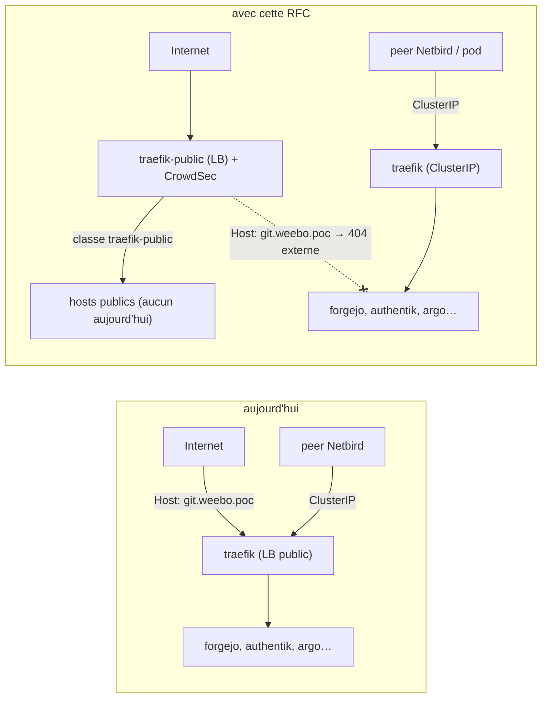
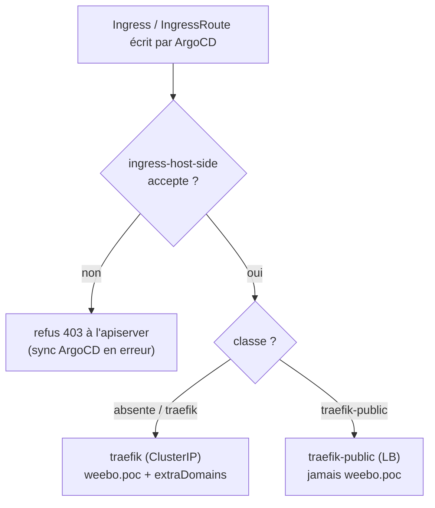
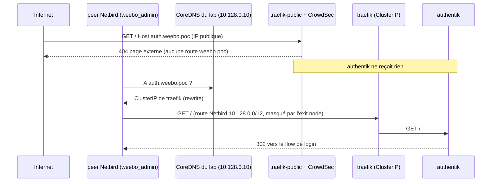
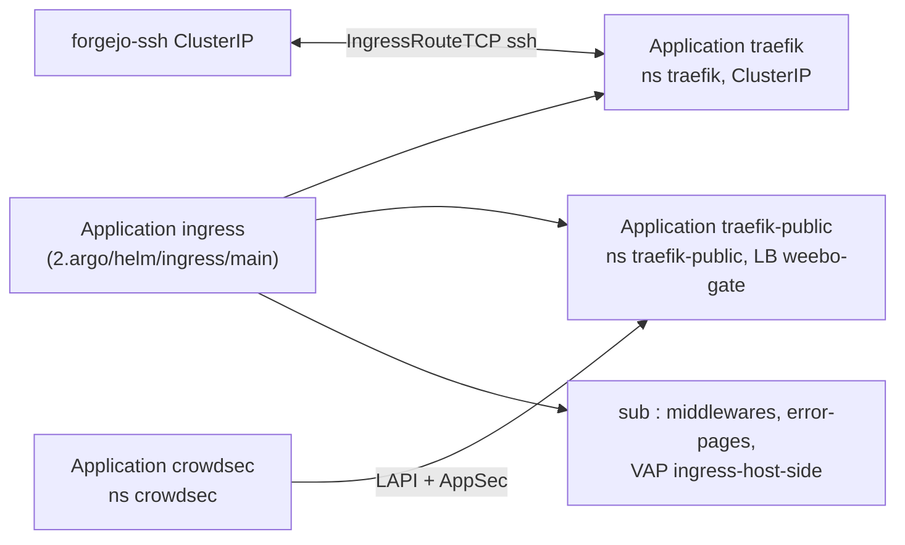
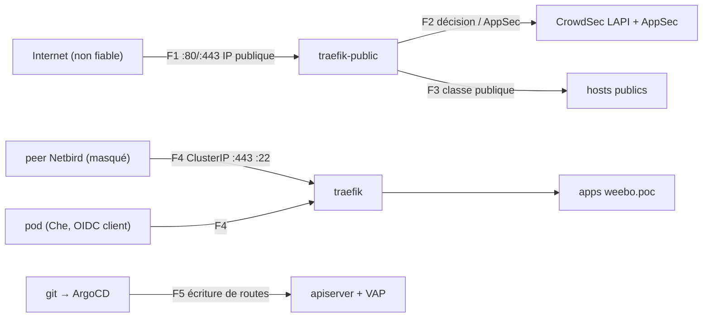

# RFC 0006 — Ingress public et interne : deux Traefik

| Champ      | Valeur |
| ---------- | ------ |
| Statut     | Draft |
| Court      | Deux Traefik, public et interne |
| Tranche    | Comment un host `weebo.poc` devient structurellement injoignable depuis Internet, et comment le public reçoit un WAF sans toucher l'interne |
| Auteur     | Max Batleforc <maxleriche.60@gmail.com> |
| Co-auteur  | Claude Opus 5.5 |
| Créée      | 2026-10-28 |
| Remplace   | — |
| Touche     | `2.argo/helm/ingress/main`, `2.argo/helm/ingress/sub`, `2.argo/helm/forgejo`, `2.argo/helm/crowdsec` (nouveau), `2.argo/app`, `0.docs` |
| Risque     | high (§7) |

> Document de référence (~6 500 mots avec le code) : §1 à §3 et §15 suffisent pour décider,
> le reste sert à construire et à relire.

---

## 1. Résumé

Aujourd'hui, un seul Traefik écoute sur l'IP publique du lab et sert tous les
hosts `*.weebo.poc`. Ce qui les sépare d'Internet, c'est le DNS, plus un
middleware `vpn-only` que seules deux routes demandent. Cette RFC coupe en
deux :

- **`traefik`** (la release actuelle, même nom, même namespace) devient
  l'instance **interne**. Son Service passe en `ClusterIP` : elle n'a plus
  aucune adresse joignable hors du cluster et du VPN. Elle reste la classe
  d'ingress par défaut.
- **`traefik-public`** (nouvelle release) prend l'IP publique. Elle ne traite
  que la classe `traefik-public` et porte le WAF (CrowdSec, bouncer et AppSec).
- Une **`ValidatingAdmissionPolicy`** refuse un host `weebo.poc` sur la classe
  publique, et, sur l'interne, tout host qui n'est ni `weebo.poc` ni un domaine
  autorisé.
- Pour la partie admin d'un domaine public, un peer Netbird passe par
  l'interne grâce à la réécriture CoreDNS (DNS différent selon le côté), et non
  par une liste d'IP.

### Avant / après

```text
# aujourd'hui
traefik        Service LoadBalancer  37.187.255.5, 2001:41d0:c:705::1  :80 :443
forgejo-ssh    Service LoadBalancer  même IP (sharing-key weebo-gate)  :22
curl --resolve git.weebo.poc:443:37.187.255.5 https://git.weebo.poc/   # répond, d'où qu'on vienne

# avec cette RFC
traefik        Service ClusterIP     10.13x.x.x   :80 :443 :22 (git ssh)   classe traefik (défaut)
traefik-public Service LoadBalancer  37.187.255.5, 2001:41d0:c:705::1  :80 :443   classe traefik-public + WAF
curl --resolve git.weebo.poc:443:37.187.255.5 https://git.weebo.poc/   # 404 de la page d'erreur externe, forgejo ne voit rien
```



La requête refusée est celle d'Internet qui nomme un host interne : elle arrive
sur une instance qui n'a aucune route `weebo.poc`. La séparation ne dépend plus
d'un middleware oublié ou non.

---

## 2. Motivation

1. **Tout host `weebo.poc` répond sur l'IP publique.** Le Service `traefik` est
   un `LoadBalancer` sur l'IP du nœud
   (`2.argo/helm/ingress/main/templates/traefik/traefik.yaml:72-80`), et seules
   les routes de vault (`2.argo/helm/vault/sub/templates/vaultInstance/ingress-https.yaml:13`)
   et des pages d'erreur (`2.argo/helm/ingress/sub/templates/error-pages/routes.yaml:32`)
   demandent `vpn-only`. authentik, forgejo, argo, clickstack, angos, s3 et Che
   se contentent du DNS. N'importe qui peut forger le `Host` vers
   `37.187.255.5`. Via Netbird, la sonde du 2026-10-28 répond `302` pour auth,
   `200` pour git et argo. La même sonde hors VPN reste à faire (§6.P n°1).
2. **git over SSH est sur le port 22 de l'IP publique.** `forgejo-ssh` partage
   l'adresse de Traefik avec la clé `weebo-gate`
   (`2.argo/helm/forgejo/values.yaml:162-171`,
   `2.argo/helm/forgejo/templates/forgejo/app.yaml:64-75`), sans aucun filtre.
   **Désactivé le 2026-10-28, avant cette RFC** : `forgejo.ssh.enabled: false`
   (Service `ClusterIP`, `DISABLE_SSH: true`). git passe par HTTPS jusqu'à
   l'entrypoint `ssh` de la phase 2 ou jusqu'au proxy SSH (décision 7).
3. **Le filet prévu ne peut pas s'activer.** La CiliumNetworkPolicy
   `traefik-ingress` (`2.argo/helm/ingress/sub/templates/middleware/network-policy.yaml`)
   ferme `world` devant tous les entrypoints. Elle couperait donc aussi tout
   futur host public, ainsi que le HTTP-01 de l'issuer `outbound`. Avec une
   seule instance, la protection de l'interne et l'ouverture du public sont
   incompatibles.
4. **`vpn-only` ne signifie pas « utilisateur VPN ».** Netbird masque les peers
   derrière le pod exit-node, et sa liste (`2.argo/helm/ingress/sub/values.yaml:29-51`)
   contient les CIDR pods et services. Tout pod du cluster passe, y compris un
   workspace Che qui exécute du code arbitraire.
5. **Un WAF n'a de sens que sur le trafic d'Internet** (`left-todo.md`,
   « WAF ? »). Sur une instance unique, il filtrerait aussi l'OIDC interne,
   les `git push` et les webhooks entre pods. Les faux positifs tomberaient sur
   l'outillage interne pour protéger un public qui n'existe pas encore.

---

## 3. Objectifs / non-objectifs

**Objectifs**

- Un host `weebo.poc` n'est joignable que depuis le cluster ou par Netbird,
  quel que soit le middleware de sa route.
- Un host public ne peut s'attacher qu'à `traefik-public`, et un host
  `weebo.poc` jamais. L'apiserver le refuse à l'écriture.
- git over SSH reste en `git@git.weebo.poc:org/repo.git` pour les peers et les
  pods, et disparaît de l'IP publique.
- `traefik-public` porte un WAF CrowdSec. La réputation des IP et le virtual
  patching bloquent dès le départ, le CRS commence en détection.
- Les références existantes ne bougent pas : `traefik-*@kubernetescrd`,
  `ingressClassName: traefik`, la cible CoreDNS `traefik.traefik.svc`, les
  policies qui visent le namespace `traefik`.

**Non-objectifs**

- **Gateway API** : elle ne sépare pas le public de l'interne (§12) et
  demanderait de réécrire chaque route. Elle est prévue plus tard sur l'interne.
- **Supprimer `vpn-only`** : il ne protège presque plus rien sur l'interne,
  mais il ne coûte rien. On le retirera une fois la RFC en place.
- **Activer la CiliumNetworkPolicy `traefik-ingress`** : elle devient une
  défense en profondeur de l'interne, à réécrire une fois le public parti. Ce
  sera un changement à part.
- **Exposer un premier service public** : aucun host public n'existe
  aujourd'hui. Cette RFC prépare l'endroit où il arrivera.
- **Toucher à Netbird** (`weebo5/1.argo/terra/vpn`) : les routes et le DNS
  `lab-dns` suffisent pour `weebo.poc` (§6.4). Le reste du DNS est une
  réflexion à part (décision 9).
- **`externalTrafficPolicy: Local`** : l'IP réelle du client arrive déjà sur
  Traefik, c'est validé (décision 4).

---

## 4. Conception côté utilisateur

### 4.1 Configuration

`2.argo/helm/ingress/main/values.yaml` (et sa copie `sub`) :

```yaml
traefik:
  enabled: true
  # renovate: datasource=docker depName=ghcr.io/traefik/helm/traefik
  version: 42.1.3
  # Instance interne : release `traefik`, namespace `traefik`, classe par défaut.
  internal:
    # Domaines admis sur la classe interne, en plus de weebo.poc : un domaine
    # public dont une partie n'est servie qu'aux peers (§4.2).
    extraDomains: []
    # git over SSH, entrypoint TCP 22 vers forgejo-ssh (ClusterIP).
    ssh:
      enabled: true
  public:
    enabled: false
    ips: ""                 # ex-traefik.ips : l'IP publique du nœud
    ingressClass: traefik-public
  hostPolicy:
    # Audit | Deny. Audit d'abord (phase 1), Deny en phase 3.
    action: Audit

crowdsec:
  enabled: false
  # renovate: datasource=docker depName=crowdsecurity/crowdsec ...
  version: 0.24.2
  appsec:
    # Le CRS : outofband = détection seule, inband = blocage.
    crs: outofband
```

- `public.enabled` est à `false` par défaut : sans lui, plus rien n'écoute sur
  l'IP publique pour HTTP. C'est le côté fermé.
- `extraDomains` absent ou `[]` veut dire la même chose : seulement
  `weebo.poc`. Il n'y a pas de joker : chaque domaine public admis en interne
  se nomme.
- `hostPolicy.action: Audit` n'est pas le côté sûr. Il ne dure que la phase 1,
  le temps de constater sur les objets existants qu'aucun ne serait refusé.
  Rester en Deny avant d'avoir vérifié bloquerait les syncs ArgoCD.
- `crowdsec.appsec.crs: outofband` n'est pas non plus le côté fermé. Le CRS au
  niveau de paranoïa 1 casse des usages réels (corps de `git push`, websockets,
  flux OIDC). Le virtual patching, lui, bloque dès le départ, et comme aucun
  host public n'existe, rien n'est encore exposé à ce que le CRS attraperait.

### 4.2 Règles de comportement

- **Le cas sans intérêt, c'est presque tout** : un Ingress ou un IngressRoute
  sans classe va sur `traefik`, c'est-à-dire en interne. Aujourd'hui tous les
  hosts sont `weebo.poc` et signés par `vault-issuer`. Aucune route existante
  ne change de classe.
- Ingress : la classe vient de `ingressClassName`. Sans elle, le plugin
  d'admission `DefaultIngressClass` pose `traefik` avant la validation.
- IngressRoute, IngressRouteTCP : la classe vient de l'annotation
  `kubernetes.io/ingress.class`. Sans annotation (ou `traefik`), c'est
  l'interne qui traite la route. `traefik-public` ne traite que les routes
  annotées `traefik-public`.
- Un domaine public avec une partie admin (par exemple `app.example.fr`) donne
  deux routes :
  - classe `traefik-public` : l'application, avec le chemin admin qui renvoie
    `403` ;
  - classe `traefik` : l'application complète, avec `app.example.fr` dans
    `internal.extraDomains`, et une ligne
    `rewrite name exact app.example.fr traefik.traefik.svc.cluster.local answer auto`
    dans CoreDNS.

  Le même Secret TLS (émis en HTTP-01 par le public) sert les deux routes.
- Un peer qui n'utilise pas le DNS du lab retombe sur le public, donc sans
  l'admin. Le défaut est le côté fermé.

### 4.3 Validation

Refusé à l'écriture par la `ValidatingAdmissionPolicy` `ingress-host-side`
(une fois en `Deny`) :

| Condition | Pourquoi refuser plutôt que dégrader |
| --- | --- |
| Ingress de classe `traefik-public` avec un host `weebo.poc` ou `*.weebo.poc` | Un host interne ne doit jamais devenir joignable depuis Internet |
| IngressRoute annotée `traefik-public` dont un `match` contient `weebo.poc` | Idem |
| IngressRoute annotée `traefik-public` avec `HostRegexp` hors du namespace `traefik-public` | On ne peut pas lire une regex pour savoir quels hosts elle couvre. Seul le catch-all de la page d'erreur y a droit |
| Ingress de classe `traefik` dont un host n'est ni `weebo.poc` ni dans `extraDomains` | Un domaine public servi en interne doit être un choix nommé |
| Ingress de classe inconnue | Une classe qu'aucun Traefik ne lit laisse une route morte sans le dire |
| IngressRouteUDP annotée `traefik-public` | Pas de host à lire. Aucun UDP public n'est prévu, et un futur besoin passera par une RFC (décision 11) |

Avertissements, et où l'opérateur les voit :

| Condition | Comportement | Visible dans |
| --- | --- | --- |
| Policy en `Audit` et objet qui violerait la règle | Admis, annotation d'audit | log d'audit de l'apiserver, et `Warn` ajouté aux `validationActions` : avertissement dans la sortie du sync ArgoCD et de `kubectl apply` |
| Règle CRS déclenchée en `outofband` | Requête servie | `cscli alerts list`, métrique `cs_appsec_rule_hits`, logs de l'AppSec dans ClickStack |

### 4.4 Surface d'API

Aucune API applicative. La surface réseau change :

| Port | Avant | Après | Qui peut joindre |
| --- | --- | --- | --- |
| IP publique :80/:443 | `traefik`, tous les hosts | `traefik-public`, classe publique seulement | Internet, à travers CrowdSec |
| IP publique :22 | `forgejo-ssh` | rien | — |
| ClusterIP `traefik` :80/:443 | tous les hosts | tous les hosts de classe interne | pods, peers Netbird `weebo_admin` (route `10.128.0.0/12`) |
| ClusterIP `traefik` :22 | — | entrypoint `ssh` vers `forgejo-ssh` | idem |

---

## 5. Architecture

### 5.1 Deux instances, une classe chacune



**Invariant 1** : `traefik` n'a pas d'adresse hors du cluster (Service
`ClusterIP`, aucune `externalIPs`, aucun `LoadBalancer` qui partage son IP).
Aucune route qu'il porte n'est donc joignable depuis Internet, quel que soit
son middleware.

**Invariant 2** : `traefik-public` ne lit que la classe `traefik-public`, et la
policy refuse `weebo.poc` sur cette classe. Un host interne ne peut donc pas y
être servi, même par erreur. Le seul `HostRegexp` admis est le catch-all, qui
renvoie la page 404 externe.

### 5.2 Le chemin d'une requête



Le diagramme montre que la séparation passe par l'adresse jointe, pas par l'IP
source : la masquarade de Netbird n'y change rien.

### 5.3 Câblage



`traefik.yaml` devient un `range` sur les deux instances. Le plugin request-id
(`experimental.localPlugins`) et `ports.*.http.middlewares` sont rendus dans
les deux, chacun avec sa liste de middlewares d'entrypoint.

---

## 6. Conception détaillée

### 6.1 `2.argo/helm/ingress/main/templates/traefik/traefik.yaml`

- Un `range` sur `internal` et `public` produit deux Applications :
  `traefik` (inchangée de nom, `releaseName: traefik`,
  `destination.namespace: traefik`) et `traefik-public`
  (`releaseName: traefik-public`, namespace `traefik-public`,
  `helm.skipCrds: true`, car les CRD Traefik sont déjà posées par `traefik`).
  Les deux restent sur le même `targetRevision`.
- **Interne** :
  - `service.spec.type: ClusterIP`, sans les annotations `lbipam.cilium.io/*` ;
  - `ingressClass: {enabled: true, isDefaultClass: true, name: traefik}` ;
  - `providers.kubernetesIngress.ingressClass: traefik` : sans ce réglage,
    Traefik traiterait toute IngressClass de son contrôleur, la publique
    comprise ;
  - `providers.kubernetesCRD.ingressClass` laissé vide : il traite alors les
    routes sans annotation ou annotées `traefik` ;
  - `ports.ssh: {port: 2222, exposedPort: 22, expose: {default: true}}` si
    `internal.ssh.enabled`.
- **Public** :
  - `service.spec.type: LoadBalancer` avec les annotations actuelles
    (`sharing-key: weebo-gate`, `ips`) ;
  - `ingressClass: {enabled: true, isDefaultClass: false, name: traefik-public}` ;
  - `providers.kubernetesIngress.ingressClass` et
    `providers.kubernetesCRD.ingressClass` à `traefik-public` ;
  - `providers.kubernetesGateway.enabled: false` ;
  - `ports.web`/`websecure` `http.middlewares` :
    `traefik-request-id@kubernetescrd` puis
    `traefik-public-crowdsec@kubernetescrd`.
- Le `lbipam.cilium.io/sharing-cross-namespace: "*"` de l'interne disparaît
  avec le LoadBalancer.

### 6.2 `2.argo/helm/ingress/sub`

- `templates/error-pages/routes.yaml` : chaque instance a son catch-all. Le
  catch-all `HostRegexp(.+\.weebo\.poc)` et la maintenance des hosts internes
  restent sur l'interne. Le catch-all `HostRegexp(.+)` vers
  `error-pages-external` passe dans le namespace `traefik-public`, annoté
  `traefik-public`. `internalDomain` reste utile pour l'interne, qui sert aussi
  ses `extraDomains`.
- `templates/clusterIssuer/cluster-issuer.yaml:17` : le solver `http01.ingress`
  passe de `class: traefik` à `ingressClassName: traefik-public`. Le HTTP-01
  doit être servi là où Let's Encrypt arrive.
- `templates/policy/ingress-host-side.yaml` (nouveau) :
  `ValidatingAdmissionPolicy` et `ValidatingAdmissionPolicyBinding`, avec
  `matchConstraints` sur `networking.k8s.io/v1 ingresses` et
  `traefik.io/v1alpha1 ingressroutes`, `ingressroutetcps`, `ingressrouteudps`
  (décision 11). Les domaines admis
  sont rendus depuis `traefik.internal.extraDomains` dans une `variables` CEL.
  `validationActions` vaut `[Audit, Warn]` puis `[Deny]` selon
  `hostPolicy.action`.
- `templates/middleware/crowdsec.yaml` (nouveau, namespace `traefik-public`) :
  le Middleware `crowdsec` du plugin bouncer, en mode `stream` vers la LAPI,
  avec AppSec activé.
- Le plugin (décision 10) est déclaré sur `traefik-public` en
  `experimental.localPlugins.crowdsec`, avec `type: localPath` sur un volume
  `emptyDir` (`deployment.additionalVolumes`). Le chart 42.1.3 prend ce type
  en charge : `templates/_helpers.tpl:399-406`. Un init container `golang`,
  tiré par angos et épinglé, remplit le volume avant Traefik :
  ```sh
  export GOPROXY=https://go.pkg.weebo.poc GOFLAGS=-mod=mod GOTOOLCHAIN=local
  go mod download -json github.com/maxlerebourg/crowdsec-bouncer-traefik-plugin@v1.8.1
  # Dir -> /plugins-local/src/github.com/maxlerebourg/crowdsec-bouncer-traefik-plugin
  go mod vendor   # dans ce dossier : la zip de module n'a pas vendor/
  ```
  `go` vérifie le `go.sum` du module et chaque zip contre `sum.golang.org`,
  par le relais sumdb de BatleHub (`/sumdb/sum.golang.org/supported` répond
  `200`, 2026-10-28). En plus, le `h1:` attendu du module est épinglé dans les
  values et comparé au champ `Sum` de la sortie JSON. L'init container échoue
  si l'un des deux ne correspond pas, et Traefik ne démarre pas. Le pod n'a
  besoin d'aucune sortie Internet.

### 6.3 `2.argo/helm/forgejo`

- `values.yaml` `forgejo.ssh` : déjà à `enabled: false` depuis le 2026-10-28
  (motivation 2). En phase 2, `templates/forgejo/app.yaml:63-78` cesse de lier
  « SSH actif » à « Service LoadBalancer » : `enabled: true` donne un Service
  `ClusterIP` et `DISABLE_SSH: false`, et `sharingKey` disparaît.
- `templates/forgejo/ssh-route.yaml` (nouveau) : `IngressRouteTCP` sur
  l'entrypoint `ssh` de `traefik`, `HostSNI(\`*\`)`, vers `forgejo-ssh:22`.
  SSH n'a pas de SNI : l'entrypoint lui est dédié, et `*` ne capte rien
  d'autre.
- `templates/forgejo/ingress.yaml:3-5` : le commentaire « git over SSH does not
  go through Traefik » devient faux et doit être corrigé.
- C'est une étape provisoire (décision 7). La cible est un proxy SSH, une
  brique à part qui aura sa propre RFC. L'entrypoint `ssh` existe pour que la
  phase 2 ne coupe pas `git@git.weebo.poc`. Le jour où le proxy arrive, il
  prend la place de `forgejo-ssh` derrière cet entrypoint, ou derrière ses
  propres ClusterIP, et cette RFC n'a rien à défaire.

### 6.4 DNS et Netbird

- `2.argo/app/templates/dns/coredns.yaml:22-23` : inchangé, la cible reste
  `traefik.traefik.svc.cluster.local`. Seules s'ajoutent, plus tard, les lignes
  `rewrite name exact <fqdn public>` des `extraDomains`.
- Netbird (`weebo5/1.argo/terra/vpn/terra-map/lab.tf`) : le groupe
  `weebo_admin` interroge déjà `lab-dns` (`10.128.0.10`) et a les routes
  `10.128.0.0/12` et `fd00:10:128::/112` par le groupe `lab`. La ClusterIP de
  `traefik` est dans ces plages. Rien à changer. Le choix du serveur DNS des
  peers pour un FQDN public est hors de cette RFC (décision 9).

### 6.5 `2.argo/helm/crowdsec` (nouveau) et `2.argo/app`

- Chart `crowdsecurity/crowdsec` 0.24.2, namespace `crowdsec` :
  - LAPI à un réplica, avec SQLite sur PVC Longhorn ;
  - agent avec l'acquisition `{namespace: traefik-public, podName: traefik-public-*, program: traefik}` ;
  - AppSec avec les collections `crowdsecurity/appsec-virtual-patching`
    (inband) et `crowdsecurity/appsec-crs` (selon `crowdsec.appsec.crs`) ;
  - CAPI désactivé (`config.config.yaml.api.server.online_client` absent, pas
    de `cscli console enroll`) jusqu'à la phase 5 (décision 8) : aucun signal
    ne sort, et seules les décisions locales et le virtual patching
    s'appliquent.
- La clé du bouncer est générée dans Vault (`mv/data/crowdsec/bouncer`) et
  passe par External Secrets vers `crowdsec` et `traefik-public`, comme les
  autres secrets du lab. Elle n'est jamais dans git.
- `2.argo/app/templates/crowdsec.yaml` : une Application de plus, comme
  `ingress.yaml`.

### 6.P Preuve avec un vrai client

Clients : `curl` 8.x, `dig`, `git` 2.5x avec OpenSSH, `kubectl` 1.36, depuis
un poste qui a deux états. Hors VPN, c'est un partage de connexion 4G, pas
seulement `netbird down`. Ce poste fait aujourd'hui passer
`37.187.255.5` et `2001:41d0:c:705::1` par `wt0` (`ip route get`, 2026-10-28),
si bien qu'une sonde « publique » faite depuis le VPN n'en est pas une. Il n'y
a pas de suite automatisée : c'est une preuve d'exploitation, rejouée après
chaque montée de version de Traefik.

1. **Avant (référence), hors VPN** :
   `curl -sk --resolve git.weebo.poc:443:37.187.255.5 https://git.weebo.poc/ -o /dev/null -w '%{http_code}'`.
   On attend `200`, ce qui confirmerait la motivation 1. Le résultat est à
   noter ici avant la phase 2.
2. **Refus, hors VPN, après la phase 2** : la même commande donne `404`, avec
   le corps de `error-pages-external`. **Aucune ligne** pour cette requête
   dans le log d'accès de `traefik` (interne), et rien dans les logs de
   forgejo. Même chose pour `auth`, `argo` et `vault`.
3. **Succès, VPN** :
   `dig +short git.weebo.poc @10.128.0.10` donne la ClusterIP de `traefik`,
   inchangée par le passage en ClusterIP. `curl -sk https://git.weebo.poc/`
   donne `200`.
4. **SSH, VPN** : `git ls-remote git@git.weebo.poc:<org>/<repo>.git` liste les
   refs. Le log d'accès de `traefik` montre une connexion TCP sur `ssh`.
5. **Refus SSH, hors VPN** : `ssh -o ConnectTimeout=5 -p 22 37.187.255.5` donne
   `Connection refused` ou un timeout, et aucune bannière `SSH-2.0`.
6. **Refus par la policy (Deny)** : `kubectl apply` d'un Ingress
   `ingressClassName: traefik-public`, host `probe.weebo.poc`, est refusé par
   l'apiserver avec le message de `ingress-host-side`. **Rien n'est créé**
   (`kubectl get ingress probe` donne `NotFound`).
7. **Refus par la policy, côté interne** : un Ingress sans classe, host
   `probe.example.org` (hors `extraDomains`), est refusé. Le même Ingress avec
   un host `probe.weebo.poc` est admis.
8. **Rien d'existant ne tombe** : pendant la phase 1 en `Audit`,
   `kubectl get --raw /metrics | grep apiserver_validating_admission_policy_check_total`
   ne montre aucune `enforcement_action="audit"` en violation pour
   `ingress-host-side` après un sync complet de toutes les Applications.
9. **ACME** : un Certificate de test `outbound` pour un host public de test
   passe `Ready=True`. Le challenge `/.well-known/acme-challenge/` apparaît
   dans le log d'accès de `traefik-public`, pas dans celui de `traefik`.
10. **WAF, réputation** : `cscli decisions add --ip <IP 4G> --duration 5m`,
    puis un `curl` hors VPN vers un host public donne `403`. Après
    `cscli decisions delete`, la réponse redevient `200`.
11. **WAF, détection** : `curl "https://<host public>/?q=%3Cscript%3Ealert(1)%3C/script%3E"`
    donne `200` en `outofband`. `cscli alerts list` montre l'alerte AppSec
    avec la règle CRS. En `inband`, la même requête donne `403`.
12. **CrowdSec en panne** : `kubectl -n crowdsec scale deploy crowdsec-appsec --replicas=0`,
    puis un `curl` public donne `403` (fail closed, §10.2). Un `curl` VPN vers
    `git.weebo.poc` donne toujours `200` : l'interne ne dépend pas de
    CrowdSec.

**Délibérément non touché**, pour que la revue n'aille pas le chercher :

- `1.pulu-conf/main.go:84-120` : le pool LB-IPAM (IP du nœud) et la politique
  L2 restent tels quels. Seul le consommateur de l'IP change.
- `2.argo/helm/ingress/sub/templates/middleware/internal.yaml`,
  `internalTCP.yaml` : `vpn-only` reste, référencé comme aujourd'hui.
- `2.argo/helm/ingress/sub/templates/middleware/network-policy.yaml` : reste
  `enabled: false` (voir non-objectifs).
- `2.argo/helm/auth`, `che`, `angos` : leurs routes n'ont pas de classe ou ont
  `traefik`, elles restent internes sans modification.
- `weebo5/1.argo/terra/vpn` : aucune route ni aucun nameserver ajouté.

---

## 7. Sécurité

**Note :** high. On déplace la frontière entre Internet et toute la plateforme
interne (authentik, argo, vault, forgejo), on ferme un port SSH public et on
ajoute un composant (CrowdSec) dans le chemin de chaque requête publique.

### 7.1 Modèle de menace

Actifs : les applications internes (authentik est l'IdP de tout le lab, argo
déploie, vault garde les secrets), le code dans forgejo, la disponibilité des
futurs hosts publics, la clé du bouncer CrowdSec.

Acteurs : un client anonyme sur Internet, un peer Netbird `weebo_admin`, un pod
quelconque (dont un workspace Che), un auteur de manifeste dans git (ArgoCD).



| # | Menace (STRIDE) | Où | Mitigation | Risque résiduel |
| --- | --- | --- | --- | --- |
| T1 | Fuite d'information / élévation : Internet atteint une app interne en forgeant `Host` | F1 | Invariant 1 : `traefik` en ClusterIP (§6.1). `traefik-public` n'a pas de route `weebo.poc` (invariant 2) | Aucun par HTTP. Accepté par Max |
| T2 | Élévation : un manifeste met un host `weebo.poc` sur la classe publique | F5 | `ingress-host-side` en Deny (§6.2) | Un objet créé hors de la policy : un CRD de route que la policy ne couvre pas (`TraefikService`, Gateway API si activée). Les quatre types de route Traefik sont couverts, Gateway API se garde par ses listeners (décision 11) |
| T3 | Fuite d'information : `git` SSH ouvert sur Internet | F1 :22 | `forgejo-ssh` en ClusterIP, entrypoint `ssh` sur l'interne seulement (§6.3) | Aucun |
| T4 | Usurpation : un pod se fait passer pour un peer VPN | F4 | Aucune : c'est accepté, et c'est la situation actuelle (`vpn-only` contient les CIDR pods). L'interne est par construction joignable depuis tout pod | Un workspace Che atteint toutes les apps internes, protégées par leur propre authentification (authentik). Inchangé, accepté par Max |
| T5 | Déni de service : un flot public atteint l'interne | F1 | Deux instances, deux pods : une saturation de `traefik-public` ne consomme pas les workers de `traefik` | Même nœud : CPU et mémoire partagés. Des `resources.limits` sur `traefik-public` et CrowdSec bornent l'effet |
| T6 | Contournement du WAF : CrowdSec injoignable, requêtes servies sans filtre | F2 | Le bouncer bloque si l'AppSec est injoignable ou en erreur (§10.2) | Indisponibilité du public pendant la panne. Accepté : aucun host public critique |
| T7 | Altération : un plugin bouncer modifié au téléchargement | init container | Module tiré de BatleHub, `go.sum` et sumdb vérifiés, `h1:` épinglé dans git (décision 10, §6.2) | Un tag réécrit en amont est détecté (le hash change). Un code malveillant publié sous une **nouvelle** version passerait si on montait sans relire le diff. Accepté |
| T8 | Usurpation de la LAPI : un pod lit la clé du bouncer et injecte des décisions | F2 | Clé dans Vault, puis External Secrets dans deux namespaces seulement. La LAPI n'accepte les décisions que des machines enregistrées, les bouncers ne font que lire | Un admin du cluster. Accepté |
| T9 | Répudiation : un refus WAF sans trace | F1-F2 | Alerte CrowdSec (IP, scénario, règle), log d'accès Traefik avec `X-Request-Id` | Rétention des alertes : §9 |

### 7.2 Authentification et autorisation

- Aucune nouvelle surface authentifiée. La séparation est réseau. Chaque app
  interne garde sa propre authentification (authentik, forward-auth, OIDC), et
  cette RFC n'en retire aucune.
- Le refus par défaut est double : une route sans classe est interne, et
  l'interne n'a pas d'adresse publique. Contourner la policy (T2) ne suffit
  pas à exposer un host qui n'est pas explicitement en classe publique.
- Qui peut changer la classe d'une route : l'auteur d'un commit sur `develop`,
  par ArgoCD. C'est la même personne qu'aujourd'hui, et la policy borne ce
  qu'elle peut faire par erreur.

### 7.3 Entrées et injection

- Les entrées non fiables restent les requêtes HTTP d'Internet, parsées par
  Traefik (inchangé) puis par l'AppSec CrowdSec (nouveau). Limite de corps
  inspecté : `crowdsecAppsecBodyLimit` du bouncer (10 MiB par défaut, à
  ramener à 1 MiB). Le README du plugin prévient qu'un corps au-delà de la
  limite n'est pas inspecté : `crowdsecAppsecUnreadableBodyBlock` décide alors
  s'il est bloqué. On l'accepte pour les uploads, à trancher par host.
- La policy lit `spec.routes[].match`, une chaîne écrite dans git et non par un
  client. Elle refuse `HostRegexp` sur la classe publique au lieu de tenter de
  l'interpréter.

### 7.4 Secrets et cryptographie

- Nouveau secret : la clé API du bouncer (`mv/data/crowdsec/bouncer`). Elle est
  générée une fois, et on la fait tourner en régénérant la valeur dans Vault :
  External Secrets la propage, et les pods redémarrent sur le checksum. Elle
  n'apparaît ni dans les logs Traefik (en-tête `X-Api-Key` vers la LAPI, hors
  du log d'accès) ni dans git.
- TLS : inchangé. L'interne garde `vault-issuer`, le public `outbound`.

### 7.5 Abus et épuisement des ressources

- Le WAF ajoute une requête vers l'AppSec par requête publique. Timeout du
  bouncer : `httpTimeoutSeconds` (10 s par défaut, à ramener à 2 s), puis
  échec fermé.
- La LAPI en mode `stream` : le bouncer garde les décisions en cache et
  rafraîchit toutes les 60 s. Un flot de requêtes ne crée pas de requêtes vers
  la LAPI.

### 7.6 Défenses existantes qui tiennent toujours

- `vpn-only` sur vault et les pages d'erreur internes.
- Les en-têtes sensibles masqués dans les logs d'accès
  (`traefik.yaml:91-96`), à reprendre tels quels sur `traefik-public`.
- La rétention de `X-Request-Id` (`trustedIPs: []`) : chaque requête publique
  reçoit un id neuf.

---

## 8. Chaîne d'approvisionnement

| Dépendance / image / outil | Version | Pourquoi celle-ci | Licence | CVE connues | Maintenance |
| --- | --- | --- | --- | --- | --- |
| Chart Traefik (seconde release) | 42.1.3, la même que l'actuelle | Aucune nouvelle dépendance | Apache-2.0 | inchangé | inchangé |
| Chart `crowdsecurity/crowdsec` | 0.24.2 (2026-09-04) | WAF et réputation des IP. Sinon, il faudrait écrire Coraza et ses règles (§12) | à vérifier (dépôt `crowdsecurity/helm-charts`) | `trivy image` à lancer sur les images du chart avant la phase 4 | Éditeur CrowdSec, releases régulières |
| Image `crowdsecurity/crowdsec` | celle du chart. v1.8.2 est sortie le 2026-10-26 : on attend deux semaines avant de la prendre | — | MIT | idem | idem |
| Plugin Traefik `maxlerebourg/crowdsec-bouncer-traefik-plugin` | v1.8.1 (2026-10-18) | Le bouncer officiel est un service ForwardAuth de plus. Le plugin tourne dans Traefik | Apache-2.0 | aucun advisory sur le dépôt (2026-10-28) | 941 étoiles, un mainteneur principal : c'est le point faible, d'où l'épinglage par hash (décision 10) |
| Collections CrowdSec (`appsec-virtual-patching`, `appsec-crs`, `traefik`) | depuis le hub, au démarrage | — | MIT / Apache-2.0 (CRS) | — | Mises à jour par `cscli hub upgrade`. Le hub n'est pas un module Go : il reste en direct depuis les pods CrowdSec, hors du chemin des requêtes. Le faire passer par un registre `generic` de BatleHub est une piste pour plus tard |
| Image `golang` (init container du plugin) | dernière stable, épinglée, tirée par angos | Le seul outil qui vérifie un module Go contre la sumdb | BSD-3-Clause | `trivy image` avant la phase 4 | Équipe Go |

- **Build et release** : aucune image construite ici. Le plugin n'est pas
  copié dans git : seuls sa version et son `h1:` le sont. Changer l'un ou
  l'autre change le pod template, ce qui fait redémarrer Traefik.
- **Mises à jour** : des commentaires `# renovate:` sur le chart CrowdSec et sur
  la version du plugin, comme les autres versions du dépôt
  (`2.argo/helm/ingress/main/values.yaml:26`). Renovate sur GitHub est le seul
  outil qui monte les versions.

---

## 9. Données et vie privée

| Donnée | Personnelle ? | Où | Rétention | Qui la lit | Sort de l'instance ? |
| --- | --- | --- | --- | --- | --- |
| Log d'accès de `traefik-public` (IP, User-Agent, en-têtes hors secrets) | oui : IP, UA | logs du pod, puis ClickStack | celle de ClickStack, inchangée | admins du lab | non |
| Décisions CrowdSec (IP bannie, scénario, durée) | oui : IP | SQLite de la LAPI (PVC) | durée de la décision (4 h par défaut). Alertes : `db_config.flush.max_age: 7d` | admins (`cscli`) | **non** tant que le public n'a pas de host : CAPI désactivé (décision 8). Ensuite, IP de l'attaquant et scénario envoyés à CrowdSec, depuis `traefik-public` seulement |
| Liste de blocage communautaire (à partir de la phase 5) | oui (IP de tiers) | cache du bouncer, SQLite | rafraîchie par CAPI | — | entrée seulement |
| Corps de requête inspecté par l'AppSec | potentiellement | mémoire de l'AppSec, pas stocké. L'alerte garde l'URI et la règle, pas le corps | — | — | non |

- Base légale : l'intérêt légitime de sécuriser le service (RGPD art. 6.1.f),
  le même que pour les logs d'accès existants. Pour minimiser, on ne stocke
  aucun corps de requête, et les décisions expirent.
- Effacement : `cscli decisions delete --ip`, `cscli alerts delete --ip`.
- Les logs d'accès de l'interne ne changent pas.

---

## 10. Exploitation

### 10.1 Observabilité

- **Métriques** :
  - `traefik-public` porte les mêmes annotations coroot que `traefik`
    (`coroot.com/scrape-metrics`, port 9100) et le label `service` de Traefik
    le distingue ;
  - CrowdSec expose `:6060/metrics` (`cs_lapi_*`, `cs_appsec_*`,
    `cs_active_decisions`). Labels bornés : scénario et règle, jamais l'IP.
- **Logs et audit** :
  - chaque refus de la policy est dans le log d'audit de l'apiserver ;
  - chaque blocage WAF est une alerte CrowdSec et une ligne `403` du log
    d'accès, avec `X-Request-Id`.
- **Alertes** : aucune au départ. Il n'y a aucun host public, et donc personne
  à réveiller. Quand le premier host public arrive : `cs_appsec_requests_total`
  à zéro pendant 10 minutes alors que Traefik reçoit du trafic (l'AppSec ne
  voit plus rien), et taux de `403` WAF au-dessus de 5 % (faux positifs).

### 10.2 Modes de défaillance

| Défaillance | Détectée par | Comportement | Reprise |
| --- | --- | --- | --- |
| AppSec CrowdSec injoignable ou en `500` | métriques du bouncer, `403` en hausse | **fermé** : `crowdsecAppsecUnreachableBlock` et `crowdsecAppsecFailureBlock` à `true`. Un WAF qui laisse passer pendant sa panne est une invitation | redémarrage du pod. En urgence, retirer le middleware d'entrypoint |
| LAPI injoignable | logs du bouncer | décisions en cache conservées (mode `stream`). Au démarrage sans LAPI, le bouncer ne connaît aucune décision | `crowdsec-lapi` revient, le stream reprend |
| `traefik-public` en panne | aucun host public : personne ne le voit | rien d'interne n'est touché | ArgoCD resynchronise |
| `traefik` (interne) en panne | tout le lab, comme aujourd'hui | inchangé | inchangé |
| Policy cassée (CEL invalide) | `failurePolicy: Fail` : toute écriture de route refusée | **fermé**, et visible tout de suite dans le sync ArgoCD | corriger le CEL. La policy est dans le même chart que les routes qu'elle garde |
| IngressClass `traefik-public` absente (public désactivé) | route publique jamais servie | fermé | `public.enabled: true` |

### 10.3 Performances et capacité

- Une seconde instance Traefik : environ 80 à 120 MiB au repos d'après le pod
  actuel. **À mesurer** avec `kubectl top pod -n traefik` avant la phase 1.
- CrowdSec (LAPI, agent, AppSec) : environ 150 à 300 MiB d'après la
  documentation de l'éditeur. **À mesurer** après la phase 4, et
  `resources.limits` posés.
- Latence : une requête vers l'AppSec par requête publique, au même nœud,
  attendue sous 5 ms en p50. À mesurer avec `traefik_service_request_duration_seconds`
  avant et après.
- Stockage : SQLite de la LAPI, quelques Mio, borné par `flush`.

---

## 11. Autres sujets

- **Accessibilité** : pas d'UI. Les pages d'erreur existantes sont réutilisées
  telles quelles.
- **Internationalisation** : aucune nouvelle chaîne affichée. La page `403` du
  WAF est celle du bouncer (texte brut), à remplacer par `error-pages` plus
  tard.
- **Conformité** : NIS2 et ISO 27001 ne s'appliquent pas au lab. La séparation
  public/interne correspond au contrôle A.8.22 (ségrégation des réseaux), si
  on vise un jour ce cadre.
- **Licences** : nos obligations ne changent pas. Apache-2.0 et MIT, rien
  n'est redistribué.
- **Documentation** :
  - `0.docs/content/docs/Infra/traefik.mdx` (presque vide aujourd'hui) décrit
    les deux instances, les classes et la règle des domaines ;
  - les commentaires de `forgejo/values.yaml:162-167` et
    `forgejo/templates/forgejo/ingress.yaml:3-5` sont corrigés ;
  - `left-todo.md` pointe ici.

---

## 12. Alternatives écartées

| Alternative | Pourquoi écartée |
| --- | --- |
| Ne rien faire, et ajouter `vpn-only` partout | Chaque nouvelle route doit penser au middleware, et l'oubli est silencieux. Le middleware ne distingue pas un peer d'un pod (motivation 4). Le SSH reste public |
| Activer la CiliumNetworkPolicy `traefik-ingress` sur l'instance unique | Ferme `world` sur tous les entrypoints : plus de public, plus de HTTP-01 (motivation 3) |
| Un seul Traefik, deux paires d'entrypoints (`websecure` en LB, `websecure-int` en ClusterIP), `asDefault` sur l'interne | Une route qui nomme le mauvais entrypoint s'expose. La séparation tient alors à un champ de chaque route, et le WAF tourne dans le même processus que l'interne (T5) |
| Gateway API sur Traefik (listeners `hostname: *.weebo.poc`) | La règle sur les hostnames est native et élégante. Mais un listener correspond à un entrypoint du même Traefik, donc il faut quand même deux instances pour l'IP. Il faudrait aussi réécrire chaque route en HTTPRoute, et Che et les charts upstream produisent des Ingress. Prévu plus tard sur l'interne |
| Cilium Gateway API (Envoy) | Chaque Gateway reçoit un Service LoadBalancer pris dans le seul pool, qui est l'IP publique : l'interne serait exposé. On perdrait aussi les middlewares Traefik (request-id, error-pages, forward-auth authentik) |
| Coraza (WASM) avec le CRS dans Traefik | Un vrai WAF, mais coûteux en mémoire et en latence par requête sur un seul nœud, sans réputation des IP. CrowdSec apporte la réputation et le virtual patching, plus le CRS si on le veut |
| Garder l'IP de l'interne et donner une IP neuve au public | Le pool LB-IPAM ne contient que l'IP du nœud (`1.pulu-conf/main.go:99-105`). Il n'y a pas de seconde IP |
| Renommer l'interne `traefik-internal` | Il faudrait changer `traefik-*@kubernetescrd`, la cible CoreDNS, `ingressClassName: traefik` (authentik, Che) et les policies du namespace `traefik` (stalwart, Che, netbird). Beaucoup de modifications pour un nom |

---

## 13. Déploiement et compatibilité

- **Comportement par défaut** : `public.enabled: false`. Après la phase 2, rien
  n'écoute en HTTP sur l'IP publique tant que le public n'est pas activé, ce
  qui est le côté fermé. Pour l'interne, rien ne change pour un client VPN ou
  un pod : même nom DNS, même ClusterIP.
- **Migration** : aucune route à modifier. Les seules modifications sont le
  Service de `traefik`, le Service et la route SSH de forgejo, et la classe du
  solver ACME.
- **Coupure** : passer `traefik` de `LoadBalancer` à `ClusterIP` libère l'IP
  publique, que `traefik-public` reprend dans le même sync. Le SSH depuis
  l'IP publique disparaît : c'est voulu. Le SSH par `git.weebo.poc` est coupé
  le temps que l'IngressRouteTCP soit servie, en quelques secondes.
- **Prérequis** : aucun DNS public, aucun certificat nouveau. Le secret du
  bouncer dans Vault doit exister avant la phase 4.
- **Retour arrière** : remettre `traefik` en `LoadBalancer` et désactiver le
  public. Cela **rouvre T1** (tous les hosts internes à nouveau joignables
  depuis Internet). Remettre `forgejo-ssh` en LB rouvre T3. La policy peut
  rester : elle ne refuse rien de ce qui existe.
- **Déploiement progressif** : la policy en `Audit` d'abord, le CRS en
  `outofband` d'abord.

---

## 14. Plan de test

- **Rendu** : `helm template` du chart `ingress/main` avec `public.enabled`
  `true` et `false`. On vérifie deux Applications, l'interne sans
  `lbipam.cilium.io/*` et le public avec `skipCrds`. Avec `ingress/sub` : la
  policy et le catch-all public dans `traefik-public`.
- **Policy** : `kubectl apply --dry-run=server` d'un jeu d'objets dans
  `2.argo/helm/ingress/sub/tests/host-side/`, deux par règle de §4.3 (un admis,
  un refusé). Les mêmes fichiers servent à vérifier `Audit` puis `Deny`.
- **Preuve** : §6.P, n°1 à 12.
- **Sécurité**, un test négatif par menace :
  - T1 : §6.P n°2 (`Host` forgé hors VPN donne `404`, aucune ligne dans
    l'interne) ;
  - T2 : §6.P n°6 (host `weebo.poc` sur la classe publique, refusé) ;
  - T3 : §6.P n°5 (port 22 public, pas de bannière) ;
  - T4 : accepté, pas de test. On vérifie seulement qu'un pod Che joint
    l'interne comme avant ;
  - T5 : `hey -z 30s` vers `traefik-public` pendant un
    `curl -w '%{time_total}'` VPN vers `git.weebo.poc`. La latence interne
    reste dans l'ordre de grandeur habituel ;
  - T6 : §6.P n°12 (AppSec à zéro, `403`) ;
  - T7 : un `h1:` volontairement faux dans les values. L'init container
    échoue (`checksum mismatch`), `traefik-public` reste en `Init:Error`, et
    l'ancien pod continue de servir pendant le rollout ;
  - T8 : `curl` vers la LAPI `POST /v1/decisions` avec la clé du bouncer, qui
    doit être refusé (un bouncer ne fait que lire) ;
  - T9 : un blocage du n°10 a son alerte et sa ligne de log avec le même
    `X-Request-Id`.
- **Audit** : `trivy image` sur les images CrowdSec avant la phase 4.
- **Suites existantes** : l'e2e du plugin request-id
  (`2.argo/helm/ingress/main/files/requestid/e2e.sh`) doit rester vert, et
  rien dans le plugin ne change.

---

## 15. Décisions et questions ouvertes

### Tranchées

| # | Question | Décision |
| --- | --- | --- |
| 1 | Une instance avec des entrypoints séparés, deux instances, ou Gateway API ? | **Deux Traefik (option A).** La séparation tient à l'adresse du Service, pas à un champ de chaque route. |
| 2 | Un WAF, et où ? | **Sur `traefik-public` seulement**, en détection d'abord. L'interne n'en a pas besoin et en subirait les faux positifs. |
| 3 | Comment réserver aux peers la partie admin d'un domaine public ? | **DNS différent selon le côté, vers l'interne, pas d'`ipAllowList` sur le public.** Netbird masque les peers derrière le pod exit-node, donc une liste d'IP ne distingue pas un peer d'un pod. |
| 4 | `externalTrafficPolicy: Local` sur le public ? | **Non.** Max a validé que l'IP réelle du client arrive déjà sur Traefik (nœud unique, Cilium sans kube-proxy). À revoir si un second nœud arrive. |
| 5 | Gateway API ? | **Plus tard, sur l'interne seulement.** Elle ne remplace pas la séparation par instance (§12). |
| 6 | Nom de l'instance interne ? (ancienne question ouverte n°1) | **On garde `traefik`** (release, namespace et classe par défaut). Toutes les références existantes restent valides (§12, dernière ligne). |
| 7 | SSH de forgejo ? (ancienne question ouverte n°2) | **Un proxy SSH, brique à part et RFC à part**, qui route selon l'utilisateur et la destination vers la bonne brique. En attendant, cette RFC pose l'entrypoint TCP `ssh` sur l'interne pour que la phase 2 ne coupe pas git (§6.3). Ce n'était pas l'une des deux options du brouillon. Contrainte à transmettre à cette RFC : SSH ne transporte pas le nom du serveur (pas de SNI), seul l'utilisateur arrive dans l'authentification. « Le FQDN » ne peut donc se lire que par l'adresse ou le port jointe, soit une ClusterIP ou un port par FQDN. `sshpiper` (routage par utilisateur) est l'existant à comparer avant d'écrire une brique. |
| 8 | Partager les signaux avec CrowdSec (CAPI) ? (ancienne question ouverte n°4) | **Pas maintenant, et pour `traefik-public` seulement.** CAPI s'active avec le premier host public (phase 5). Avant, il n'y a rien à protéger ni à partager. La recommandation du brouillon (oui tout de suite) n'est pas retenue. |
| 9 | DNS des peers pour un FQDN public servi en interne ? (ancienne question ouverte n°5) | **Hors de cette RFC**, la réflexion DNS est en cours ailleurs. Rien ici n'en dépend avant le premier `extraDomains`. |
| 10 | Plugin bouncer : catalogue Traefik ou vendu localement ? (ancienne question ouverte n°3, puis n°1) | **Mis en cache par BatleHub.** Traefik ne sait pas le faire lui-même : `pluginsURL = "https://plugins.traefik.io/public/"` est une constante (`pkg/plugins/downloader.go:29`, v3.7.16), et Traefik appelle le catalogue à chaque démarrage, même avec l'archive en cache. Le plugin est donc tiré en module Go depuis `go.pkg.weebo.poc` (registre `goproxy` hybride, `2.argo/helm/batlehub/values.yaml:357-362`) par un init container, vérifié contre la sumdb et un `h1:` épinglé, puis chargé en `localPlugins` `localPath` (§6.2). Ce n'était aucune des deux options du brouillon : on évite à la fois le démarrage qui dépend de traefik.io et la copie du code dans git. |
| 11 | Quels types la policy surveille-t-elle ? (ancienne question ouverte n°6, puis n°2) | **Les quatre types de route de Traefik dès la phase 1** : `Ingress`, `IngressRoute`, `IngressRouteTCP` et `IngressRouteUDP`, l'UDP étant refusé sur la classe publique. Gateway API se garde par les `hostname` de ses listeners, et `traefik-public` n'active jamais `kubernetesGateway`. Recommandation du brouillon retenue. |

### Encore ouvertes

Aucune.

---

## 16. Phases d'implémentation

Chaque phase laisse ArgoCD synchronisé et vert. La phase 2 est utile à elle
seule : elle ferme T1 et T3. Le WAF (phase 4) arrive avant le premier host
public (phase 5), pas après.

| Phase | Contenu | Vérifiée par |
| --- | --- | --- |
| 0 | §6.P n°1 hors VPN, noté dans la RFC. `kubectl top` de `traefik` | référence |
| 1 | `traefik.yaml` en `range`. `traefik-public` déployé **en ClusterIP**, classe `traefik-public`. Policy `ingress-host-side` en `Audit`, jeu de tests | §6.P n°8, rendu `helm template` |
| 2 | Bascule dans un seul commit : `traefik` en ClusterIP, `traefik-public` en LoadBalancer `weebo-gate`, entrypoint `ssh` et `forgejo-ssh` en ClusterIP, catch-all externe dans `traefik-public`, solver `outbound` en `traefik-public`. Doc `Infra/traefik.mdx` | §6.P n°2 à 5 et 9, T1, T3 |
| 3 | Policy en `Deny` | §6.P n°6 et 7, T2 |
| 4 | `2.argo/helm/crowdsec` sans CAPI, secret du bouncer, middleware d'entrypoint sur `traefik-public`. Virtual patching inband, CRS outofband | §6.P n°10 à 12, T6, T8, T9 |
| 5 | (quand il existe) le premier host public. CAPI activé (décision 8). Si besoin, son `extraDomains` et la réécriture CoreDNS, selon la réflexion DNS (décision 9). Le CRS passe en inband après deux semaines sans faux positif | sonde publique, `cscli alerts list` |
| 6 | (plus tard) `kubernetesGateway` sur l'interne, HTTPRoute pour les nouvelles routes internes | RFC à part |

Le contrôle qui protège l'interne (ClusterIP) arrive en phase 2, le jour où
l'IP publique change de propriétaire. Le WAF arrive avant tout host public.
