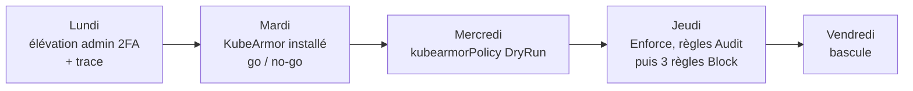

Objectif : vendredi soir, le travail de tous les jours se fait dans un workspace Che de Weebo-SI avec le compte `batleforc`, qui n'est plus cluster-admin par défaut. L'admin s'obtient par élévation : un contexte kubectl séparé, un second facteur, un jeton d'une heure, une trace par élévation. Deux chantiers, dans cet ordre : le second s'appuie sur l'opérateur weebo-si-operator 0.3.0 déjà déployé et ne touche pas à l'identité.

État de départ (2 novembre 2026) :

| Sujet | État | Où |
| --- | --- | --- |
| Compte | un seul AuthentikUser `batleforc`, membre de `weebo_admin` (cluster-admin) et `batleforc`, sans second facteur | `2.argo/helm/auth/sub/values.yaml`, `2.argo/app/templates/auth/weebo_admin.yaml` |
| Apiserver | une `AuthenticationConfiguration` à un seul authenticator JWT, username `labsso:` + email, groupes préfixés `labsso:` | `1.pulu-init/main.go` (`authenticationConfig`) |
| kubectl | un contexte OIDC via dex (`weebo-kube`), le kubeconfig Talos à côté | `0.config/kubeconfig.oidc.yaml`, `0.config/kubeconfig.yaml` |
| Authentik | pas de SMTP, aucune règle de notification, événements visibles dans Events → Logs seulement | `2.argo/helm/auth/main/templates/authentik/authentik.yaml` |
| Workspace | `dev-ws-batleforc`, WeeboSiUser `batleforc`, dotfiles `weebo-dotfiles-che` | `2.argo/helm/che/hardening/values.yaml` |
| KubeArmor | absent ; feature `kubearmorPolicy` écrite mais `enabled: false` | `2.argo/helm/che/hardening/values.yaml` |
| Nœud | Talos v1.13.5, noyau 6.18, LSM actifs `lockdown,capability,yama,selinux,bpf,landlock` | `talosctl read /sys/kernel/security/lsm` |

## Ordre des étapes



Chaque journée se termine par ses vérifications. Une journée qui ne passe pas ne bloque pas la bascule : l'élévation suffit pour travailler sur Weebo-SI, KubeArmor peut rester en DryRun.

## Lundi : un compte, deux identités kube, le 2FA à l'élévation

**Décision : un seul compte `batleforc`, l'admin est une élévation et non un second compte.** Les solutions à deux comptes (double login, ou impersonation Authentik) ont été écartées : la bascule y est un état global qui oblige à se reconnecter dans chaque application, et le second facteur n'y garde pas l'élévation elle-même. Ici l'apiserver reçoit un second authenticator JWT dont l'issuer est une application Authentik `kube-admin`, protégée par un flow d'autorisation qui exige un second facteur. Dev et admin sont deux contextes kubectl valides en même temps ; le contexte dit le rôle.

Ce que ça change, et ce que ça ne change pas :

| | Contexte `Weebo-si` (dev) | Contexte `Weebo-si-admin` |
| --- | --- | --- |
| Issuer | dex, client `weebo-kube`, inchangé | Authentik, `https://auth.weebo.poc/application/o/kube-admin/` |
| Username vu par l'apiserver | `labsso:max@weebo.internal`, inchangé | `labsso-admin:max@weebo.internal` |
| Groupes | les groupes Authentik **moins `weebo_admin`** | tous, dont `labsso:weebo_admin` → CRB cluster-admin |
| Droits | ses RoleBindings dans `dev-ws-batleforc` | cluster-admin |
| Jeton | 12 h, refresh | 1 h, pas de refresh token |
| Second facteur | non | oui, redemandé au plus toutes les 8 h |

Rien ne bouge dans les applications web : `batleforc` reste `weebo_admin`, donc admin dans Argo CD, Forgejo, batlehub, angos, rustfs comme aujourd'hui. Longhorn et ClickStack, réservés à `weebo_admin`, prennent le même flow 2FA que `kube-admin`. Le durcissement des autres apps est dans « ce qui reste après ».

### 1. Second facteur sur `batleforc`

Avant tout le reste, sinon l'étape 2 enferme le compte dehors : User settings → MFA devices, enrôler une clé WebAuthn (passkey) et, en secours, un TOTP. Les flows `default-authenticator-webauthn-setup` et `default-authenticator-totp-setup` existent déjà (AuthentikFlow `builtin-*`).

### 2. Flow `admin-step-up` dans Authentik

Le CRD AuthentikFlow ne modélise que le flow, pas ses stages ni leurs bindings, et l'opérateur crée sans jamais adopter par slug : le flow ne peut donc pas être partagé entre un CR et autre chose. Il est entièrement porté par un blueprint Authentik, `2.argo/helm/auth/main/files/blueprints/admin-step-up.yaml`, que le chart `auth/main` met dans la ConfigMap `authentik-blueprints` (`authentik.blueprints.enabled`) et que le chart Authentik monte sur le worker (`blueprints.configMaps`). Le worker l'applique à chaque changement et toutes les heures.

Le flow `admin-step-up` (désignation `authorization`) a un seul stage, Authenticator Validation `admin-step-up-mfa`, binding d'ordre 0 :

| Réglage | Valeur | Pourquoi |
| --- | --- | --- |
| Device classes | WebAuthn, TOTP | pas de SMS ni de codes statiques pour l'admin |
| Not configured action | Deny | un compte sans second facteur ne s'élève pas, il n'est pas invité à en créer un ici |
| Last validation threshold | `hours=8` | un facteur par journée, pas par renouvellement de jeton |
| WebAuthn user verification | preferred | une touche sur la clé suffit |

Le flow d'autorisation implicite par défaut n'a aucun stage ; celui-ci en a un seul. Aucun consentement à ajouter.

### 3. Application `kube-admin` (`2.argo/helm/auth/sub/values.yaml`, `applications`)

```yaml
  kubeAdmin:
    enabled: true
    slug: kube-admin
    name: kube-admin
    accessGroup: weebo_admin
    provider:
      kind: oauth2
      oauth2:
        clientType: public          # kubectl oidc-login, pas de secret, pas de secretTargets
        clientId: kube-admin
        authorizationFlow: admin-step-up
        invalidationFlow: default-provider-invalidation-flow
        signingKey: "authentik Self-signed Certificate"
        grantTypes: ["authorization_code"]   # pas de refresh_token : l'admin expire, point
        accessTokenValidity: "hours=1"
        propertyMappings:
          # PAS le mapping OpenID 'email' par défaut : il renvoie
          # email_verified=false et l'apiserver exige claims.email_verified == true.
          - "weebo email"
          - "weebo groups"
          - "authentik default OAuth Mapping: OpenID 'profile'"
          - "authentik default OAuth Mapping: OpenID 'openid'"
        allowedRedirectUris:
          - matchingMode: strict
            url: "http://localhost:8000"
          - matchingMode: strict
            url: "http://localhost:18000"
```

Longhorn et ClickStack : `authorizationFlow: admin-step-up` à la place de l'implicite. Le seuil de 8 h est partagé par toutes les applications qui utilisent le flow : une touche le matin couvre kubectl, Longhorn et ClickStack.

### 4. Apiserver : second authenticator JWT (`1.pulu-init/main.go`)

Avant de toucher au code, lire la configuration en place sur le nœud, c'est elle qui fait foi sur l'issuer actuel :

```bash
talosctl --talosconfig 0.config/talosconfig2.yaml -n talos-r2k-rp0 read /var/lib/apiserver/authentication.yaml
```

`authenticationConfig` prend deux entrées `jwt` au lieu d'une. La première est l'actuelle, avec une seule différence : les groupes passent par une expression CEL qui retire `weebo_admin`.

```go
// jwt[0] -- dev, issuer et audience inchangés
"groups": map[string]interface{}{
    "expression": `has(claims.groups) ? claims.groups.filter(g, g != "weebo_admin").map(g, "labsso:" + g) : []`,
},
```

```go
// jwt[1] -- admin
"issuer": map[string]interface{}{
    "url":                  "https://auth.weebo.poc/application/o/kube-admin/",
    "audiences":            []string{"kube-admin"},
    "audienceMatchPolicy":  "MatchAny",
    "certificateAuthority": caPEM,   // même PKI Vault que l'issuer dev
},
"claimValidationRules": /* identique : claims.email_verified == true */,
"claimMappings": map[string]interface{}{
    // Préfixe distinct : l'audit apiserver sépare les deux identités d'un
    // coup d'œil, et aucun RoleBinding de dev-ws-* ne nomme celle-ci.
    "username": map[string]interface{}{"expression": `"labsso-admin:" + claims.email`},
    "groups":   map[string]interface{}{"claim": "groups", "prefix": "labsso:"},
    "uid":      map[string]interface{}{"expression": "claims.sub"},
},
"userValidationRules": /* identiques */,
```

Issuer et audience de l'admin sont dans git (constantes `adminIssuerURL` / `adminClientID`, à garder alignées sur le slug et le clientId ci-dessus), pas besoin d'aller-retour par Vault ni de nouvelle tâche `vault:OIDC_*`. `auth.weebo.poc` rejoint `dex.weebo.poc` dans les `extraHostEntries` du nœud : sans elle l'apiserver ne résout pas l'issuer admin. Deux conséquences à connaître :

- Le chemin dev perd `weebo_admin` pour tous ses consommateurs, y compris le jeton que le dashboard Che transmet à l'apiserver (`aud` `weebo-kube` via dex). C'est voulu : un workspace n'est pas admin.
- Le fichier est rechargé à chaud par l'apiserver. Une expression CEL invalide ne fait pas tomber l'apiserver, elle est refusée au rechargement et l'ancienne configuration reste en place : surveiller `apiserver_authentication_config_controller_automatic_reload_last_timestamp_seconds{status="failure"}` après le `pulumi up`, et garder `0.config/kubeconfig.yaml` ouvert dans un terminal pendant toute l'étape.

### 5. Kubeconfig (`0.config/kubeconfig.oidc-template.yaml`, puis `kubeconfig.oidc.yaml`)

Un second `user` et un second `context`, le contexte courant reste `Weebo-si` :

```yaml
contexts:
  - context: { cluster: Weebo-si, user: Weebo-si-admin }
    name: Weebo-si-admin
users:
  - name: Weebo-si-admin
    user:
      exec:
        apiVersion: client.authentication.k8s.io/v1beta1
        command: kubectl
        args:
          - oidc-login
          - get-token
          - --oidc-issuer-url=https://auth.weebo.poc/application/o/kube-admin/
          - --oidc-client-id=kube-admin
          - --oidc-extra-scope=email
          - --oidc-extra-scope=profile
          - --oidc-extra-scope=groups
          # pas d'offline_access : pas de refresh token, l'élévation expire
          # Cache séparé, sinon le jeton dev en cache sert aussi à ce contexte.
          - --token-cache-dir=~/.kube/cache/oidc-login-admin
          - --grant-type=authcode
```

Dans le shell : `alias kadmin='kubectl --context Weebo-si-admin'`. `0.config/kubeconfig.yaml` (Talos, non OIDC) sort du quotidien : c'est le break-glass.

### 6. Traçabilité de l'élévation

« Login » et « logout » n'ont pas le même sens dans ce modèle. Le login, c'est l'émission d'un jeton `kube-admin` après second facteur. Il n'y a pas de logout explicite : sans refresh token, le jeton meurt à l'heure, et la fin réelle d'une session admin est sa dernière requête à l'apiserver. D'où trois traces, de la plus simple à la plus complète :

| Trace | Ce qu'elle dit | Où | Quand |
| --- | --- | --- | --- |
| Événements Authentik | chaque `authorize_application` sur `kube-admin` : qui, quelle IP, quand ; rétention 365 jours | Events → Logs, base Authentik | lundi, natif |
| Mail par élévation | une ligne « élévation admin à 9 h 12 depuis telle IP » dans `max@weebo.internal`, au plus une par heure d'admin | Notification Rule + transport Email | lundi |
| Audit apiserver | toutes les requêtes `labsso-admin:*`, donc première et dernière action de chaque session | ClickStack, via `/var/log/audit/kube` du nœud | « ce qui reste après » |

Pour le mail, deux réglages que l'opérateur ne modélise pas, tous deux dans git :

- **SMTP.** Le compte d'envoi `authentik@weebo.internal` existe déjà côté Stalwart (`bootstrap.serviceAccounts` de `2.argo/helm/mail`) et ses identifiants dans `mv/auth/smtp` (`2.terra/vault/terra-map/mail.tf`) ; `auth` est déjà dans `networkPolicy.mailClients`. `authentik.yaml` lit `host`, `port`, `username`, `password` et `from` par `vault:mv/data/auth/smtp#...` dans les env `AUTHENTIK_EMAIL__*`, avec STARTTLS (`USE_TLS`), derrière `authentik.smtp.enabled`.
- **Notification Rule** `weebo-notify-admin-step-up`, blueprint `2.argo/helm/auth/main/files/blueprints/admin-step-up-notify.yaml` : groupe destinataire `weebo_admin`, transports `default-email-transport` et `default-local-transport` (celui-ci garde une copie dans l'UI), sévérité Notice. Une seule Expression Policy, qui vérifie l'action **et** l'application : une règle de notification évalue ses policies en mode `any`, un Event Matcher sur `authorize_application` lié à côté ferait partir un mail pour toutes les applications.

```python
event = request.context.get("event")
if event is None or event.action != "authorize_application":
    return False
app = event.context.get("authorized_application") or {}
return app.get("name") == "kube-admin"
```

Le niveau de log par défaut du serveur Authentik n'écrit pas ses événements en stdout (vérifié sur 72 h : requêtes HTTP seulement), donc ClickStack ne voit pas ces élévations sans monter le niveau. La base Authentik et le mail sont la source de vérité du login ; l'audit apiserver, quand il sera collecté, celle des actions.

### Vérifications

```bash
# dev : plus admin, toujours chez soi
KUBECONFIG=0.config/kubeconfig.oidc.yaml kubectl auth whoami
#   labsso:max@weebo.internal, groupes labsso:weebo_moderator labsso:weebo_user labsso:batleforc -- pas de weebo_admin
KUBECONFIG=0.config/kubeconfig.oidc.yaml kubectl auth can-i '*' '*'                                   # no
KUBECONFIG=0.config/kubeconfig.oidc.yaml kubectl auth can-i create pods -n dev-ws-batleforc           # yes
KUBECONFIG=0.config/kubeconfig.oidc.yaml kubectl get ns                                               # forbidden

# admin : le navigateur s'ouvre, Authentik demande la clé, puis
KUBECONFIG=0.config/kubeconfig.oidc.yaml kubectl --context Weebo-si-admin auth whoami
#   labsso-admin:max@weebo.internal, dont labsso:weebo_admin
KUBECONFIG=0.config/kubeconfig.oidc.yaml kubectl --context Weebo-si-admin auth can-i '*' '*'          # yes

# trace
#   Authentik Events -> Logs : un authorize_application, application kube-admin, l'IP du poste
#   un mail dans max@weebo.internal
# comportement du seuil : rm -rf ~/.kube/cache/oidc-login-admin puis kadmin get nodes
#   -> redirection navigateur, PAS de nouvelle demande de clé (moins de 8 h)
```

Puis un login Che avec `batleforc` (ouvrir un workspace existant) et vérifier depuis son terminal que `kubectl get ns` est refusé, un login Longhorn (clé demandée si plus de 8 h), un `npm whoami --registry https://npm.pkg.weebo.poc`.

**Retour arrière** : l'expression CEL du `jwt[0]` revient à `claim: groups, prefix: labsso:` et `pulumi up` ; l'apiserver recharge le fichier à chaud. L'application `kube-admin` et le second authenticator peuvent rester, ils ne donnent rien que `weebo_admin` n'ait déjà. Si l'apiserver n'accepte plus aucun jeton, `0.config/kubeconfig.yaml`.

## Mardi : KubeArmor installé, go / no-go

**Ce qu'on sait** : le nœud a `bpf` dans sa liste LSM, donc BPF-LSM est armé au boot. C'est le seul enforcer possible sur Talos (pas d'AppArmor) et c'est celui que KubeArmor préfère. **Ce qu'on ne sait pas** : KubeArmor n'a pas de validation officielle sur Talos, l'[issue #1540](https://github.com/kubearmor/KubeArmor/issues/1540) est ouverte. D'où le go / no-go en fin de journée.

### 1. Projet Argo `security` (`2.argo/app/values.yaml`)

```yaml
  - name: security
    sourceRepo:
      - https://kubearmor.github.io/charts
    includeBaseRepo: true
    dest:
      - server: https://kubernetes.default.svc
        namespace: kubearmor
    clusterResourceWhitelist:
      - { group: "", kind: Namespace }
      - { group: apiextensions.k8s.io, kind: CustomResourceDefinition }
      - { group: rbac.authorization.k8s.io, kind: ClusterRole }
      - { group: rbac.authorization.k8s.io, kind: ClusterRoleBinding }
      - { group: admissionregistration.k8s.io, kind: MutatingWebhookConfiguration }
```

Et `security.enabled: true`, `security.project: security` à côté des autres apps. Le projet est déjà annoncé dans `Infra/argo.mdx`.

### 2. Application `security` (`2.argo/app/templates/security.yaml`) vers `2.argo/helm/security`

Même forme que `vpn.yaml` : `managedNamespaceMetadata` avec `pod-security.kubernetes.io/enforce: privileged` (Talos impose `baseline` partout), `CreateNamespace`. Le chart `2.argo/helm/security` prend `weebo-base` en dépendance et rend :

- une Application enfant sur `kubearmor/kubearmor-operator` **v1.7.6**, `imagePinning: true` avec les six images réécrites `registry.pkg.weebo.poc/hub/kubearmor/<image>` (cache Docker Hub d'angos) ;
- un `KubeArmorConfig` (le chart l'embarque sous `kubearmorConfig`) : `defaultFilePosture`, `defaultNetworkPosture`, `defaultCapabilitiesPosture` à `audit`, visibilité `process,file,network,capabilities`, `enableStdOutAlerts: true` pour que ClickStack ramasse les alertes dans les logs du DaemonSet sans brancher le relais ;
- les CiliumNetworkPolicies du namespace (`ciliumNetworkPolicies.policies`) : ingress `allowHost` (sondes kubelet, webhook du controller appelé par l'apiserver), egress vers le kube-apiserver seulement. À passer dans `task docs:netflow` pour la page network-flows.

### 3. Validation sur le nœud

```bash
export KUBECONFIG=0.config/kubeconfig.yaml
kubectl -n kubearmor get pods                         # operator, snitch (Completed), kubearmor DaemonSet, relay, controller
kubectl get node talos-r2k-rp0 -o jsonpath='{.metadata.labels}' | tr ',' '\n' | grep kubearmor.io
#   kubearmor.io/enforcer=bpf   kubearmor.io/runtime=containerd   kubearmor.io/btf=yes
karmor probe                                          # Enforcement: bpf, Active LSM: BPFLSM
kubectl -n weebo-si-hardening exec deploy/weebo-si-operator-controller -- \
  weebo-si-operator backends kubearmor --verbose      # CRD servie, nœud enforce
```

**Go** : `enforcer=bpf` et `karmor probe` annonce BPFLSM. **No-go** : `enforcer` absent ou `karmor probe` en visibilité seule. Dans ce cas KubeArmor ne bloquera jamais sur ce nœud ; on garde l'installation pour les événements, on saute jeudi, et le sujet repart avec le runbook Talos (le `/sys/kernel/btf/vmlinux` ou le socket containerd sont les deux suspects à regarder dans les logs du snitch).

**Retour arrière** : `security.enabled: false`, le namespace part avec l'Application. Rien d'autre ne dépend de KubeArmor tant que mercredi n'a pas commencé.

## Mercredi : `kubearmorPolicy` en DryRun

### 1. RBAC de l'opérateur (`2.argo/helm/che/main/values.yaml`)

```yaml
      kubearmorPolicy:
        rbac:
          enabled: true
```

### 2. La feature (`2.argo/helm/che/hardening/values.yaml`)

`config.features.kubearmorPolicy.enabled: true`, `mode: DryRun`, postures `Audit` (déjà écrites). Le template `weebo-armor-base` remplace son audit du token de ServiceAccount, que chaque workspace lit légitimement pour kubectl, par ce qu'un workspace ne devrait jamais faire :

```yaml
      templates:
        weebo-armor-base:
          apiVersion: security.kubearmor.com/v1
          kind: KubeArmorPolicy
          spec:
            file:
              matchPaths:
                - path: /etc/shadow
                  action: Audit
              matchDirectories:
                - dir: /usr/bin/
                  recursive: true
                  readOnly: true
                  action: Audit
                - dir: /usr/sbin/
                  recursive: true
                  readOnly: true
                  action: Audit
            capabilities:
              matchCapabilities:
                - capability: net_raw
                  action: Audit
            action: Audit
```

Et l'équipe `weebo` reçoit le profil : `kubearmorPolicy: { catalog: [{ key: base, templateRef: { name: weebo-armor-base, namespace: weebo-si-hardening } }], default: [base] }`. La clé `base` de l'équipe doit être identique à celle du cluster.

### Vérifications

```bash
kubectl -n weebo-si-hardening logs deploy/weebo-si-operator-controller | grep kubearmor-policy
#   kubearmor-policy namespace=dev-ws-batleforc mode=DryRun diffs=1  (rien d'écrit)
# métriques : weebo_si_kubearmor_reconcile_total{result="dry_run"} > 0
#             weebo_si_kubearmor_enforced{state="not_enforced"} == 0
karmor logs -n dev-ws-batleforc --logFilter all      # une journée de workspace réel : IDE, mise, kubectl, git
```

Le flux `karmor logs` de la journée est ce qui décide des règles de jeudi : tout chemin de `/usr/bin` ou `/usr/sbin` qu'un outil du workspace écrit (mise installe sous `~/.local`, ça ne devrait pas arriver) sort de la liste.

**Retour arrière** : `enabled: false`. En DryRun rien n'a été écrit.

## Jeudi : Enforce, puis trois règles en Block

1. `mode: Enforce`, toutes les règles encore en `Audit`. Les `KubeArmorPolicy` et les trois annotations de posture existent maintenant dans `dev-ws-batleforc`. Vérifier `weebo_si_kubearmor_managed_objects` et `kubectl -n dev-ws-batleforc get kubearmorpolicies`.
2. Après une matinée sans événement surprenant dans `karmor logs`, passer en `Block` les règles de la plus étroite à la plus large : `/etc/shadow`, puis `net_raw`, puis les écritures sous `/usr/sbin/` et `/usr/bin/`. Un template modifié est repris au reconcile suivant, le workspace en cours est mis à jour en place.
3. **Pas de `defaultPosture: Block`** cette semaine, ni de règle sur le token de ServiceAccount.

Vérification de chaque Block depuis un terminal du workspace : `cat /etc/shadow` doit rendre `Permission denied` et l'événement apparaître dans `karmor logs` avec `Action: Block`.

**Retour arrière** : une règle qui gêne repasse en `Audit` dans le template (le plus rapide) ; la feature entière en `mode: Off` supprime tout ce qu'elle gère, les annotations de posture restent.

## Vendredi : bascule

Checklist, avec le contexte dev uniquement, `kadmin` seulement si une étape le réclame et alors noter laquelle :

- [ ] Un workspace Che ouvert depuis le devfile du projet du jour, dotfiles appliqués, mise fonctionnel.
- [ ] `git push` vers `git.batleforc.fr` et vers GitHub depuis le workspace (profil réseau `internet` opt-in si besoin).
- [ ] `npm install` et `cargo fetch` via batlehub, `docker pull` via angos.
- [ ] kubectl depuis le workspace sur `dev-ws-batleforc` (token de ServiceAccount, profil `kube-api`), et `kubectl get ns` refusé.
- [ ] Courrier `max@weebo.internal` lisible, avec les mails d'élévation de la semaine.
- [ ] Rien sur Weebo5 n'a été ouvert de la journée.

Cocher dans `left-todo.md` : Weebo Si Hardening → Bascule et KubeArmor policies, et Security → KubeArmor.

## Ce qui reste après

Dans cet ordre de valeur, chacun sa journée, aucun ne bloque le quotidien :

1. **Audit apiserver dans ClickStack.** Talos écrit déjà l'audit (niveau Metadata) dans `/var/log/audit/kube` sur le nœud. Un hostPath en lecture sur le DaemonSet otel-node (`2.argo/helm/monitoring`, le namespace est déjà en PSA `privileged`), un receiver filelog, un filtre sur `user.username` préfixé `labsso-admin:`. C'est ce qui donne la dernière action d'une session admin, donc son vrai « logout ».
2. `policyGuard` et `dwocPin` de DryRun à Enforce.
3. `podSecurity` du 0.3.0 : DryRun puis `weebo-si-operator pods audit --all-namespaces`.
4. Les alertes KubeArmor dans ClickStack par le relais plutôt que par stdout, et une alerte sur `weebo_si_kubearmor_enforced{state="not_enforced"} > 0`.
5. Le flow `admin-step-up` sur Argo CD, Forgejo et batlehub pour les membres de `weebo_admin`, une fois le confort du seuil de 8 h confirmé sur kubectl.
6. `resourceQuotas` du 0.3.0, avec son namespace de templates.
7. Kloak.
