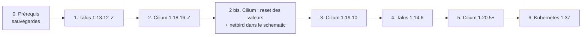

Le cluster tourne sur **un seul nœud** (`talos-r2k-rp0`, `37.187.255.5`), qui est à la fois control plane et worker. Chaque redémarrage de Talos ou de l'agent Cilium coupe donc tout le cluster, VM et workspaces compris. On monte une version à la fois et on vérifie entre chaque étape.

État au 15 novembre 2026 (étapes 1 et 2 faites) :

| Composant | Version | Où elle est fixée |
| --- | --- | --- |
| Talos | v1.13.12 | `1.pulu-init/Pulumi.dev.yaml` → `talosVersion` |
| Kubernetes | v1.36.2 | `1.pulu-init/Pulumi.dev.yaml` → `kubeVersion` |
| Cilium | v1.18.16 | `1.pulu-init/Pulumi.dev.yaml` → `ciliumVersion`, valeurs dans `1.pulu-init/cilium-values.yaml`, qui décrit toute la release depuis l'étape 2 bis |

`talosVersion` et `ciliumVersion` dans `1.pulu-conf/Pulumi.dev.yaml` ne servent à rien : `1.pulu-conf/main.go` ne lit que `argoAppsVersion`. Ne pas s'y fier.

## Ordre des étapes



Pourquoi cet ordre :

- **Une mineure à la fois**, toujours depuis le dernier patch de la mineure en cours : ni Talos ni Cilium ne testent les sauts de mineure ([Talos](https://docs.siderolabs.com/talos/v1.14/configure-your-talos-cluster/lifecycle-management/upgrading-talos), [Cilium](https://docs.cilium.io/en/v1.20/operations/upgrade/)).
- **Kubernetes en dernier** : Cilium 1.18 est testé jusqu'à Kubernetes 1.33 et Cilium 1.19 jusqu'à 1.35. Seul Cilium 1.20 couvre la 1.36 qu'on fait déjà tourner ([matrice](https://docs.cilium.io/en/v1.20/network/kubernetes/requirements/)). On ne monte pas Kubernetes avant d'être en Cilium 1.20.
- **Cilium 1.20.5 au minimum, pas 1.20.4** : depuis la 1.20.2, des endpoints restaurés peuvent perdre leurs règles de policy quand l'agent redémarre ([#49019](https://github.com/cilium/cilium/issues/49019)). Le bug frapperait pendant la mise à jour elle-même, et les workspaces dépendent de ces policies. Le correctif ([#49091](https://github.com/cilium/cilium/pull/49091)) a été mergé le 29/10/2026, soit après la sortie de la 1.20.4 (23/10). Son backport vers la 1.20 était encore en attente au 15/11 (`backport-pending/1.20`). Vérifier qu'il figure dans les notes de la 1.20.x visée. La 1.19 n'est pas touchée : le changement en cause ([#48195](https://github.com/cilium/cilium/pull/48195)) n'a été backporté que vers la 1.20 (`backport-done/1.20`), et n'apparaît dans aucune note de 1.19.x.

## Les pièges propres à ce cluster

<Callout type="error" title="Ne jamais modifier talosInstallVersion">
`talosInstallVersion` alimente `dedicated.NewServerReinstallTask` dans `1.pulu-init/main.go`. Le changer peut **réinstaller le serveur OVH, donc effacer le disque**. Pour une mise à jour, on ne touche qu'à `talosVersion`.
</Callout>

<Callout type="warn" title="src_valid_mark doit rester à 0">
`net.ipv4.conf.all.src_valid_mark` est à `0` dans `1.pulu-init/main.go`. À `1`, toute résolution DNS IPv4 d'un pod soumis à une policy avec une règle DNS (tous les `toFQDNs`, donc networkProfiles et les workspaces) expire. C'est un bug Cilium encore ouvert dans toutes les versions ciblées ici ([#46284](https://github.com/cilium/cilium/issues/46284), [#46260](https://github.com/cilium/cilium/issues/46260), [#48706](https://github.com/cilium/cilium/issues/48706)). On le vérifie après **chaque** étape.
</Callout>

<Callout type="warn" title="Ne pas activer bpf.masquerade">
Avec le hostDNS de Talos (`forwardKubeDNSToHost`, actif par défaut), `bpf.masquerade: true` casse la résolution DNS externe de CoreDNS ([doc Sidero](https://docs.siderolabs.com/kubernetes-guides/cni/deploying-cilium)). Ça a été constaté sur ce cluster : github ne répondait plus, mais les noms internes oui. On reste en masquerading iptables.
</Callout>

<Callout type="error" title="Toujours --drain=false sur talosctl upgrade">
`talosctl upgrade` draine le nœud par défaut, contrairement à `talosctl reboot`. Il installe d'abord la nouvelle image, puis draine, avec un délai de 5 minutes. Or sept PDB n'autorisent aucune interruption sur un nœud unique : les trois primaires cnpg (`*-pg-primary`), `csi-attacher` et `csi-provisioner` de Longhorn, et ses deux instance-managers. Le drain échoue donc toujours. talosctl s'arrête alors en erreur : **nœud cordonné, une partie des pods déjà évincée, pas de redémarrage**. Il n'y a de toute façon aucun autre nœud où déplacer les pods : on passe `--drain=false`, et le kubelet arrête les pods proprement au redémarrage (vu dans le code de talosctl 1.14.2, `cmd/talosctl/cmd/talos/upgrade.go`). Si un drain est quand même lancé et reste bloqué : `task k-o -- uncordon talos-r2k-rp0`.
</Callout>

<Callout type="error" title="Ne jamais s'arrêter sur Talos 1.13.8">
En 1.13.8, l'extension `iscsi-tools` est passée d'open-iscsi 2.1.11 à 2.1.12 sans changer de numéro (elle affiche toujours `v0.2.0`). La 2.1.12 a renommé un paramètre des enregistrements de `/var/lib/iscsi/nodes/` (`conn_reopen_log_freq` → `sess_reopen_log_freq`) et refuse ceux qu'a écrits la 2.1.11. Résultat : **plus aucun volume Longhorn ne s'attache**, et revenir en 1.13.7 ne répare pas, puisque la 1.13.8 a déjà réécrit les enregistrements ([talos#14000](https://github.com/siderolabs/talos/issues/14000), [extensions#1182](https://github.com/siderolabs/extensions/issues/1182), [open-iscsi#540](https://github.com/open-iscsi/open-iscsi/issues/540)). Corrigé à partir de 1.13.9 : l'extension accepte les deux formats et écrit l'ancien (commit `8135db042`), donc un retour arrière en 1.13.5 reste lisible. On saute directement de 1.13.5 à 1.13.12. Si un volume ne s'attache plus malgré tout avec `Unknown parameter name node.session.conn_reopen_log_freq` dans les logs de l'instance-manager, supprimer les enregistrements fautifs sous `/var/lib/iscsi/nodes/` : Longhorn les recrée à l'attachement suivant.
</Callout>

<Callout type="warn" title="Le socket-LB peut se rattacher au mauvais cgroup au démarrage">
Bug Cilium ouvert ([#48420](https://github.com/cilium/cilium/issues/48420), signalé sur Talos 1.13.9 et Cilium 1.20.1, même config que la nôtre : KPR, `Socket LB Coverage: Hostns-only`). Au démarrage du nœud, l'agent peut accrocher les programmes socket-LB à un cgroup éphémère au lieu de la racine. Les pods en `hostNetwork`, **kube-apiserver compris**, n'atteignent alors plus aucune ClusterIP. L'apiserver ne joint plus ses webhooks, donc plus aucun pod ne se crée. `cilium-dbg status` continue d'afficher `Socket LB: Enabled`, et les logs ne disent rien. On le contrôle après chaque redémarrage (point 6 des vérifications).
</Callout>

<Callout type="warn" title="cilium-values.yaml est toute la release (depuis l'étape 2 bis)">
Jusqu'au 15/11/2026, le provider `pulumi-cilium` faisait ses upgrades en *reset-then-reuse*, son défaut : Helm repartait des valeurs de la release précédente. Une clé retirée de `cilium-values.yaml` restait donc dans le cluster, comme les `podAnnotations` otel du port 9965 supprimées par `2b2b6449`. Plusieurs valeurs n'existaient d'ailleurs que dans la release : celles écrites par cilium-cli à l'installation (`cluster.name`, `routingMode: tunnel`, `tunnelProtocol: vxlan`, `socketLB.*`) et celles de `NewHubble` (`hubble.relay/ui`).

Depuis, l'`Install` de `main.go` passe `Reset: true` et `Reusethenreuse: false`, l'équivalent de `helm upgrade --reset-values`. La release vaut alors les défauts du chart, plus `cilium-values.yaml`, plus les `Sets` (`k8sServiceHost`). À l'upgrade, cilium-cli n'ajoute rien d'autre. `UpgradeWithHelm` ne passe que `-f` et `--set`, et `autodetectKubeProxy` ajoute `kubeProxyReplacement`, `k8sServiceHost` et `k8sServicePort` seulement s'ils manquent : les trois sont fournis (vérifié dans le code épinglé, cilium v1.18.0-pre.3). Conséquences :
- **toute valeur absente du fichier disparaît au prochain `up`** : c'est voulu, mais il faut le savoir ;
- le `helm template` de comparaison se fait avec `-f 1.pulu-init/cilium-values.yaml --set k8sServiceHost=37.187.255.5` ;
- après chaque `up`, `helm get values cilium` doit être égal au fichier plus `k8sServiceHost`.
</Callout>

<Callout type="warn" title="Avant chaque upgrade Talos : aucun diff sur machine.files">
`machine.NewConfigurationApply` tourne en mode `auto`. Un changement de `machine.files` (par exemple l'`authentication.yaml` de l'apiserver) ne s'applique pas à chaud : Talos redémarre le nœud pendant `pulunit:up`, et ce redémarrage coupe le `talosctl upgrade` lancé juste après (vécu le 04/11/2026). Si `preview --diff` montre un changement de `machine.files`, on l'applique seul, on attend le redémarrage et les vérifications, puis on fait l'upgrade. Toute modification de l'`authentication-config` se valide d'abord hors ligne (`podman run registry.k8s.io/kube-apiserver:<ver> kube-apiserver --authentication-config=…`) : l'apiserver ne la contrôle strictement qu'au démarrage.
</Callout>

Autres points à connaître :

- **Pare-feu et netbird** : quand `ADMIN_CIDRS` est défini, apid (50000) et l'apiserver (6443) acceptent aussi la plage netbird du compte (`100.64.0.0/16`, `fd67:3c3d:53b7:8bb7::/64`), en secours si `ADMIN_CIDRS` devient obsolète. Le certificat de l'apiserver contient déjà `100.64.45.25`. Au 15/11/2026, ce secours **ne marche pas encore** : le poste admin testé ne liste pas le nœud parmi ses pairs netbird (`talosctl -e 100.64.45.25` : *no route to host*), probablement faute de policy d'accès. Il faut d'abord une policy netbird admin → nœud en TCP 50000/6443, puis tester `task t -- -e 100.64.45.25 -n 100.64.45.25 version` **avant** d'activer le pare-feu. Ce secours tombe avec l'extension netbird, par exemple pendant l'étape 4.
- **Jamais de `pulumi refresh` sur `1.pulu-init`.** Il remplace les IDs de schematic de l'état par les vrais IDs du contenu des inputs (voir « Schematic d'upgrade »), et la config machine suivrait au `up` d'après. `reinstallTalos` est protégé (`Protect` + `IgnoreChanges`). Après un `up` interrompu, on corrige l'état à la main (`stack export` / `stack import`). Et on cherche `reinstall` dans chaque preview.
- **L'`Install` de `pulumi-cilium` passe `Wait: false`** depuis l'étape 2 bis. Le `Wait()` de cilium-cli pouvait rester bloqué indéfiniment après « Upgrade complete » de Helm (vécu en 1.18.16 ; il fallait deux SIGINT, puis remettre `version` avec le préfixe `v` dans l'état). Contrepartie : `pulunit:up` rend la main dès que Helm a fini. Il faut attendre les rollouts soi-même :
  ```bash
  task k-o -- -n kube-system rollout status ds/cilium --timeout=10m
  task k-o -- -n kube-system rollout status deploy/cilium-operator deploy/hubble-relay --timeout=5m
  ```
- **pulumi-talos v0.8.1 embarque la machinery Talos 1.13.0** (terraform-provider-talos v0.11.0). Avec `talosVersion: v1.14.x`, `GetConfigurationOutput` devrait donc continuer à générer une config au format 1.13 (v1alpha1, avec `extraMounts`/`extraVolumes`). Talos 1.14 l'accepte, et c'est ce qu'on veut. À confirmer dans le `preview --diff`. Le passage aux documents séparés est planifié à part : [Config Talos multi-documents](/docs/runbooks/migration-talos-multidoc). Ne pas monter le provider pendant cette série de mises à jour.

- **Le provider `pulumi-cilium` n'est plus maintenu** (dernière version v0.2.1, juillet 2025, basée sur cilium-cli 1.18). Il télécharge le chart de la version demandée, mais sa logique n'a jamais été testée avec 1.19 ou 1.20, y compris l'étape séparée `NewHubble`. On compare donc toujours le rendu avec `helm template` avant d'appliquer.
- **Schematic d'upgrade : l'ID de l'état ne suit pas les mises à jour.** Le bridge Pulumi ne peut pas changer l'ID d'une ressource lors d'une mise à jour en place. Quand les inputs de `schematicUpdateResource` changent, le provider crée bien un nouveau schematic à l'Image Factory, mais l'état garde l'ancien ID, et c'est lui que lisent `schematicUpdateId` et l'URL de l'installer. C'est arrivé le 28/06/2026 (commit `1f8ee185`, netbird → fuse3) : l'état a gardé `c6851a…` (contenu : netbird, sans fuse3), alors que le contenu des inputs a l'ID `184ab2…` (fuse3, sans netbird). C'est pour ça que fuse3 n'est jamais arrivé avec la 1.13.12, et que le refresh du 05/11 a « vu » un autre ID. **Pour qu'un changement d'extensions prenne effet, il faut remplacer la ressource** (`--replace`, étape 2 bis). netbird est revenu dans la liste le 15/11/2026, dans `schematicUpdateResource` seulement : le schematic d'installation alimente `reinstallTalos` et n'est pas touché. Un changement de `machine.install.image` seul s'applique **sans redémarrage** (vérifié par `talosctl patch mc --dry-run --mode auto`).
- **Talos 1.14 et etcd 3.7** : une fois les données migrées en 3.7, revenir en Talos 1.13 n'est sûr qu'avec le snapshot pris avant.

## Avant de commencer

1. **Récupérer un `talosconfig`.** `task t` lit `0.config/talosconfig2.yaml`, absent d'un poste neuf. Vérifier l'accès :
   ```bash
   task t -- -n 37.187.255.5 version
   ```
2. **Récupérer un kubeconfig admin** dans `0.config/kubeconfig.yaml`, dont Pulumi a besoin (`KUBECONFIG` de la tâche `pulunit:base`). Le kubeconfig OIDC (`task k-o`) suffit pour les vérifications.
3. **Vérifier que `src_valid_mark=0` est bien appliqué par Pulumi**, et pas seulement en direct sur le nœud :
   ```bash
   task t -- -n 37.187.255.5 read /proc/sys/net/ipv4/conf/all/src_valid_mark   # doit afficher 0
   ```
   S'il affiche `1`, lancer d'abord `task pulunit:up` sur le commit qui le met à `0`.
4. **Sauvegardes**, à refaire avant chaque étape :
   ```bash
   mkdir -p .tmp/backup/$(date +%F)
   task t -- -n 37.187.255.5 etcd snapshot .tmp/backup/$(date +%F)/etcd.db
   task t -- -n 37.187.255.5 get mc -o yaml > .tmp/backup/$(date +%F)/machineconfig.yaml
   task pulunit:base -- stack export > .tmp/backup/$(date +%F)/pulumi-stack.json
   task k-o -- get cnp,ccnp,ciliumloadbalancerippools,ciliuml2announcementpolicies -A -o yaml > .tmp/backup/$(date +%F)/cilium-objects.yaml
   task k-o -- -n kube-system get cm cilium-config -o yaml > .tmp/backup/$(date +%F)/cilium-config.yaml
   ```
   Plus une sauvegarde Longhorn des volumes importants, depuis l'UI Longhorn.
5. **Vérifier qu'aucun webhook bloquant ne pointe dans le vide.** Un webhook en `failurePolicy: Fail` dont le Service n'existe plus refuse toutes les requêtes qu'il intercepte. Après le redémarrage, si ce sont des créations de pods, plus aucun pod ne démarre. La commande suivante ne doit rien afficher :
   ```bash
   task k-o -- get validatingwebhookconfigurations,mutatingwebhookconfigurations -o json | jq -r '
     .items[] | .metadata.name as $n | .webhooks[]
     | select((.failurePolicy // "Fail") == "Fail" and .clientConfig.service != null)
     | "\(.clientConfig.service.namespace) \(.clientConfig.service.name) \($n)"' | sort -u |
   while read ns svc wh; do
     task k-o -- -n "$ns" get svc "$svc" >/dev/null 2>&1 || echo "MORT: $wh -> $ns/$svc"
   done
   ```
   Contrôler aussi que kyverno exclut toujours `vault-infra` de ses webhooks. Sans cette exclusion, kyverno et le webhook Vault se bloquent mutuellement : chacun a besoin de l'autre pour recréer son pod (voir `2.argo/helm/hook/main/templates/kyverno/kyverno.yaml`).
   ```bash
   task k-o -- get mutatingwebhookconfiguration kyverno-resource-mutating-webhook-cfg -o jsonpath='{.webhooks[0].namespaceSelector}' | grep -q vault-infra && echo OK
   ```

## Vérifications après chaque étape

À lancer après chaque étape, avant de passer à la suivante. Si une ligne échoue, on s'arrête et on applique le retour arrière de l'étape.

```bash
# 1. Le nœud et le cluster
task t -- -n 37.187.255.5 health
task k-o -- get nodes -o wide
task k-o -- -n argocd get applications --no-headers -o custom-columns=N:.metadata.name,H:.status.health.status | grep -v Healthy

# 2. Cilium : état, mode de routage (Host: Legacy) et masquerading (IPTables)
CP=$(task k-o -- -n kube-system get pod -l k8s-app=cilium -o jsonpath='{.items[0].metadata.name}')
task k-o -- -n kube-system exec $CP -c cilium-agent -- cilium-dbg status --verbose | grep -E "^Cilium:|^Routing|^Masquerading|^KubeProxyReplacement"

# 3. src_valid_mark toujours à 0
task t -- -n 37.187.255.5 read /proc/sys/net/ipv4/conf/all/src_valid_mark

# 4. DNS sous policy depuis un workspace (IPv4 ET IPv6), puis flux autorisés et bloqués
P=$(task k-o -- -n dev-ws-batleforc get pod -l controller.devfile.io/devworkspace_id -o jsonpath='{.items[0].metadata.name}')
task k-o -- -n dev-ws-batleforc exec $P -c tools -- sh -c '
  getent ahostsv4 github.com | head -1
  for u in https://github.com https://cde.dev.weebo.poc http://che-host.eclipse-che.svc:8080/api/system/state https://kubernetes.default.svc/version; do
    curl -sk -o /dev/null -m 6 -w "%{http_code} $u\n" $u; done
  curl -sk -o /dev/null -m 6 -w "%{http_code} google (doit être bloqué: 000)\n" https://www.google.com'

# 5. Drops réseau inattendus
task k-o -- -n kube-system exec $CP -c cilium-agent -- hubble observe --verdict DROPPED --last 50

# 6. Socket-LB accroché à la racine des cgroups (cilium#48420) : doit afficher cgroup_id 1.
#    Sinon : rm /sys/fs/bpf/cilium/socketlb/links/cgroup/* dans l'agent, puis supprimer le pod cilium.
task k-o -- -n kube-system exec $CP -c cilium-agent -- bpftool link show | grep -A1 inet4_connect

# 7. Volumes Longhorn tous attachés et sains (le piège iscsi de 1.13.8)
task k-o -- -n longhorn get volumes.longhorn.io -o custom-columns=N:.status.kubernetesStatus.pvcName,S:.status.state,R:.status.robustness | grep -v "attached *healthy"
```

```bash
# 8. Chaque pod hors hostNetwork a son CiliumEndpoint (cilium#49974, vu en 1.19.8 et 1.19.10).
#    Ne doit rien afficher. Sinon : supprimer le pod concerné, son remplaçant reçoit un CEP.
comm -23 \
  <(task k-o -- get pod -A --field-selector=status.phase=Running -o json | jq -r '.items[] | select(.spec.hostNetwork!=true) | "\(.metadata.namespace)/\(.metadata.name)"' | sort) \
  <(task k-o -- get ciliumendpoints -A -o json | jq -r '.items[] | "\(.metadata.namespace)/\(.metadata.name)"' | sort)
```

Le point 7 n'affiche normalement que l'en-tête et les volumes des workspaces arrêtés (`detached`). Référence pour le point 8 au 15/11/2026, en Cilium 1.18.16 : 91 pods, 91 CEP, aucun manquant.

Penser aussi à vérifier :

- **le DNS des VM** ;
- **un pull d'image via angos**, par exemple en créant un nouveau workspace (images `registry.pkg.weebo.poc/quay/...`) ;
- **le login Che**, qui passe par dex puis Authentik.

## Étape 1 : Talos 1.13.5 → 1.13.12 (faite le 04/11/2026)

Mise à jour patch : noyau 6.18.36 → 6.18.57, containerd 2.2.10, CoreDNS 1.14.7, etcd 3.6.14, et des corrections réseau qui concernent ce nœud (route IPv6, routes recréées en boucle, DHCP, buffers netlink de nftables) ([notes de version](https://github.com/siderolabs/talos/releases/tag/v1.13.12)).

Vérifié le 2026-10-30 avant l'opération : rien entre 1.13.6 et 1.13.12 ne touche eBPF, le routage de Cilium ou son proxy DNS, et aucune issue Cilium ou Talos ne signale d'incompatibilité entre ces versions et Cilium 1.18.10. Deux changements à noter : `CONFIG_NFT_SOCKET` est activé en 1.13.8 (sans effet, Cilium passe par iptables) et un débordement noyau sur les métadonnées de tunnel est corrigé en 1.13.6 (concerne `cilium_vxlan`). Le seul vrai piège est celui d'iscsi en 1.13.8 (voir « Les pièges propres à ce cluster »), qu'on évite en allant directement en 1.13.12.

1. Sauvegardes (voir « Avant de commencer »).
2. Mettre à jour la version dans Pulumi, **uniquement `talosVersion`** :
   ```yaml
   # 1.pulu-init/Pulumi.dev.yaml
   0.pulumi:talosVersion: v1.13.12
   ```
3. Prévisualiser et lire le diff :
   ```bash
   task pulunit:base -- preview --diff
   ```
   On attend un nouveau schematic d'installation (et `fuse3`) et une config machine qui pointe vers le nouvel installer. **Si `reinstallTalos` apparaît dans le diff, on s'arrête.**
4. Appliquer, puis lancer la mise à jour du nœud avec l'image de l'installer :
   ```bash
   task pulunit:up
   task pulunit:base -- stack output schematicUpdateId
   task t -- -n 37.187.255.5 upgrade --drain=false --image factory.talos.dev/installer/<schematicUpdateId>:v1.13.12
   ```
   Le nœud redémarre : le cluster est indisponible pendant quelques minutes.

   C'est aussi le premier redémarrage depuis que `cluster.etcd.extraArgs.listen-metrics-urls` est passé à `http://127.0.0.1:2381`. Talos ne relance pas etcd quand sa spec change, donc ce réglage attendait ce redémarrage. Vérifier que les métriques etcd arrivent :
   ```bash
   task t -- -n 37.187.255.5 netstat -l -t | grep 127.0.0.1:2381
   # et dans le dashboard ClickStack « Control plane », « Components down » doit revenir à 0
   ```
5. Vérifications après chaque étape.

**Retour arrière** : `task t -- -n 37.187.255.5 rollback`, puis remettre `talosVersion: v1.13.5` dans Pulumi.

## Étape 2 : Cilium 1.18.10 → 1.18.16 (faite le 05/11/2026)

Prévue en 1.18.14, faite directement en 1.18.16, le dernier patch de la 1.18.

Mise à jour patch. Aucune note ne touche au proxy DNS ni au routage legacy. Deux changements à surveiller :

- **Envoy passe en 1.37.**
- **L'option `enable-xt-socket-fallback` est enfin vraiment appliquée** ([#47635](https://github.com/cilium/cilium/pull/47635)). C'est sur le chemin iptables qu'emprunte le proxy DNS : bien vérifier le DNS sous policy après coup.

Le bug de la 1.18.8 où l'agent plantait au démarrage avec Talos, KPR et le proxy DNS transparent ([#45208](https://github.com/cilium/cilium/issues/45208)) a été fermé sans correctif. Il ne se produit pas en 1.18.10, mais c'est le premier suspect si l'agent ne démarre pas.

1. Sauvegardes.
2. Comparer le rendu du chart avec la config actuelle :
   ```bash
   helm repo add cilium https://helm.cilium.io && helm repo update
   # valeurs live : avant l'étape 2 bis, la release ne correspondait pas au fichier
   helm --kubeconfig 0.config/kubeconfig.yaml -n kube-system get values cilium -o yaml > .tmp/cilium-live-values.yaml
   for v in 1.18.10 1.18.16; do
     helm template cilium cilium/cilium --version $v -n kube-system --kube-version v1.36.2 -f .tmp/cilium-live-values.yaml > .tmp/cilium-$v.yaml
     yq 'select(.kind=="ConfigMap" and .metadata.name=="cilium-config") | .data | to_entries | .[] | .key + "=" + .value' .tmp/cilium-$v.yaml | sort > .tmp/cilium-config-$v.txt
   done
   diff .tmp/cilium-config-1.18.10.txt .tmp/cilium-config-1.18.16.txt
   diff .tmp/cilium-1.18.10.yaml .tmp/cilium-1.18.16.yaml | less
   ```
3. Mettre à jour la version, puis prévisualiser et appliquer :
   ```yaml
   # 1.pulu-init/Pulumi.dev.yaml
   0.pulumi:ciliumVersion: v1.18.16
   ```
   ```bash
   task pulunit:base -- preview --diff
   task pulunit:up
   ```
   L'agent redémarre : quelques secondes de coupure pour le DNS des pods sous policy, les VM et les connexions Envoy.
4. Vérifications après chaque étape, en insistant sur le point 4 (DNS sous policy).

**Retour arrière** : remettre `ciliumVersion: v1.18.10` puis `task pulunit:up`. Si Pulumi échoue, `helm rollback cilium -n kube-system`, puis remettre l'état Pulumi en cohérence.

## Étape 2 bis : valeurs Cilium en reset (Cilium reste en 1.18.16), schematic d'upgrade remplacé

Un `up` sans changement de version, pour essayer les deux nouveaux comportements du provider (`Reset`, `Wait: false`) seuls, sans les mélanger avec le passage en 1.19. Il coûte une coupure de plus, courte : l'agent redémarre, parce que la suppression des `podAnnotations` change le template du DaemonSet. Décidé le 15/11/2026 : étape séparée de l'étape 3, pour savoir lequel des deux changements est en cause en cas de problème.

Vérifié le 15/11/2026 avant l'opération :
- le rendu 1.18.16 de `cilium-values.yaml` + `k8sServiceHost` ne diffère du rendu des valeurs live que par les `podAnnotations` (seul changement attendu) ;
- aucun des attributs `reset`, `reusethenreuse` et `wait` ne force le remplacement de l'`Install` (pas de `RequiresReplace` dans terraform-provider-cilium v0.3.2). Un remplacement, ce serait un uninstall de Cilium ;
- `preview --diff` sans `--replace` : 2 mises à jour (schematic, Install), 11 inchangées, ni `reinstall`, ni `machine.files`. **Mais la mise à jour du schematic ne change rien en pratique** : l'ID reste `c6851a…` (voir « Schematic d'upgrade ») ;
- `preview --diff --replace <urn du schematic>` : le schematic et `patchJson` sont remplacés, `configurationApply` est mis à jour (nouvelle image d'installer), aucun `reinstall`.

1. Sauvegardes (voir « Avant de commencer »), dont `helm get values cilium -o yaml`.
2. Cilium seul d'abord, en ciblant l'Install :
   ```bash
   task pulunit:base -- preview --diff --target 'urn:pulumi:dev::0.pulumi::cilium:index/install:Install::ciliumInstall'
   task pulunit:base -- up --target 'urn:pulumi:dev::0.pulumi::cilium:index/install:Install::ciliumInstall'
   task k-o -- -n kube-system rollout status ds/cilium --timeout=10m
   task k-o -- -n kube-system rollout status deploy/cilium-operator deploy/hubble-relay --timeout=5m
   # la release ne contient plus que le fichier + k8sServiceHost : le diff doit être vide
   helm --kubeconfig 0.config/kubeconfig.yaml -n kube-system get values cilium -o yaml | yq 'del(.k8sServiceHost)' > .tmp/cilium-release.yaml
   diff <(yq -P '... comments="" | sort_keys(..)' .tmp/cilium-release.yaml) <(yq -P '... comments="" | sort_keys(..)' 1.pulu-init/cilium-values.yaml)
   ```
   Puis les vérifications après chaque étape.
3. Le schematic d'upgrade, en deux temps pour lire le vrai diff de la config machine. Le preview combiné ne la montre pas : le patch devient « inconnu » tant que le nouvel ID n'existe pas.
   ```bash
   U='urn:pulumi:dev::0.pulumi::talos:imageFactory/schematic:Schematic::schematicUpdateResource'
   task pulunit:base -- up --target "$U" --replace "$U"     # nouveau schematic seulement
   curl -s https://factory.talos.dev/schematics/$(task pulunit:base -- stack output schematicUpdateId | tail -1)   # netbird ET fuse3
   task pulunit:base -- preview --diff    # attendu : configurationApply ne change que machine.install.image
   task pulunit:base -- up
   task t -- -n 37.187.255.5 get mc -o yaml | grep 'image: factory'
   ```
   Si le preview montre autre chose que `install.image` dans la config machine (surtout `machine.files`), on s'arrête. Sans redémarrage attendu, le nœud ne doit pas rebooter.

**Retour arrière** : Cilium : remettre `cilium-values.yaml` et `main.go`, `up --target` sur l'Install, ou en dernier recours `helm rollback cilium -n kube-system`, puis remettre l'état en cohérence. Schematic : sans conséquence tant qu'aucun `talosctl upgrade` n'a utilisé la nouvelle image. Remettre l'ancienne liste dans `main.go` et refaire le `--replace`.

## Étape 3 : Cilium 1.18.16 → 1.19.10

À lire avant : [notes de mise à jour 1.19](https://docs.cilium.io/en/v1.19/operations/upgrade/). Ce qui concerne ce cluster :

- Dans les motifs DNS, `**.` couvre maintenant plusieurs niveaux de sous-domaines. Nos profils utilisent `*.`, donc pas d'impact. Vérifier quand même que personne n'a ajouté de `**.` entre-temps (aucun au 15/11/2026) :
  ```bash
  task k-o -- get cnp,ccnp -A -o yaml | grep -nE '\*\*\.|authentication:|fromRequires|toRequires'
  ```
- `CiliumLoadBalancerIPPool` en `v2alpha1` est déprécié. `1.pulu-conf` utilise déjà `cilium.io/v2`.
- `FromRequires` et `ToRequires` sont refusés dans les policies (non utilisés ici).
- Aucune valeur Helm de `cilium-values.yaml` n'est supprimée. Les deux flags passés en `extraArgs`, `--hubble-metrics-server` (agent) et `--operator-prometheus-serve-addr` (opérateur), existent toujours en 1.19.10 et en 1.20.4. Vérifié avec `--help` sur les images. Un flag disparu ferait planter l'agent au démarrage.

**Rendu du chart 1.18.16 → 1.19.10 avec les valeurs live** (vérifié le 15/11/2026, le rendu 1.18.16 reproduit exactement le `cilium-config` live). Le DaemonSet garde les mêmes arguments, capacités et variables d'environnement. Deux objets apparaissent : `Role` et `RoleBinding` `cilium-operator-ztunnel`. Dans `cilium-config` :

| Clé | 1.18.16 | 1.19.10 | Impact ici |
| --- | --- | --- | --- |
| `mesh-auth-enabled` | `true` | `false` | aucun : aucune policy n'utilise `authentication:` |
| `policy-default-local-cluster` | `false` | `true` | aucun : pas de clustermesh |
| `packetization-layer-pmtud-mode` | — | `blackhole` | PLPMTUD noyau activé dans le netns des pods (défaut 1.19). À surveiller sur le vxlan |
| `enable-no-service-endpoints-routable` | — | `true` | « Enable routes when service has 0 endpoints », valeur par défaut de l'agent 1.19 |
| `policy-deny-response` | — | `none` | drop sans ICMP, comme avant |
| `enable-internal-traffic-policy`, `enable-svc-source-range-check` | `true` | retirées | ces clés n'étaient déjà plus des flags de l'agent 1.18.16 (absentes de `--help`). Aucun Service n'utilise `loadBalancerSourceRanges` |
| `proxy-*`, `clustermesh-*`, `enable-host-firewall=false`, `enable-service-topology=false` | — | ajoutées | valeurs par défaut rendues explicites |
| `unmanaged-pod-watcher-interval` | `15` | `15s` | format seulement |

**Notes de version 1.19.9 et 1.19.10** : uniquement des correctifs, dont deux qui nous concernent en bien. Les erreurs de renommage de chaînes ip6tables ne sont plus ignorées en silence (dual-stack), et les backends en cours d'arrêt sont restaurés correctement après un redémarrage de l'agent. La 1.19.10 est une release de sécurité (CiliumEnvoyConfig limitée à son namespace, sans effet ici).

**Issues ouvertes connues** :
- [#49974](https://github.com/cilium/cilium/issues/49974) (1.19.8 et 1.19.10) : un pod qui démarre en même temps que l'agent peut se retrouver sans CiliumEndpoint. Sur un seul nœud, l'agent connaît ses endpoints locaux, donc le datapath ne devrait pas être touché. Mais le redémarrage de l'étape 4 relance tous les pods en même temps que l'agent : c'est le point 8 des vérifications.
- [#49370](https://github.com/cilium/cilium/issues/49370) (blocage CPU après le démarrage de Cilium) : un seul serveur sur 94 chez le rapporteur, aussi reproduit sous Ubuntu. Probablement matériel ou noyau, pas un motif d'arrêt.

Procédure : sauvegardes ; `helm template` de `cilium-values.yaml` + `k8sServiceHost` pour comparer 1.18.16 et 1.19.10 ; `ciliumVersion: v1.19.10` ; `preview --diff` ; `pulunit:up` ; attendre les rollouts (`Wait: false`) ; puis les vérifications.

En plus des vérifications habituelles, vérifier que Hubble répond encore : l'étape `NewHubble` du provider Pulumi n'a jamais été testée avec 1.19.
```bash
task k-o -- -n kube-system get deploy hubble-relay hubble-ui
```

**Retour arrière** : `ciliumVersion: v1.18.16` puis `task pulunit:up`. On ne revient jamais en arrière de plus d'une mineure.

## Étape 4 : Talos 1.13.12 → 1.14.6

À lire avant : [notes de version 1.14.0](https://github.com/siderolabs/talos/releases/tag/v1.14.0). On vise **1.14.6**, le dernier patch au 15/11/2026. Les 1.14.0 et 1.14.1 avaient des routes recréées en boucle ([#14416](https://github.com/siderolabs/talos/issues/14416)), corrigées en 1.14.2.

Relu dans les notes de 1.14.3 à 1.14.6 (15/11/2026) :
- **etcd 3.7.3**, noyau 6.18.63 (BTF présent : `/sys/kernel/btf/vmlinux` existe déjà en 6.18.57), containerd 2.3.7.
- 1.14.3 : les anciennes routes sont supprimées avant d'ajouter leurs remplaçantes, meilleure reprise de KubePrism, `talosctl time --check` retiré au rôle `os:reader`.
- 1.14.5 : **chargement des modules noyau à la demande** (`request_module()`), images tirées en HTTP/1.1, erreurs netlink récupérables ignorées.
- 1.14.6 : le correctif du provider `aescbc` pour le chiffrement etcd ne nous concerne pas, le cluster n'a qu'un `secretboxEncryptionSecret`.
- Issues : aucune ouverte sur Cilium, Longhorn, iSCSI ou etcd. [#14829](https://github.com/siderolabs/talos/issues/14829) (fermée) : `upgrade --image …@sha256:` échouait en 1.14.5. Passer seulement le tag à `--image`.

**iSCSI / Longhorn (le piège de la 1.13.8, revérifié)** : en 1.14, `iscsi-tools` (toujours affiché `v0.2.0`) passe à **open-iscsi 2.1.13**, et le patch maison `node-reopen-log-freq-compat.patch` n'y est plus. C'est voulu : la 2.1.13 lit nativement `conn_reopen_log_freq` comme alias de `sess_reopen_log_freq`, et une clé inconnue n'est plus fatale ([open-iscsi#542](https://github.com/open-iscsi/open-iscsi/pull/542)). Les enregistrements écrits par la 1.13.12 (ancien format) sont donc lus par la 1.14.6, et un retour en 1.13.12 relit le nouveau format grâce au patch de compatibilité. Le point 7 des vérifications reste obligatoire.

**Extensions** : toutes celles du schematic existent pour la v1.14.6 : `netbird` 0.76.3 → 0.82.0 (le pod exit-node tourne déjà en 0.81.4 contre le même serveur), `crun` 1.29 → 1.29.1, `fuse3` ajoutée, et `mei` suit la version de Talos. **Avant `talosctl upgrade`, vérifier le contenu du schematic utilisé** : il doit contenir `siderolabs/netbird` **et** `siderolabs/fuse3` (voulue), sinon on s'arrête : le `--replace` de l'étape 2 bis n'a pas été fait.
```bash
curl -s https://factory.talos.dev/schematics/$(task pulunit:base -- stack output schematicUpdateId | tail -1)
```
Après l'étape, vérifier que le pair netbird revient (`task t -- -n 37.187.255.5 service ext-netbird`).

Ce qui change pour ce cluster :

- **Format de config** : tous les champs utilisés ici sont dépréciés mais toujours supportés (`machine.sysctls`, `machine.files`, `machine.kubelet.extraArgs`/`extraMounts`, `cluster.apiServer`, `features.hostDNS`…). On **garde** le format v1alpha1. Le nouveau format multi-documents n'a plus `kubelet.extraMounts` ni les `extraVolumes` de l'apiserver, or on utilise les deux : `/var/local-path-provisioner` et `/var/lib/apiserver`, pour la config OIDC.
- **`talosVersion` est aussi passé à `GetConfigurationOutput`** (`main.go`). pulumi-talos v0.8.1 embarque la machinery 1.13.0 : la config devrait rester au format 1.13, et le diff de config machine se limiter à l'image de l'installer. Tout autre changement se lit ligne par ligne avant d'appliquer : **c'est le point à lire en priorité**. Aucun changement de `machine.files` ne doit apparaître (voir « Avant chaque upgrade Talos »).
- **etcd passe en 3.7** : par défaut, métriques et santé passent sur le port 2383, en mTLS. Ici, `listen-metrics-urls` est personnalisé (`http://127.0.0.1:2381`, lu par otel-controlplane), et les notes de version indiquent qu'une valeur personnalisée ne bouge pas. Après l'étape, vérifier que `127.0.0.1:2381` écoute toujours. Le retour en 1.13 n'est sûr qu'avec le snapshot.
- **TLS 1.3 minimum** pour kube-apiserver et etcd. Les clients anciens (scripts, outils) doivent le supporter.
- **`send_redirects=0`** par défaut, et NRI activé dans containerd.
- **L'isolation des workloads (sandboxd) reste désactivée** sur un cluster mis à jour. Ne pas l'activer : elle casse le plugin iSCSI dont Longhorn a besoin.
- Deux régressions des bêtas touchaient ce cluster, toutes deux corrigées en 1.14.0 : `authentication-config` cassé pour l'apiserver (#14030), et les règles ip6tables de Cilium en dual-stack (#13935).

1. Sauvegardes, **snapshot etcd obligatoire**.
2. `talosVersion: v1.14.6`, puis `task pulunit:base -- preview --diff`. Lire le diff de la config machine ligne par ligne. Si `extraMounts`, `extraVolumes` ou les `sysctls` disparaissent, si `machine.files` change, ou si `reinstall` apparaît, on s'arrête.
3. `task pulunit:up`, puis `task t -- -n 37.187.255.5 upgrade --drain=false --image factory.talos.dev/installer/<schematicUpdateId>:v1.14.6` (talosctl local en 1.14.5 au 15/11, ça suffit).
4. Vérifications après chaque étape, plus :
   ```bash
   # l'apiserver accepte toujours les tokens OIDC (dex)
   task k-o -- auth whoami
   # les règles ip6tables de Cilium sont toujours en place
   task k-o -- -n kube-system exec $CP -c cilium-agent -- ip6tables -t mangle -S | grep -c TPROXY
   ```

**Retour arrière** : `task t -- -n 37.187.255.5 rollback`. Si le retour en 1.13 échoue à cause d'etcd, restaurer le snapshot (`talosctl bootstrap --recover-from=...`), puis remettre `talosVersion: v1.13.12` dans Pulumi.

## Étape 5 : Cilium 1.19.10 → 1.20.5 (ou plus)

**Pas avant que le correctif de [#49019](https://github.com/cilium/cilium/issues/49019) ([#49091](https://github.com/cilium/cilium/pull/49091), « Fix restored endpoints getting only policy rules that select all endpoints ») figure dans les notes de la 1.20.x visée.** Il n'est pas dans la 1.20.4. La 1.20.4 corrige aussi une régression Gateway API de la 1.20.3 (sans effet ici). Si on vise une 1.20.x plus récente, relire ses notes et ses issues `affects/v1.20` + `kind/regression`.

À lire avant : [notes de mise à jour 1.20](https://docs.cilium.io/en/v1.20/operations/upgrade/). Ce qui concerne ce cluster :

- **Accès des pods aux services NodePort** : avec `socketLB.hostNamespaceOnly`, ils sont maintenant load-balancés côté pod client. Les policies doivent alors autoriser l'egress vers les backends, et les backends l'ingress depuis le client.
- **Les CNP vides sont refusées** (validation CEL). Vérifier que l'opérateur weebo-si-hardening n'en écrit jamais :
  ```bash
  task k-o -- get cnp -A -o json | python3 -c 'import json,sys; [print(i["metadata"]["namespace"], i["metadata"]["name"]) for i in json.load(sys.stdin)["items"] if not (i["spec"].get("ingress") or i["spec"].get("egress") or i["spec"].get("ingressDeny") or i["spec"].get("egressDeny"))]'
  ```
- `CiliumNodeConfig` en `v2alpha1` est supprimé (non utilisé ici). `CiliumL2AnnouncementPolicy` n'existe encore qu'en `v2alpha1`, sans conséquence tant que les annonces L2 ne sont pas activées.
- **BTF** : vérifier que le noyau l'expose, sinon le socket-LB ne se charge pas ([#48778](https://github.com/cilium/cilium/issues/48778)) :
  ```bash
  task t -- -n 37.187.255.5 ls /sys/kernel/btf/vmlinux
  ```

Procédure identique à l'étape 3 : `helm template` pour comparer, `ciliumVersion`, `preview --diff`, `pulunit:up`, attendre les rollouts, vérifications.

**Retour arrière** : `ciliumVersion: v1.19.10` puis `task pulunit:up`.

## Étape 6 : Kubernetes 1.36 → 1.37

Seulement une fois Talos en 1.14.x (qui supporte Kubernetes 1.33 à 1.37) et Cilium en 1.20.x.

1. Sauvegardes, snapshot etcd.
2. Lancer la mise à jour, puis aligner Pulumi :
   ```bash
   task t -- -n 37.187.255.5 upgrade-k8s --to 1.37.1
   ```
   ```yaml
   # 1.pulu-init/Pulumi.dev.yaml
   0.pulumi:kubeVersion: v1.37.1
   ```
3. Vérifications après chaque étape, plus le login OIDC (`task k-o -- auth whoami`).

**Retour arrière** : Kubernetes ne se rétrograde pas proprement. C'est le snapshot etcd de l'étape 1 qui sert de filet de sécurité.

## Sources

- Talos : [v1.13.12](https://github.com/siderolabs/talos/releases/tag/v1.13.12), [v1.14.0](https://github.com/siderolabs/talos/releases/tag/v1.14.0), [v1.14.6](https://github.com/siderolabs/talos/releases/tag/v1.14.6), [mise à jour de Talos](https://docs.siderolabs.com/talos/v1.14/configure-your-talos-cluster/lifecycle-management/upgrading-talos), [matrice de support](https://docs.siderolabs.com/talos/v1.14/getting-started/support-matrix), [Cilium sur Talos](https://docs.siderolabs.com/kubernetes-guides/cni/deploying-cilium)
- Cilium : [v1.18.14](https://github.com/cilium/cilium/releases/tag/v1.18.14), [v1.19.9](https://github.com/cilium/cilium/releases/tag/v1.19.9), [v1.19.10](https://github.com/cilium/cilium/releases/tag/v1.19.10), [v1.20.4](https://github.com/cilium/cilium/releases/tag/v1.20.4), [#49974](https://github.com/cilium/cilium/issues/49974), [mise à jour 1.19](https://docs.cilium.io/en/v1.19/operations/upgrade/), [mise à jour 1.20](https://docs.cilium.io/en/v1.20/operations/upgrade/), [prérequis Kubernetes](https://docs.cilium.io/en/v1.20/network/kubernetes/requirements/)
- iscsi-tools : [open-iscsi 2.1.13](https://github.com/open-iscsi/open-iscsi/releases/tag/2.1.13), [open-iscsi#542](https://github.com/open-iscsi/open-iscsi/pull/542) ; en 1.13.8 : [talos#14000](https://github.com/siderolabs/talos/issues/14000), [extensions#1182](https://github.com/siderolabs/extensions/issues/1182), [open-iscsi#540](https://github.com/open-iscsi/open-iscsi/issues/540)
- Socket-LB sur le mauvais cgroup : [cilium#48420](https://github.com/cilium/cilium/issues/48420)
- Bug DNS et `src_valid_mark` : [#46284](https://github.com/cilium/cilium/issues/46284), [#46260](https://github.com/cilium/cilium/issues/46260), [#48706](https://github.com/cilium/cilium/issues/48706), [#48928](https://github.com/cilium/cilium/pull/48928)
