{/* Généré par `task docs:authflow` (0.task/scripts/authflow.py). Ne pas éditer à la main. */}

Une section par application Authentik (`AuthentikApplication`), avec qui y a accès, par quel flux, et qui consomme son client.

## Légende

- Un **groupe** donne accès à une application Authentik par une politique d'accès (`AuthentikAccessPolicy`). Les membres d'un groupe enfant passent aussi les politiques de ses parents : `weebo_admin` ⊂ `weebo_moderator` ⊂ `weebo_user`.
- Une flèche **Authentik → consommateur** suit le client OIDC : l'opérateur écrit `client_id`/`client_secret` dans Vault (`secretTargets`), un `ExternalSecret` ou une injection `vault:` le relit dans un namespace, et l'objet qui nomme ce Secret est le consommateur. Une URL `/application/o/<slug>/` en dur compte aussi.
- Une flèche **épaisse** (`==>`) passe par une étape de second facteur (flux d'autorisation à étape `authenticator_validate`, ici `admin-step-up`).
- Les **Dex** sont des courtiers : ils se connectent à Authentik comme un client, puis émettent leurs propres jetons à leurs clients statiques.
- Les **proxys** Authentik sont servis par le middleware Traefik `forwardAuth` : l'IngressRoute n'atteint le backend qu'après l'avant-poste Authentik.
- Côté Kubernetes, l'apiserver accepte deux émetteurs JWT (`AuthenticationConfiguration` de `1.pulu-init`), et les (Cluster)RoleBindings donnent les droits aux noms préfixés qu'ils produisent.

## angos

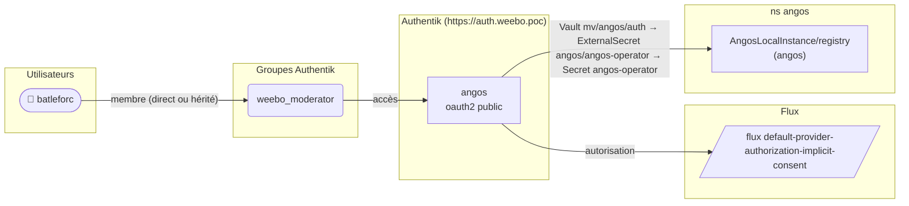

| Propriété | Valeur |
|---|---|
| Slug | `angos` |
| CR | `angos` |
| Fournisseur | oauth2 |
| Émetteur | `https://auth.weebo.poc/application/o/angos/` |
| Client | `angos` (public) |
| Grants | `authorization_code`, `urn:ietf:params:oauth:grant-type:device_code`, `refresh_token` |
| Durée du jeton d'accès | `hours=12` |
| Scopes / mappings | `weebo email` `weebo groups` `authentik default OAuth Mapping: OpenID 'profile'` `authentik default OAuth Mapping: OpenID 'openid'` `authentik default OAuth Mapping: OpenID 'offline_access'` |
| Redirections | `https://registry.pkg.weebo.poc/` (strict) `https://registry.pkg.weebo.poc/oauth2/callback` (strict) |
| Clé de signature | `authentik Self-signed Certificate` |
| Flux d'autorisation | `default-provider-authorization-implicit-consent` |
| Flux d'invalidation | `default-provider-invalidation-flow` |
| Accès | `weebo_moderator` |
| Utilisateurs autorisés | `batleforc` |
| Secret écrit dans | `angos/auth` |

### Consommateurs

| App Argo CD | Objet | Chemin du secret |
|---|---|---|
| `angos` | `angos/AngosLocalInstance/registry` | Vault `mv/angos/auth` → ExternalSecret `angos/angos-operator` → Secret `angos-operator` |

## argo

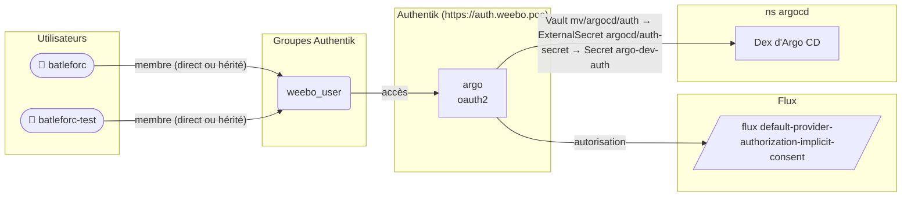

| Propriété | Valeur |
|---|---|
| Slug | `argo` |
| CR | `argo` |
| Fournisseur | oauth2 |
| Émetteur | `https://auth.weebo.poc/application/o/argo/` |
| Client | `argo` (confidential) |
| Grants | `authorization_code` |
| Durée du jeton d'accès | `défaut` |
| Scopes / mappings | `authentik default OAuth Mapping: OpenID 'email'` `authentik default OAuth Mapping: OpenID 'profile'` `authentik default OAuth Mapping: OpenID 'openid'` |
| Redirections | `https://argo.weebo.poc/api/dex/callback` (strict) `https://localhost:8085/auth/callback` (strict) |
| Clé de signature | `authentik Self-signed Certificate` |
| Flux d'autorisation | `default-provider-authorization-implicit-consent` |
| Flux d'invalidation | `default-provider-invalidation-flow` |
| Accès | `weebo_user` |
| Utilisateurs autorisés | `batleforc`, `batleforc-test` |
| Secret écrit dans | `argocd/auth` |

### Consommateurs

| App Argo CD | Objet | Chemin du secret |
|---|---|---|
| `argocd (1.pulu-conf)` | `argocd/ConfigMap/argocd-cm` | Vault `mv/argocd/auth` → ExternalSecret `argocd/auth-secret` → Secret `argo-dev-auth` |

## argo-admin

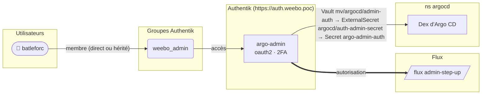

| Propriété | Valeur |
|---|---|
| Slug | `argo-admin` |
| CR | `argo-admin` |
| Fournisseur | oauth2 |
| Émetteur | `https://auth.weebo.poc/application/o/argo-admin/` |
| Client | `argo-admin` (confidential) |
| Grants | `authorization_code` |
| Durée du jeton d'accès | `hours=1` |
| Scopes / mappings | `weebo email` `argo admin profile` `authentik default OAuth Mapping: OpenID 'openid'` |
| Redirections | `https://argo.weebo.poc/api/dex/callback` (strict) |
| Clé de signature | `authentik Self-signed Certificate` |
| Flux d'autorisation | `admin-step-up` (second facteur) |
| Flux d'invalidation | `default-provider-invalidation-flow` |
| Accès | `weebo_admin` |
| Utilisateurs autorisés | `batleforc` |
| Secret écrit dans | `argocd/admin-auth` |

### Consommateurs

| App Argo CD | Objet | Chemin du secret |
|---|---|---|
| `argocd (1.pulu-conf)` | `argocd/ConfigMap/argocd-cm` | Vault `mv/argocd/admin-auth` → ExternalSecret `argocd/auth-admin-secret` → Secret `argo-admin-auth` |

## batlehub

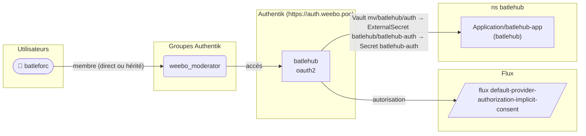

| Propriété | Valeur |
|---|---|
| Slug | `batlehub` |
| CR | `batlehub` |
| Fournisseur | oauth2 |
| Émetteur | `https://auth.weebo.poc/application/o/batlehub/` |
| Client | `batlehub` (confidential) |
| Grants | `authorization_code`, `urn:ietf:params:oauth:grant-type:device_code`, `refresh_token` |
| Durée du jeton d'accès | `hours=12` |
| Scopes / mappings | `weebo email` `authentik default OAuth Mapping: OpenID 'profile'` `authentik default OAuth Mapping: OpenID 'openid'` `authentik default OAuth Mapping: OpenID 'offline_access'` |
| Redirections | `https://pkg.weebo.poc/api/v1/auth/oidc/callback` (strict) |
| Clé de signature | `authentik Self-signed Certificate` |
| Flux d'autorisation | `default-provider-authorization-implicit-consent` |
| Flux d'invalidation | `default-provider-invalidation-flow` |
| Accès | `weebo_moderator` |
| Utilisateurs autorisés | `batleforc` |
| Secret écrit dans | `batlehub/auth` |

### Consommateurs

| App Argo CD | Objet | Chemin du secret |
|---|---|---|
| `batlehub` | `batlehub/Application/batlehub-app` | Vault `mv/batlehub/auth` → ExternalSecret `batlehub/batlehub-auth` → Secret `batlehub-auth` |

## che-cluster

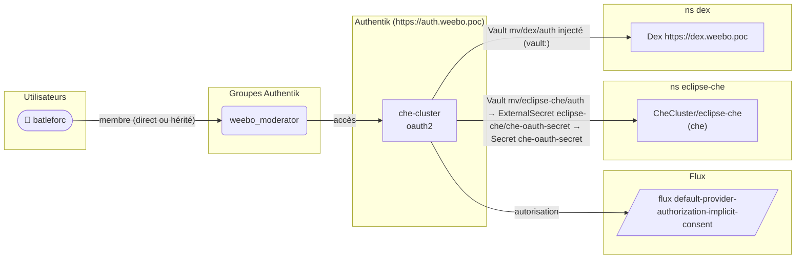

| Propriété | Valeur |
|---|---|
| Slug | `che-cluster` |
| CR | `che` |
| Fournisseur | oauth2 |
| Émetteur | `https://auth.weebo.poc/application/o/che-cluster/` |
| Client | `che-cluster` (confidential) |
| Grants | `authorization_code` |
| Durée du jeton d'accès | `défaut` |
| Scopes / mappings | `weebo email` `authentik default OAuth Mapping: OpenID 'profile'` `authentik default OAuth Mapping: OpenID 'openid'` `authentik default OAuth Mapping: OpenID 'offline_access'` |
| Redirections | `http://localhost:8000` (strict) `https://dex.weebo.poc/callback` (strict) `https://cde.dev.weebo.poc/oauth/callback` (strict) `https://.*.cde.dev.weebo.poc/*.` (regex) |
| Clé de signature | `authentik Self-signed Certificate` |
| Flux d'autorisation | `default-provider-authorization-implicit-consent` |
| Flux d'invalidation | `default-provider-invalidation-flow` |
| Accès | `weebo_moderator` |
| Utilisateurs autorisés | `batleforc` |
| Secret écrit dans | `eclipse-che/auth`, `dex/auth` |

### Consommateurs

| App Argo CD | Objet | Chemin du secret |
|---|---|---|
| `che` | `eclipse-che/CheCluster/eclipse-che` | Vault `mv/eclipse-che/auth` → ExternalSecret `eclipse-che/che-oauth-secret` → Secret `che-oauth-secret` |
| `auth` | `dex/Application/dex` | Vault `mv/dex/auth` injecté (`vault:`) |

## clickstack

| Propriété | Valeur |
|---|---|
| Slug | `clickstack` |
| CR | `clickstack` |
| Fournisseur | proxy |
| Hôte externe | `https://clickstack.weebo.poc` |
| Hôte interne | `http://clickstack-preauth.monitoring.svc.cluster.local:8080` |
| Flux d'autorisation | `admin-step-up` (second facteur) |
| Flux d'invalidation | `default-provider-invalidation-flow` |
| Accès | `weebo_admin` |
| Utilisateurs autorisés | `batleforc` |
| Secret écrit dans | — |

### Consommateurs

| App Argo CD | Objet | Chemin du secret |
|---|---|---|
| — | `monitoring/IngressRoute/clickstack` | forwardAuth `auth/authentik` sur `clickstack.weebo.poc` |

## endpoint-gateway

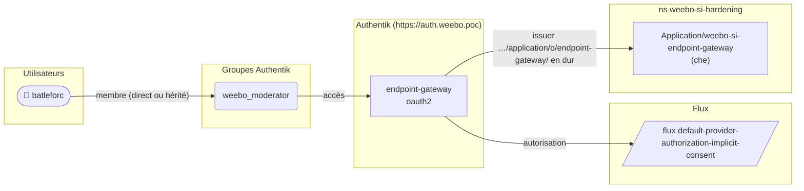

| Propriété | Valeur |
|---|---|
| Slug | `endpoint-gateway` |
| CR | `endpoint-gateway` |
| Fournisseur | oauth2 |
| Émetteur | `https://auth.weebo.poc/application/o/endpoint-gateway/` |
| Client | `endpoint-gateway` (confidential) |
| Grants | `authorization_code`, `refresh_token` |
| Durée du jeton d'accès | `défaut` |
| Scopes / mappings | `weebo email` `weebo groups` `authentik default OAuth Mapping: OpenID 'profile'` `authentik default OAuth Mapping: OpenID 'openid'` `authentik default OAuth Mapping: OpenID 'offline_access'` |
| Redirections | `https://endpoint-auth.cde.dev.weebo.poc/oidc/callback` (strict) |
| Clé de signature | `authentik Self-signed Certificate` |
| Flux d'autorisation | `default-provider-authorization-implicit-consent` |
| Flux d'invalidation | `default-provider-invalidation-flow` |
| Accès | `weebo_moderator` |
| Utilisateurs autorisés | `batleforc` |
| Secret écrit dans | `weebo-si-hardening/endpoint-gateway` |

### Consommateurs

| App Argo CD | Objet | Chemin du secret |
|---|---|---|
| `che` | `weebo-si-hardening/Application/weebo-si-endpoint-gateway` | issuer `…/application/o/endpoint-gateway/` en dur |

## forgejo

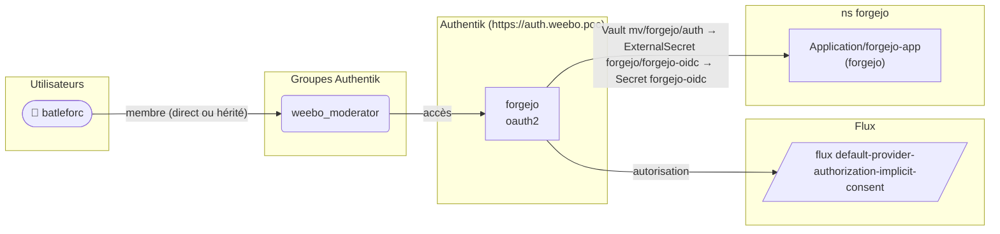

| Propriété | Valeur |
|---|---|
| Slug | `forgejo` |
| CR | `forgejo` |
| Fournisseur | oauth2 |
| Émetteur | `https://auth.weebo.poc/application/o/forgejo/` |
| Client | `forgejo` (confidential) |
| Grants | `authorization_code`, `refresh_token` |
| Durée du jeton d'accès | `défaut` |
| Scopes / mappings | `weebo email` `weebo groups` `authentik default OAuth Mapping: OpenID 'profile'` `authentik default OAuth Mapping: OpenID 'openid'` `authentik default OAuth Mapping: OpenID 'offline_access'` |
| Redirections | `https://git.weebo.poc/user/oauth2/authentik/callback` (strict) |
| Clé de signature | `authentik Self-signed Certificate` |
| Flux d'autorisation | `default-provider-authorization-implicit-consent` |
| Flux d'invalidation | `default-provider-invalidation-flow` |
| Accès | `weebo_moderator` |
| Utilisateurs autorisés | `batleforc` |
| Secret écrit dans | `forgejo/auth` |

### Consommateurs

| App Argo CD | Objet | Chemin du secret |
|---|---|---|
| `forgejo` | `forgejo/Application/forgejo-app` | Vault `mv/forgejo/auth` → ExternalSecret `forgejo/forgejo-oidc` → Secret `forgejo-oidc` |

## kube-admin

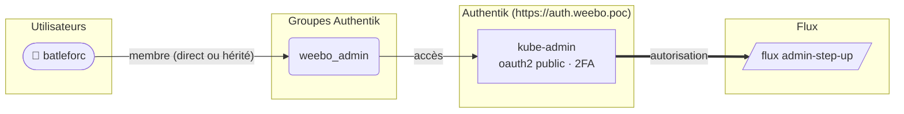

| Propriété | Valeur |
|---|---|
| Slug | `kube-admin` |
| CR | `kube-admin` |
| Fournisseur | oauth2 |
| Émetteur | `https://auth.weebo.poc/application/o/kube-admin/` |
| Client | `kube-admin` (public) |
| Grants | `authorization_code` |
| Durée du jeton d'accès | `hours=1` |
| Scopes / mappings | `weebo email` `weebo groups` `authentik default OAuth Mapping: OpenID 'profile'` `authentik default OAuth Mapping: OpenID 'openid'` |
| Redirections | `http://localhost:8000` (strict) `http://localhost:18000` (strict) |
| Clé de signature | `authentik Self-signed Certificate` |
| Flux d'autorisation | `admin-step-up` (second facteur) |
| Flux d'invalidation | `default-provider-invalidation-flow` |
| Accès | `weebo_admin` |
| Utilisateurs autorisés | `batleforc` |
| Secret écrit dans | — |

### Consommateurs

| App Argo CD | Objet | Chemin du secret |
|---|---|---|
| hors Argo CD | kubeconfig `Weebo-si-admin` | issuer de l'application |
| hors Argo CD | apiserver jwt[1] | issuer de l'application |

## longhorn

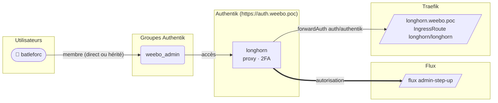

| Propriété | Valeur |
|---|---|
| Slug | `longhorn` |
| CR | `longhorn` |
| Fournisseur | proxy |
| Hôte externe | `https://longhorn.weebo.poc` |
| Hôte interne | `http://longhorn-frontend.longhorn.svc.cluster.local` |
| Flux d'autorisation | `admin-step-up` (second facteur) |
| Flux d'invalidation | `default-provider-invalidation-flow` |
| Accès | `weebo_admin` |
| Utilisateurs autorisés | `batleforc` |
| Secret écrit dans | — |

### Consommateurs

| App Argo CD | Objet | Chemin du secret |
|---|---|---|
| — | `longhorn/IngressRoute/longhorn` | forwardAuth `auth/authentik` sur `longhorn.weebo.poc` |

## openbao

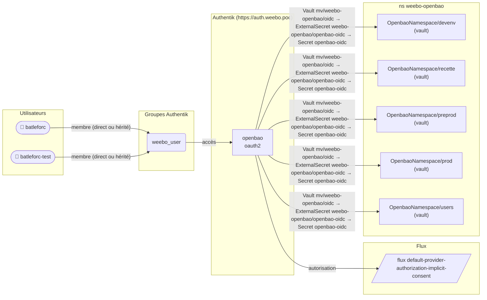

| Propriété | Valeur |
|---|---|
| Slug | `openbao` |
| CR | `openbao` |
| Fournisseur | oauth2 |
| Émetteur | `https://auth.weebo.poc/application/o/openbao/` |
| Client | `openbao` (confidential) |
| Grants | `authorization_code` |
| Durée du jeton d'accès | `défaut` |
| Scopes / mappings | `weebo email` `weebo groups` `authentik default OAuth Mapping: OpenID 'profile'` `authentik default OAuth Mapping: OpenID 'openid'` |
| Redirections | `https://vault.weebo.poc/ui/vault/auth/authentik/oidc/callback?namespace=devenv` (strict) `https://vault.weebo.poc/ui/vault/auth/authentik/oidc/callback?namespace=recette` (strict) `https://vault.weebo.poc/ui/vault/auth/authentik/oidc/callback?namespace=preprod` (strict) `https://vault.weebo.poc/ui/vault/auth/authentik/oidc/callback?namespace=prod` (strict) `https://vault.weebo.poc/ui/vault/auth/authentik/oidc/callback?namespace=users` (strict) `http://localhost:8250/oidc/callback` (strict) |
| Clé de signature | `authentik Self-signed Certificate` |
| Flux d'autorisation | `default-provider-authorization-implicit-consent` |
| Flux d'invalidation | `default-provider-invalidation-flow` |
| Accès | `weebo_user` |
| Utilisateurs autorisés | `batleforc`, `batleforc-test` |
| Secret écrit dans | `weebo-openbao/oidc` |

### Consommateurs

| App Argo CD | Objet | Chemin du secret |
|---|---|---|
| `vault` | `weebo-openbao/OpenbaoNamespace/devenv` | Vault `mv/weebo-openbao/oidc` → ExternalSecret `weebo-openbao/openbao-oidc` → Secret `openbao-oidc` |
| `vault` | `weebo-openbao/OpenbaoNamespace/recette` | Vault `mv/weebo-openbao/oidc` → ExternalSecret `weebo-openbao/openbao-oidc` → Secret `openbao-oidc` |
| `vault` | `weebo-openbao/OpenbaoNamespace/preprod` | Vault `mv/weebo-openbao/oidc` → ExternalSecret `weebo-openbao/openbao-oidc` → Secret `openbao-oidc` |
| `vault` | `weebo-openbao/OpenbaoNamespace/prod` | Vault `mv/weebo-openbao/oidc` → ExternalSecret `weebo-openbao/openbao-oidc` → Secret `openbao-oidc` |
| `vault` | `weebo-openbao/OpenbaoNamespace/users` | Vault `mv/weebo-openbao/oidc` → ExternalSecret `weebo-openbao/openbao-oidc` → Secret `openbao-oidc` |

## s3

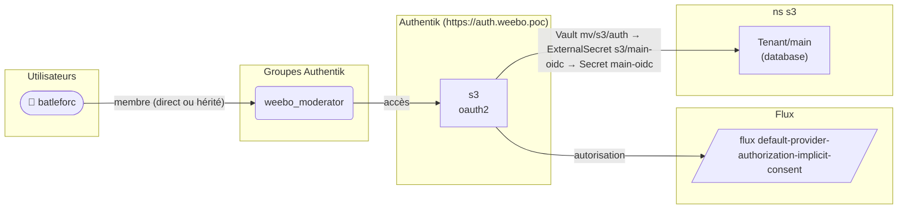

| Propriété | Valeur |
|---|---|
| Slug | `s3` |
| CR | `s3` |
| Fournisseur | oauth2 |
| Émetteur | `https://auth.weebo.poc/application/o/s3/` |
| Client | `s3` (confidential) |
| Grants | `authorization_code` |
| Durée du jeton d'accès | `défaut` |
| Scopes / mappings | `authentik default OAuth Mapping: OpenID 'email'` `authentik default OAuth Mapping: OpenID 'profile'` `authentik default OAuth Mapping: OpenID 'openid'` `authentik default OAuth Mapping: OpenID 'offline_access'` `rustfs policies` |
| Redirections | `https://s3-main.weebo.poc/rustfs/admin/v3/oidc/callback/default` (strict) |
| Clé de signature | `authentik Self-signed Certificate` |
| Flux d'autorisation | `default-provider-authorization-implicit-consent` |
| Flux d'invalidation | `default-provider-invalidation-flow` |
| Accès | `weebo_moderator` |
| Utilisateurs autorisés | `batleforc` |
| Secret écrit dans | `s3/auth` |

### Consommateurs

| App Argo CD | Objet | Chemin du secret |
|---|---|---|
| `database` | `s3/Tenant/main` | Vault `mv/s3/auth` → ExternalSecret `s3/main-oidc` → Secret `main-oidc` |

## stalwart

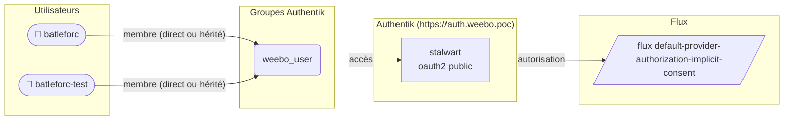

| Propriété | Valeur |
|---|---|
| Slug | `stalwart` |
| CR | `stalwart` |
| Fournisseur | oauth2 |
| Émetteur | `https://auth.weebo.poc/application/o/stalwart/` |
| Client | `stalwart` (public) |
| Grants | `authorization_code`, `refresh_token` |
| Durée du jeton d'accès | `défaut` |
| Scopes / mappings | `weebo email` `weebo groups` `authentik default OAuth Mapping: OpenID 'profile'` `authentik default OAuth Mapping: OpenID 'openid'` `authentik default OAuth Mapping: OpenID 'offline_access'` |
| Redirections | `https://mail\.weebo\.poc/.*` (regex) |
| Clé de signature | `authentik Self-signed Certificate` |
| Flux d'autorisation | `default-provider-authorization-implicit-consent` |
| Flux d'invalidation | `default-provider-invalidation-flow` |
| Accès | `weebo_user` |
| Utilisateurs autorisés | `batleforc`, `batleforc-test` |
| Secret écrit dans | `mail/auth` |

### Consommateurs

Aucun consommateur trouvé dans le rendu.

