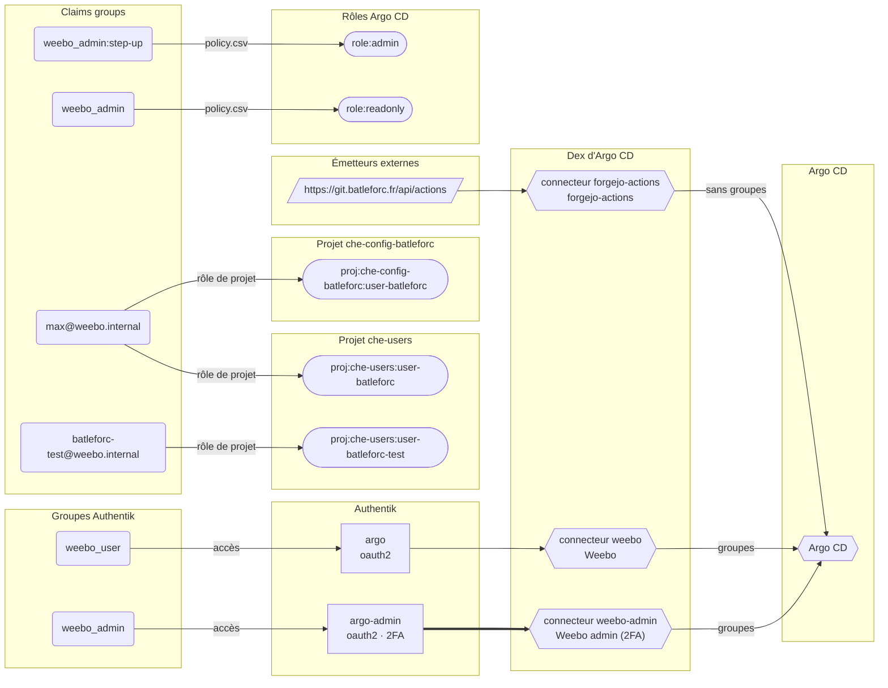

{/* Généré par `task docs:authflow` (0.task/scripts/authflow.py). Ne pas éditer à la main. */}

Comment on entre dans Argo CD et ce que chacun y peut, d'après `1.pulu-conf/main.go` (Dex, RBAC, réglages) et les AppProjects rendus par les charts. Ce que décrit `1.pulu-conf` n'est en place qu'après `pulumi up`.

## Réglages

| Clé | Valeur (1.pulu-conf) | Rôle |
|---|---|---|
| `admin.enabled` | `pulumi.String(fmt.Sprintf("%t", !deployed))` | compte local `admin` (mot de passe statique) |
| `exec.enabled` | `pulumi.Bool(false)` | terminal web dans les pods |
| `users.session.duration` | `pulumi.String("8h")` | durée d'une session (24h par défaut) |
| `policy.default` | `pulumi.String("")` | rôle de qui n'est nommé nulle part |
| `scopes` | `pulumi.String("[groups, email]")` | claims lues comme groupes par le RBAC |
| `server.rbac.log.enforce.enable` | `pulumi.String("true")` | journalisation des refus RBAC |
| `server.insecure` | `pulumi.Bool(deployed)` | TLS terminé en amont (Traefik) |

## Connecteurs Dex

| Connecteur | Nom | Émetteur | Groupes transmis | Nom d'utilisateur |
|---|---|---|---|---|
| `weebo` | Weebo | `$argo-dev-auth:url` | oui | `défaut` |
| `weebo-admin` | Weebo admin (2FA) | `$argo-admin-auth:url` | oui | `défaut` |
| `forgejo-actions` | forgejo-actions | `https://git.batleforc.fr/api/actions` | non | `sub` |

Un connecteur sans groupes ni email n'obtient que ce qu'un rôle de projet donne à son nom d'utilisateur ; `policy.default` donne le reste.

## Rôles globaux (`policy.csv`)

| Claim | Rôle | Nature |
|---|---|---|
| `weebo_admin:step-up` | `role:admin` | marqueur émis par un mapping |
| `weebo_admin` | `role:readonly` | groupe Authentik |

## Projets

L'app of apps `main` est dans le projet `bootstrap`, destination `argocd` (`1.pulu-conf`).

Projet `default` : **Non verrouillé** : le projet intégré d'Argo CD permet tout (`lockDefaultProject: false` dans `2.argo/app/values.yaml`). Plus aucune Application ne l'utilise : il peut être verrouillé.

| Projet | Sources | Destinations | Types cluster | Types namespacés | Applications | Rendu par |
|---|---|---|---|---|---|---|
| `bootstrap` | ce dépôt | `argocd`, `kube-system` | `ClusterRoleBinding` | tous | `main (1.pulu-conf)` | `app of apps` |
| `che-config-batleforc` | `https://github.com/batleforc/weebo-dotfiles-che` | `dev-ws-batleforc` | aucun | `ConfigMap`, `Secret` | `batleforc-external-config (2.helm/user-app)` | `che` |
| `che-users` | ce dépôt | `dev-ws-*`, `argocd` | `Namespace` | `RoleBinding`, `SecretStore`, `Application`, `ConfigMap` | `che-user-batleforc (weebo-si-operator)` `che-user-batleforc-test (weebo-si-operator)` | `che` |
| `database` | `oci://ghcr.io/clickhouse/clickhouse-operator-helm` `https://mongodb.github.io/helm-charts` `https://cloudnative-pg.github.io/charts` `https://operator.rustfs.com` `https://github.com/rustfs/operator` `https://valkey.io/valkey-helm` ce dépôt | `argocd`, `database`, `monitoring`, `s3`, `valkey` | `Namespace`, `CustomResourceDefinition`, `ClusterRole`, `MutatingWebhookConfiguration`, `ValidatingWebhookConfiguration`, `ClusterRoleBinding`, `Tenant` | tous | `clickhouse-operator` `cnpg-operator` `database` `database-app` `mongodb-operator` `s3-operator` `valkey-operator` | `app of apps` |
| `dev` | `https://github.com/devfile/devworkspace-operator` `https://eclipse-che.github.io/che-operator/charts` `oci://ghcr.io/batleforc/charts/weebo-si-operator` `oci://ghcr.io/batleforc/charts/endpoint-gateway` ce dépôt | `argocd`, `eclipse-che`, `devworkspace-controller`, `weebo-si-hardening` | `Namespace`, `ClusterRole`, `ClusterRoleBinding`, `MutatingWebhookConfiguration`, `CustomResourceDefinition`, `ValidatingWebhookConfiguration`, `DevWorkspaceOperatorConfig`, `Bundle`, `WeeboSiConfig`, `WeeboSiTeam`, `WeeboSiUser` | tous | `che` `che-app` `che-app-bis` `devworkspace-operator` `eclipse-che-operator` `weebo-si-endpoint-gateway` `weebo-si-hardening-config` `weebo-si-hardening-operator` | `app of apps` |
| `dev-base` | `oci://ghcr.io/batlehub/batlehub/charts/batlehub` `oci://code.forgejo.org/forgejo-helm/forgejo` `oci://ghcr.io/batleforc/charts/weebo-forgejo` `oci://ghcr.io/batleforc/charts/weebo-batlehub` `oci://ghcr.io/batleforc/charts/weebo-angos` `oci://ghcr.io/batleforc/charts/weebo-stalwart` ce dépôt | `argocd`, `angos`, `batlehub`, `forgejo`, `weebo-forgejo`, `weebo-batlehub`, `weebo-angos`, `angos-node`, `mail`, `weebo-stalwart` | `Namespace`, `ValkeyCluster`, `ClusterRole`, `ClusterRoleBinding`, `ClusterSecretStore`, `ClusterExternalSecret`, `CustomResourceDefinition`, `ValidatingWebhookConfiguration`, `ForgejoInstance`, `ForgejoNamespacePolicy`, `StalwartInstance`, `StalwartNamespacePolicy`, `StalwartDomain` | tous | `angos` `batlehub` `batlehub-app` `forgejo` `forgejo-app` `weebo-angos` `weebo-batlehub` `weebo-forgejo` | `app of apps` |
| `infra` | `oci://ghcr.io/traefik/helm/traefik` `oci://quay.io/jetstack/charts/cert-manager` `oci://ghcr.io/bank-vaults/helm-charts/vault-operator` `oci://quay.io/jetstack/charts/trust-manager` `oci://ghcr.io/tarampampam/error-pages/charts/error-pages` `https://ghcr.io/external-secrets/charts` `https://ghcr.io/bank-vaults/helm-charts` `https://charts.dexidp.io` `https://kyverno.github.io/kyverno/` `https://charts.longhorn.io` `https://github.com/kubernetes-csi/external-snapshotter` `https://charts.goauthentik.io` `oci://ghcr.io/batleforc/charts/weebo-authentik` `ghcr.io/external-secrets/charts` `ghcr.io/bank-vaults/helm-charts` `https://github.com/rancher/local-path-provisioner` ce dépôt | `argocd`, `auth`, `dex`, `cert-manager`, `kube-system`, `hook`, `longhorn`, `netbird`, `traefik`, `vault`, `vault-operator`, `vault-infra`, `external-secrets`, `local-path-storage` | `Namespace`, `CustomResourceDefinition`, `ClusterRole`, `Role`, `ClusterRoleBinding`, `RoleBinding`, `IngressClass`, `ValidatingWebhookConfiguration`, `MutatingWebhookConfiguration`, `ClusterIssuer`, `Vault`, `Bundle`, `Certificate`, `MutatingPolicy`, `ClusterPolicy`, `PriorityClass`, `AuthentikInstance`, `AuthentikNamespacePolicy`, `AuthentikUser`, `AuthentikGroup`, `AuthentikBrand`, `AuthentikFlow`, `AuthentikScopeMapping`, `AuthentikBlueprint`, `RecurringJob`, `StorageClass` | tous | `auth` `auth-app` `authentik` `authentik-operator` `cert-manager` `dex` `error-pages-external` `error-pages-internal` `external-secrets` `hook` `hook-app` `ingress` `ingress-app` `kyverno` `local-storage` `longhorn` `main-storage` `snapshot-crds` `terra-authentik` `terra-vault` `traefik` `trust-manager` `vault` `vault-app` `vault-operator` `vault-webhook` `vpn` | `app of apps` |
| `monitoring` | `https://open-telemetry.github.io/opentelemetry-helm-charts` `https://github.com/batleforc/weebo-si-hardening` ce dépôt | `argocd`, `monitoring`, `obi` | `Namespace`, `ClusterRole`, `ClusterRoleBinding`, `ClusterSecretStore`, `ClusterExternalSecret` | tous | `clickstack` `clickstack-preauth` `monitoring` `obi` `otel-cluster` `otel-node` | `app of apps` |

## Rôles de projet

| Projet | Rôle | Sujets | Politiques |
|---|---|---|---|
| `che-config-batleforc` | `user-batleforc` | `max@weebo.internal` | `p, proj:che-config-batleforc:user-batleforc, applications, get, che-config-batleforc/*, allow` `p, proj:che-config-batleforc:user-batleforc, applications, sync, che-config-batleforc/*, allow` |
| `che-users` | `user-batleforc` | `max@weebo.internal` | `p, proj:che-users:user-batleforc, applications, get, che-users/che-user-batleforc, allow` `p, proj:che-users:user-batleforc, applications, sync, che-users/che-user-batleforc, allow` |
| `che-users` | `user-batleforc-test` | `batleforc-test@weebo.internal` | `p, proj:che-users:user-batleforc-test, applications, get, che-users/che-user-batleforc-test, allow` `p, proj:che-users:user-batleforc-test, applications, sync, che-users/che-user-batleforc-test, allow` |

