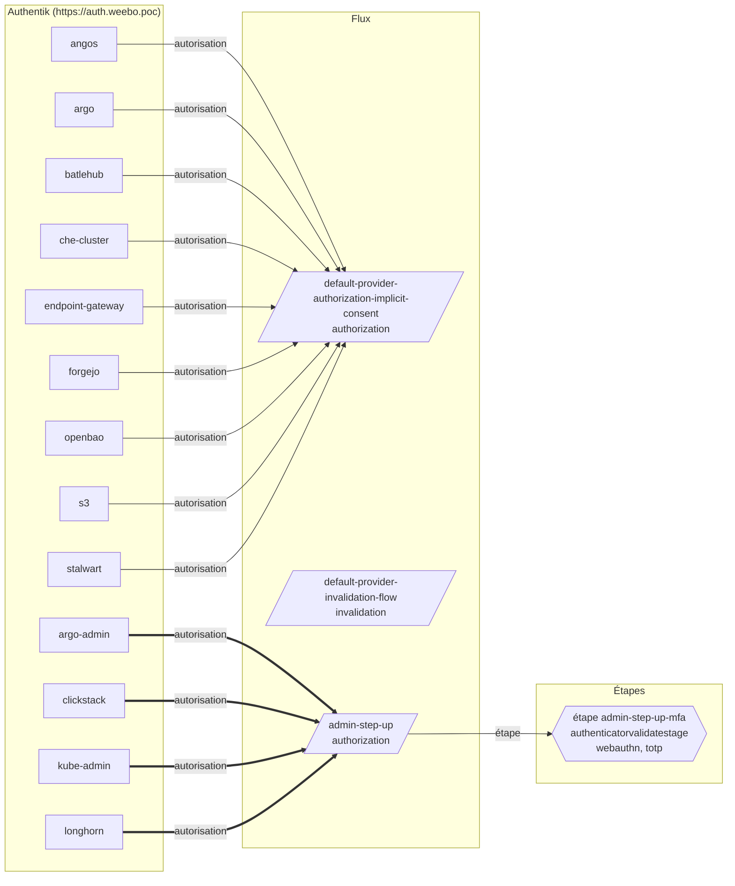

{/* Généré par `task docs:authflow` (0.task/scripts/authflow.py). Ne pas éditer à la main. */}

Les flux Authentik : ceux qu'adoptent les `AuthentikFlow`, ceux que créent les blueprints (`AuthentikBlueprint`), et les applications qui s'en servent.

## Applications → flux d'autorisation

Une flèche épaisse mène à un flux qui exige un second facteur.

## Flux

| Slug | Désignation | Authentification | Titre | Source | Utilisé par |
|---|---|---|---|---|---|
| `admin-step-up` | authorization | `require_authenticated` | Second facteur pour l'accès admin | blueprint `admin-step-up` | `argo-admin`, `clickstack`, `kube-admin`, `longhorn` |
| `default-authentication-flow` | authentication | `none` | Sign in to Weebo | AuthentikFlow `builtin-default-authentication-flow` | — |
| `default-authenticator-static-setup` | stage_configuration | `require_authenticated` | Your recovery codes | AuthentikFlow `builtin-default-authenticator-static-setup` | — |
| `default-authenticator-totp-setup` | stage_configuration | `require_authenticated` | Set up an authenticator app | AuthentikFlow `builtin-default-authenticator-totp-setup` | — |
| `default-authenticator-webauthn-setup` | stage_configuration | `require_authenticated` | Register a security key | AuthentikFlow `builtin-default-authenticator-webauthn-setup` | — |
| `default-password-change` | stage_configuration | `require_authenticated` | Change your password | AuthentikFlow `builtin-default-password-change` | — |
| `default-provider-authorization-explicit-consent` | authorization | `require_authenticated` | %(app)s wants to know who you are | AuthentikFlow `builtin-default-provider-authorization-explicit-consent` | — |
| `default-provider-authorization-implicit-consent` | authorization | `require_authenticated` | On to %(app)s | AuthentikFlow `builtin-default-provider-authorization-implicit-consent` | `angos`, `argo`, `batlehub`, `che-cluster`, `endpoint-gateway`, `forgejo`, `openbao`, `s3`, `stalwart` |
| `default-provider-invalidation-flow` | invalidation | `none` | Signed out of %(app)s | AuthentikFlow `builtin-default-provider-invalidation-flow` | `angos`, `argo`, `argo-admin`, `batlehub`, `che-cluster`, `clickstack`, `endpoint-gateway`, `forgejo`, `kube-admin`, `longhorn`, `openbao`, `s3`, `stalwart` |
| `default-source-authentication` | authentication | `require_unauthenticated` | Sign in to Weebo | AuthentikFlow `builtin-default-source-authentication` | — |
| `default-source-enrollment` | enrollment | `none` | Pick a username | AuthentikFlow `builtin-default-source-enrollment` | — |
| `default-user-settings-flow` | stage_configuration | `require_authenticated` | Your details | AuthentikFlow `builtin-default-user-settings-flow` | — |
| `device-code-flow` | stage_configuration | `require_authenticated` | Device Code Flow | AuthentikFlow `device-code-flow` | — |

**Flux référencés mais absents du rendu** (fournis par Authentik lui-même, ou à créer) : `default-invalidation-flow`

## Étapes déclarées

| Flux | Étape | Modèle | Attributs |
|---|---|---|---|
| `admin-step-up` | `admin-step-up-mfa` | `authentik_stages_authenticator_validate.authenticatorvalidatestage` | device_classes: `["webauthn", "totp"]` not_configured_action: `deny` last_auth_threshold: `hours=8` webauthn_user_verification: `preferred` |

## Flux de la marque

La marque `weebo` (`AuthentikBrand`) :

| Champ | Flux |
|---|---|
| `flowAuthentication` | `default-authentication-flow` |
| `flowInvalidation` | `default-invalidation-flow` |

## Blueprints

### weebo - admin step-up

Second factor for weebo_admin applications (CR `admin-step-up`)

| Modèle | Id | Identifiants |
|---|---|---|
| `authentik_flows.flow` | `flow` | `{"slug": "admin-step-up"}` |
| `authentik_stages_authenticator_validate.authenticatorvalidatestage` | `mfa` | `{"name": "admin-step-up-mfa"}` |
| `authentik_flows.flowstagebinding` | — | `{"target": "flow", "stage": "mfa", "order": 0}` |

### weebo - admin step-up notifications

Mail on every kube-admin elevation (CR `admin-step-up-notify`)

| Modèle | Id | Identifiants |
|---|---|---|
| `authentik_blueprints.metaapplyblueprint` | — | `{}` |
| `authentik_policies_expression.expressionpolicy` | `match` | `{"name": "weebo-match-kube-admin-elevation"}` |
| `authentik_events.notificationrule` | `rule` | `{"name": "weebo-notify-admin-step-up"}` |
| `authentik_policies.policybinding` | — | `{"order": 0, "policy": "match", "target": "rule"}` |

