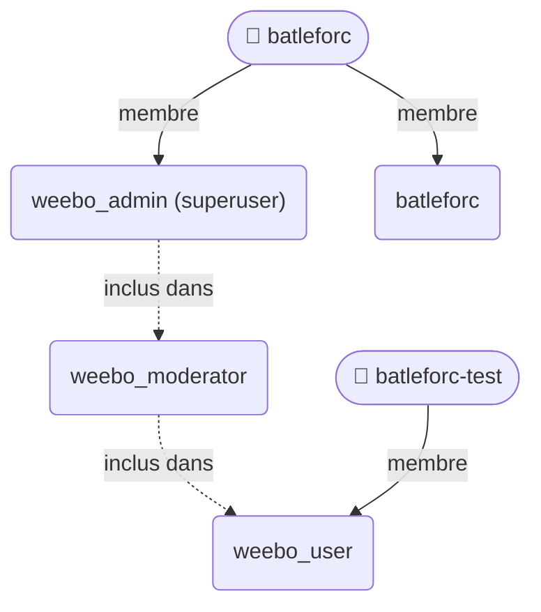

{/* Généré par `task docs:authflow` (0.task/scripts/authflow.py). Ne pas éditer à la main. */}

Les groupes et utilisateurs déclarés dans `2.argo/helm/auth/sub` (`AuthentikGroup`, `AuthentikUser`), ce qu'ils ouvrent dans Authentik, et ce qu'un groupe donne ensuite dans chaque système qui lit la claim `groups`.

## Hiérarchie

Un membre d'un groupe enfant est aussi membre de ses parents pour Authentik : une politique sur `weebo_user` laisse passer `weebo_moderator` et `weebo_admin`.

## Utilisateurs

| Utilisateur | Nom | Email | Groupes directs | Groupes effectifs | Actif |
|---|---|---|---|---|---|
| `batleforc` | max | `max@weebo.internal` | `weebo_admin`, `batleforc` | `weebo_admin`, `weebo_moderator`, `weebo_user`, `batleforc` | oui |
| `batleforc-test` | batleforc-test | `batleforc-test@weebo.internal` | `weebo_user` | `weebo_user` | oui |

## Applications Argo CD visibles

Ce que chaque utilisateur voit une fois connecté à Argo CD (qui exige d'abord l'accès à l'application Authentik `argo`) : les rôles globaux de `policy.csv` (`1.pulu-conf`) par groupe, et les rôles des AppProjects par groupe ou par email (scopes RBAC : `[groups, email]`). La politique par défaut d'Argo CD ne donne rien.

Ces rôles, comme les RoleBindings `labsso:<email>` de l'apiserver, font confiance à la claim `email` : ils supposent qu'un utilisateur ne peut pas changer son email dans Authentik (System › Settings, « Allow users to change email » désactivé).

| Utilisateur | Applications | Par |
|---|---|---|
| `batleforc` | tout (`role:admin`) | `policy.csv` : `weebo_admin:step-up`, émis par le mapping `argo admin profile` de l'application `argo-admin` (second facteur) |
| `batleforc` | tout (`role:readonly`) | `policy.csv` : `weebo_admin` |
| `batleforc` | `che-users/che-user-batleforc` (get, sync) | rôle `proj:che-users:user-batleforc` : `max@weebo.internal` |
| `batleforc` | `che-config-batleforc/*` (get, sync) | rôle `proj:che-config-batleforc:user-batleforc` : `max@weebo.internal` |
| `batleforc-test` | `che-users/che-user-batleforc-test` (get, sync) | rôle `proj:che-users:user-batleforc-test` : `batleforc-test@weebo.internal` |

## Accès aux applications

« ✅ » : la politique d'accès de l'application vise ce groupe ; « ✅ hérité » : elle vise un parent, que ce groupe satisfait.

|  | angos | argo | argo-admin | batlehub | che-cluster | clickstack | endpoint-gateway | forgejo | kube-admin | longhorn | s3 | stalwart |
|---|---|---|---|---|---|---|---|---|---|---|---|---|
| `weebo_user` | — | ✅ | — | — | — | — | — | — | — | — | — | ✅ |
| `weebo_moderator` | ✅ | ✅ hérité | — | ✅ | ✅ | — | ✅ | ✅ | — | — | ✅ | ✅ hérité |
| `weebo_admin` | ✅ hérité | ✅ hérité | ✅ | ✅ hérité | ✅ hérité | ✅ | ✅ hérité | ✅ hérité | ✅ | ✅ | ✅ hérité | ✅ hérité |
| `batleforc` | — | — | — | — | — | — | — | — | — | — | — | — |
| 👤 `batleforc` | ✅ | ✅ | ✅ | ✅ | ✅ | ✅ | ✅ | ✅ | ✅ | ✅ | ✅ | ✅ |
| 👤 `batleforc-test` | — | ✅ | — | — | — | — | — | — | — | — | — | ✅ |

## Claims émises

Les mappings de scope maison (`AuthentikScopeMapping`) : ce qu'une application qui les demande reçoit dans le jeton.

| Mapping | Scope | Description | Expression |
|---|---|---|---|
| `argo admin profile` | `profile` | Argo CD admin marker, emitted after the step-up only | `admin = ak_is_group_member(request.user, name="weebo_admin")` `return {` `    "name": request.user.name,` `    "preferred_username": request.user.username,` `    "nickname": request.user.username,` `    "groups": ["weebo_admin:step-up"] if admin else [],` `}` |
| `rustfs policies` | `groups` | S3 access level | `for group_name, policy in (` `    ("weebo_admin", "consoleAdmin"),` `    ("weebo_moderator", "bucketHealth"),` `):` `    if ak_is_group_member(request.user, name=group_name):` `        return {"rustfs_policy": [policy]}` `return {"rustfs_policy": []}` |
| `weebo email` | `email` | Email address, verified per the identity's attributes | `attributes = request.user.group_attributes()` `verified = attributes.get("email_verified", "false")` `return {` `    "email": request.user.email,` `    "email_verified": str(verified).lower() == "true",` `}` |
| `weebo groups` | `groups` | Weebo group membership, for angos | `return {"groups": [g.name for g in request.user.ak_groups.all()]}` |

## Ce que les groupes donnent en aval

Chaque endroit du rendu (et de la configuration Pulumi d'Argo CD) qui nomme un groupe Authentik : une autorisation accordée au groupe par le système qui consomme la claim `groups`.

| Groupe | App Argo CD | Objet | Champ |
|---|---|---|---|
| `weebo_moderator` | `batlehub` | `batlehub/Application/batlehub-app` | `spec.source.helm.valuesObject.config.auth[0].role_mappings.weebo_moderator` |
| `weebo_moderator` | `batlehub` | `batlehub/BatleHubLocalInstance/main` | `spec.config.auth[0].role_mappings.weebo_moderator` |
| `weebo_moderator` | `auth` | `auth/AuthentikScopeMapping/rustfs-policies` | `spec.expression` |
| `weebo_admin` | `app of apps` | `development/ClusterRoleBinding/weebo-admin-crb` | `subjects[0].name` |
| `weebo_admin` | `angos` | `angos/AngosLocalInstance/registry` | `spec.global.access.jobs[0]` |
| `weebo_admin` | `angos` | `angos/AngosLocalInstance/registry` | `spec.global.access.admin[0]` |
| `weebo_admin` | `angos` | `angos/AngosRepository/weebo` | `spec.access.delete[0]` |
| `weebo_admin` | `batlehub` | `batlehub/Application/batlehub-app` | `spec.source.helm.valuesObject.config.auth[0].role_mappings.weebo_admin` |
| `weebo_admin` | `batlehub` | `batlehub/BatleHubLocalInstance/main` | `spec.config.auth[0].role_mappings.weebo_admin` |
| `weebo_admin` | `forgejo` | `forgejo/Application/forgejo-app` | `spec.source.helm.valuesObject.gitea.oauth[0].adminGroup` |
| `weebo_admin` | `auth` | `auth/AuthentikScopeMapping/argo-admin-profile` | `spec.expression` |
| `weebo_admin` | `auth` | `auth/AuthentikScopeMapping/rustfs-policies` | `spec.expression` |
| `weebo_admin` | `argocd (1.pulu-conf)` | `argocd/ConfigMap/argocd-cm` | `data.policy.csv` |
| `batleforc` | `batlehub` | `batlehub/BatleHubNamespaceClaim/npm-batleforc` | `spec.group` |
| `batleforc` | `batlehub` | `batlehub/BatleHubNamespaceClaim/cargo-batleforc` | `spec.prefix` |
| `batleforc` | `batlehub` | `batlehub/BatleHubNamespaceClaim/cargo-batleforc` | `spec.group` |
| `batleforc` | `batlehub` | `batlehub/BatleHubNamespaceClaim/go-batleforc` | `spec.group` |
| `batleforc` | `batlehub` | `batlehub/BatleHubNamespaceClaim/go-batleforc-org` | `spec.group` |
| `batleforc` | `forgejo` | `forgejo/Application/forgejo-app` | `spec.source.helm.valuesObject.gitea.oauth[0].groupTeamMap` |
| `batleforc` | `che` | `eclipse-che/CheCluster/eclipse-che` | `spec.components.cheServer.extraProperties.CHE_SYSTEM_ADMIN_NAME` |

### Argo CD (`1.pulu-conf`, `policy.csv`)

Scopes lus pour les groupes : `[groups, email]`.

| Groupe | Rôle Argo CD |
|---|---|
| `weebo_admin:step-up` | `role:admin` |
| `weebo_admin` | `role:readonly` |

