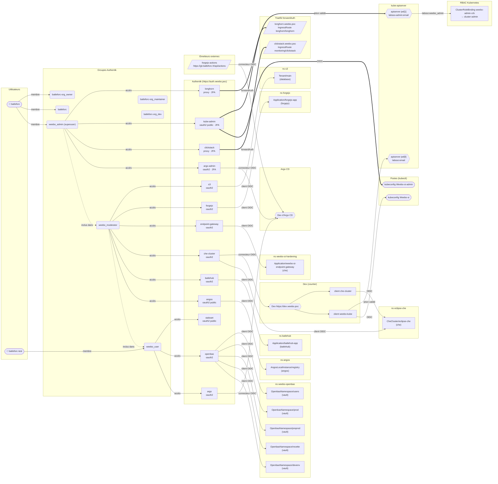

{/* Généré par `task docs:authflow` (0.task/scripts/authflow.py). Ne pas éditer à la main. */}

La chaîne d'authentification du cluster, tirée du rendu Helm des applications Argo CD (comme [les flux réseau](/docs/security/network-flows)), des CRs de l'opérateur `weebo-authentik`, de la configuration Pulumi de l'apiserver et d'Argo CD, et du kubeconfig du dépôt.

Fournisseur d'identité : Authentik (`https://auth.weebo.poc`), géré par CRs dans `2.argo/helm/auth/sub`. Tout le reste s'y raccroche, directement ou par un Dex.

- [Applications Authentik](/docs/security/authentication/applications) : chaque client, ses consommateurs et la façon dont le secret leur parvient.
- [Groupes et accès](/docs/security/authentication/groupes) : qui ouvre quoi, et ce que chaque groupe donne en aval.
- [Flux Authentik](/docs/security/authentication/flux) : les flux, les blueprints, le second facteur.
- [Kubernetes](/docs/security/authentication/kubernetes) : de `kubectl` aux RoleBindings.
- [Argo CD](/docs/security/authentication/argocd) : connecteurs, rôles, projets et ce que chacun permet.

## Légende

- Un **groupe** donne accès à une application Authentik par une politique d'accès (`AuthentikAccessPolicy`). Les membres d'un groupe enfant passent aussi les politiques de ses parents : `weebo_admin` ⊂ `weebo_moderator` ⊂ `weebo_user`.
- Une flèche **Authentik → consommateur** suit le client OIDC : l'opérateur écrit `client_id`/`client_secret` dans Vault (`secretTargets`), un `ExternalSecret` ou une injection `vault:` le relit dans un namespace, et l'objet qui nomme ce Secret est le consommateur. Une URL `/application/o/<slug>/` en dur compte aussi.
- Une flèche **épaisse** (`==>`) passe par une étape de second facteur (flux d'autorisation à étape `authenticator_validate`, ici `admin-step-up`).
- Les **Dex** sont des courtiers : ils se connectent à Authentik comme un client, puis émettent leurs propres jetons à leurs clients statiques.
- Les **proxys** Authentik sont servis par le middleware Traefik `forwardAuth` : l'IngressRoute n'atteint le backend qu'après l'avant-poste Authentik.
- Côté Kubernetes, l'apiserver accepte deux émetteurs JWT (`AuthenticationConfiguration` de `1.pulu-init`), et les (Cluster)RoleBindings donnent les droits aux noms préfixés qu'ils produisent.

## Chaîne globale

## Applications

| Application | Type | Accès | Flux d'autorisation | Consommateurs |
|---|---|---|---|---|
| [`angos`](/docs/security/authentication/applications#angos) | oauth2 public | `weebo_moderator` | `default-provider-authorization-implicit-consent` | AngosLocalInstance/registry (angos) |
| [`argo`](/docs/security/authentication/applications#argo) | oauth2 | `weebo_user` | `default-provider-authorization-implicit-consent` | ConfigMap/argocd-cm (argocd) |
| [`argo-admin`](/docs/security/authentication/applications#argo-admin) | oauth2 | `weebo_admin` | `admin-step-up` | ConfigMap/argocd-cm (argocd) |
| [`batlehub`](/docs/security/authentication/applications#batlehub) | oauth2 | `weebo_moderator` | `default-provider-authorization-implicit-consent` | Application/batlehub-app (batlehub) |
| [`che-cluster`](/docs/security/authentication/applications#che-cluster) | oauth2 | `weebo_moderator` | `default-provider-authorization-implicit-consent` | Application/dex (dex) CheCluster/eclipse-che (eclipse-che) |
| [`clickstack`](/docs/security/authentication/applications#clickstack) | proxy | `weebo_admin` | `admin-step-up` | IngressRoute monitoring/clickstack |
| [`endpoint-gateway`](/docs/security/authentication/applications#endpoint-gateway) | oauth2 | `weebo_moderator` | `default-provider-authorization-implicit-consent` | Application/weebo-si-endpoint-gateway (weebo-si-hardening) |
| [`forgejo`](/docs/security/authentication/applications#forgejo) | oauth2 | `weebo_moderator` | `default-provider-authorization-implicit-consent` | Application/forgejo-app (forgejo) |
| [`kube-admin`](/docs/security/authentication/applications#kube-admin) | oauth2 public | `weebo_admin` | `admin-step-up` | kubeconfig `Weebo-si-admin` apiserver jwt[1] |
| [`longhorn`](/docs/security/authentication/applications#longhorn) | proxy | `weebo_admin` | `admin-step-up` | IngressRoute longhorn/longhorn |
| [`openbao`](/docs/security/authentication/applications#openbao) | oauth2 | `weebo_user` | `default-provider-authorization-implicit-consent` | OpenbaoNamespace/devenv (weebo-openbao) OpenbaoNamespace/preprod (weebo-openbao) OpenbaoNamespace/prod (weebo-openbao) OpenbaoNamespace/recette (weebo-openbao) OpenbaoNamespace/users (weebo-openbao) |
| [`s3`](/docs/security/authentication/applications#s3) | oauth2 | `weebo_moderator` | `default-provider-authorization-implicit-consent` | Tenant/main (s3) |
| [`stalwart`](/docs/security/authentication/applications#stalwart) | oauth2 public | `weebo_user` | `default-provider-authorization-implicit-consent` | aucun rendu |

## Charts non rendus

- aucun

