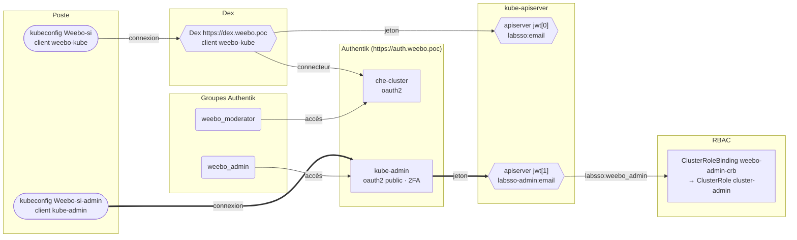

{/* Généré par `task docs:authflow` (0.task/scripts/authflow.py). Ne pas éditer à la main. */}

De `kubectl` aux droits : les deux émetteurs que l'apiserver accepte (`AuthenticationConfiguration`, écrite par `1.pulu-init/main.go`), d'où viennent leurs jetons, et les (Cluster)RoleBindings qu'atteignent les noms qu'ils produisent.

## Émetteurs JWT de l'apiserver

|  | Émetteur | Audience | Origine | Derrière | Nom d'utilisateur | Groupes | Groupes retirés |
|---|---|---|---|---|---|---|---|
| jwt[0] | `https://dex.weebo.poc` | `weebo-kube` | Vault (`OIDC_URL`, `OIDC_CLIENT_ID`), valeur attendue d'après le kubeconfig | Dex, connecteur vers Authentik `che-cluster` | `"labsso:" + claims.email` | `has(claims.groups) ? dyn(claims.groups).filter(g, g != "weebo_admin").map(g, "labsso:" + g) : []` | `weebo_admin` |
| jwt[1] | `https://auth.weebo.poc/application/o/kube-admin/` | `kube-admin` | constante de `1.pulu-init/main.go` | Authentik `kube-admin` | `"labsso-admin:" + claims.email` | claim `groups`, préfixe `labsso:` | — |

Règles communes, sur les claims puis sur l'utilisateur obtenu :

- `claims.email_verified == true`
- `!user.username.startsWith('system:')`
- `user.groups.all(group, !group.startsWith('system:'))`

## Contextes du kubeconfig

`0.config/kubeconfig.oidc-template.yaml` :

| Contexte | Émetteur | Client | Scopes en plus |
|---|---|---|---|
| `Weebo-si` | `https://dex.weebo.poc` | `weebo-kube` | `email offline_access profile openid groups` |
| `Weebo-si-admin` | `https://auth.weebo.poc/application/o/kube-admin/` | `kube-admin` | `email profile groups` |

## Clients statiques de Dex

| Client | Nom | Redirections | Pairs de confiance |
|---|---|---|---|
| `weebo-kube` | Kube App | `https://dex.weebo.poc/callback` `http://localhost:8000` | `che-cluster` |
| `che-cluster` | Eclipse Che | `https://cde.dev.weebo.poc/oauth/callback` | — |

## RBAC

Les bindings du rendu qui nomment un groupe ou un utilisateur hors `system:`, et l'émetteur capable de produire ce nom.

| Binding | Portée | Rôle | Sujet | Atteint par | App Argo CD |
|---|---|---|---|---|---|
| `ClusterRoleBinding/weebo-admin-crb` | cluster | `ClusterRole/cluster-admin` | Group `labsso:weebo_admin` | jwt[1] (accès Authentik : `weebo_admin`) | `app of apps` |

