{/* Généré par `task docs:netflow` (0.task/scripts/netflow.py). Ne pas éditer à la main. */}

Les flux réseau que les NetworkPolicies et CiliumNetworkPolicies du dépôt autorisent, tirés du rendu Helm de chaque chart d'application Argo CD. Le schéma global est volontairement exhaustif, donc illisible : il sert à voir la forme de l'ensemble. Le détail se lit par application.

## Légende

- Une **flèche pleine** est un flux autorisé par une politique déployée aujourd'hui.
- Une **flèche pointillée** est un flux qu'une politique `weebo-base` encore désactivée (`ciliumNetworkPolicies.enabled: false`) autoriserait.
- Un cadre est un namespace, une boîte un ensemble de pods (« tous les pods » = sélecteur vide).
- Une **flèche épaisse** « via Traefik » relie un workload au backend qu'il atteint par un nom `*.weebo.poc` (annotation `weebo.io/reaches`, backend tiré des IngressRoute/Ingress du dépôt, ou du bloc `ingress` des values d'un chart upstream). C'est une relation applicative : la politique ne contrôle que le saut vers Traefik, c'est Traefik qui ouvre la connexion vers le backend.
- `tout : internet + cluster` marque des pods qu'aucune politique déployée ne restreint en sortie : ils peuvent joindre n'importe quelle destination, IP directe comprise. « autres pods » désigne ceux du namespace qu'aucune politique d'egress ne sélectionne, et un pod visé par une politique proposée reste ouvert tant qu'elle est désactivée.
- L'entité `host` sans port n'est pas dessinée : chaque politique `weebo-base` la laisse entrer (sondes kubelet, apiserver vers les webhooks).
- Une politique qui ne liste que de l'ingress laisse l'egress ouvert, et inversement.

## Régénérer

```sh
task docs:netflow
```

Le hook `pre-commit` (cog.toml) la lance dès qu'un commit touche `2.argo/helm`, `2.helm` ou le générateur, et ajoute le résultat au commit.

## Par application

- [angos](/docs/security/network-flows/angos)
- [auth](/docs/security/network-flows/auth)
- [batlehub](/docs/security/network-flows/batlehub)
- [che](/docs/security/network-flows/che)
- [database](/docs/security/network-flows/database)
- [forgejo](/docs/security/network-flows/forgejo)
- [hook](/docs/security/network-flows/hook)
- [ingress](/docs/security/network-flows/ingress)
- [main-storage](/docs/security/network-flows/main-storage)
- [monitoring](/docs/security/network-flows/monitoring)
- [vault](/docs/security/network-flows/vault)
- [vpn](/docs/security/network-flows/vpn)

## Schéma global

```mermaid
flowchart LR
  n_entity_kube_apiserver_3b39a7(["entité: kube-apiserver"])
  n_entity_open_f65d5d(["tout : internet + cluster"])
  n_entity_world_1a2945(["entité: world"])
  n_fqdn_api_anthropic_com_41439f[/"FQDN<br/>api.anthropic.com"/]
  n_fqdn_codeberg_org_code_forgejo_org_gcr_io_storage_googleapis_com_ghcr_io_pkg_con_feb69b[/"FQDN<br/>codeberg.org<br/>code.forgejo.org<br/>gcr.io<br/>storage.googleapis.com<br/>ghcr.io<br/>pkg-containers.githubusercontent.com<br/>registry-1.docker.io<br/>auth.docker.io<br/>production.cloudflare.docker.com<br/>quay.io<br/>*.quay.io<br/>registry.access.redhat.com<br/>*.redhat.com<br/>*.redhat.io"/]
  n_fqdn_github_com_git_batleforc_fr_c00a93[/"FQDN<br/>github.com<br/>git.batleforc.fr"/]
  subgraph ns_angos["angos"]
    n_ns_angos_ece4d4["angos / server"]
    n_ns_angos_dafce5["autres pods"]
    n_ns_angos_f1c162["svc registry"]
    n_ns_angos_86cc70["tous les pods"]
  end
  subgraph ns_angos_node["angos-node"]
    n_ns_angos_node_61b630["tous les pods"]
  end
  subgraph ns_auth["auth"]
    n_ns_auth_3aba95["authentik / server (chart authentik)"]
    n_ns_auth_895bb8["tous les pods"]
  end
  subgraph ns_batlehub["batlehub"]
    n_ns_batlehub_eb6c8e["svc batlehub"]
    n_ns_batlehub_62b5f7["tous les pods"]
  end
  subgraph ns_cert_manager["cert-manager"]
    n_ns_cert_manager_12e016["tous les pods"]
  end
  subgraph ns_database["database"]
    n_ns_database_89cec4["clickhouse-operator"]
    n_ns_database_7191e8["cloudnative-pg"]
    n_ns_database_a3a908["mongodb-kubernetes-operator"]
    n_ns_database_47a91f["tous les pods"]
    n_ns_database_7ef0dc["valkey-operator"]
  end
  subgraph ns_devworkspace_controller["devworkspace-controller"]
    n_ns_devworkspace_controller_3115b1["tous les pods"]
  end
  subgraph ns_dex["dex"]
    n_ns_dex_bea24e["dex (chart dex)"]
    n_ns_dex_d4c810["tous les pods"]
  end
  subgraph ns_eclipse_che["eclipse-che"]
    n_ns_eclipse_che_50dd3c["che-gateway"]
    n_ns_eclipse_che_2b9ac4["component In che,che-dashboard,che-gateway"]
    n_ns_eclipse_che_43d24e["tous les pods"]
  end
  subgraph ns_external_secrets["external-secrets"]
    n_ns_external_secrets_276995["tous les pods"]
  end
  subgraph ns_forgejo["forgejo"]
    n_ns_forgejo_881e90["svc forgejo-http"]
    n_ns_forgejo_90cc22["tous les pods"]
  end
  subgraph ns_hook["hook"]
    n_ns_hook_d7c9c8["tous les pods"]
  end
  subgraph ns_kube_system["kube-system"]
    n_ns_kube_system_9d0e37["kube-dns"]
  end
  subgraph ns_local_path_storage["local-path-storage"]
    n_ns_local_path_storage_78f2b1["tous les pods"]
  end
  subgraph ns_longhorn["longhorn"]
    n_ns_longhorn_e4afa5["longhorn-manager"]
    n_ns_longhorn_3ce2a9["svc longhorn-frontend"]
    n_ns_longhorn_911a87["tous les pods"]
  end
  subgraph ns_monitoring["monitoring"]
    n_ns_monitoring_f1b4f0["opentelemetry-collector / component=agent-collector"]
    n_ns_monitoring_adae0f["svc clickstack-preauth"]
    n_ns_monitoring_1d4c40["tous les pods"]
  end
  subgraph ns_netbird["netbird"]
    n_ns_netbird_45c447["exit-node-ingress"]
    n_ns_netbird_b1fc84["tous les pods"]
  end
  subgraph ns_obi["obi"]
    n_ns_obi_e941c2["tous les pods"]
  end
  subgraph ns_s3["s3"]
    n_ns_s3_aa1591["svc main-console"]
    n_ns_s3_0ff49c["tous les pods"]
  end
  subgraph ns_traefik["traefik"]
    n_ns_traefik_67721a["svc error-pages-internal"]
    n_ns_traefik_907541["tous les pods"]
    n_ns_traefik_d50a8d["traefik"]
  end
  subgraph ns_vault["vault"]
    n_ns_vault_da07f8["openbao"]
    n_ns_vault_b5391e["svc openbao"]
    n_ns_vault_1e8c25["tous les pods"]
  end
  subgraph ns_vault_infra["vault-infra"]
    n_ns_vault_infra_14c050["tous les pods"]
  end
  subgraph ns_vault_operator["vault-operator"]
    n_ns_vault_operator_bf680a["tous les pods"]
  end
  subgraph ns_weebo_angos["weebo-angos"]
    n_ns_weebo_angos_b7bea6["tous les pods"]
  end
  subgraph ns_weebo_batlehub["weebo-batlehub"]
    n_ns_weebo_batlehub_3f15d5["tous les pods"]
  end
  subgraph ns_weebo_forgejo["weebo-forgejo"]
    n_ns_weebo_forgejo_29bdd1["tous les pods"]
  end
  subgraph ns_weebo_si_hardening["weebo-si-hardening"]
    n_ns_weebo_si_hardening_98b8dc["endpoint-gateway"]
    n_ns_weebo_si_hardening_af5a96["tous les pods"]
    n_ns_weebo_si_hardening_973fb2["weebo-si-operator"]
  end
  subgraph ns_workspaces_Che__dev_ws___["workspaces Che (dev-ws-*)"]
    n_ns_workspaces_Che__dev_ws____07f3cd["profil weebo-net-anthropic"]
    n_ns_workspaces_Che__dev_ws____ac87b9["profil weebo-net-base"]
    n_ns_workspaces_Che__dev_ws____fa1322["profil weebo-net-dev-registries"]
    n_ns_workspaces_Che__dev_ws____01372c["profil weebo-net-internet"]
    n_ns_workspaces_Che__dev_ws____e38a98["profil weebo-net-kube-api"]
    n_ns_workspaces_Che__dev_ws____a24264["tous les pods"]
  end
  n_ns_angos_ece4d4 -.->|"TCP 6443"| n_entity_kube_apiserver_3b39a7
  n_ns_angos_ece4d4 -->|"egress non restreint tant que angos-egress est désactivée"| n_entity_open_f65d5d
  n_ns_angos_ece4d4 -.->|"TCP 443"| n_fqdn_codeberg_org_code_forgejo_org_gcr_io_storage_googleapis_com_ghcr_io_pkg_con_feb69b
  n_ns_angos_ece4d4 -.->|"tous ports"| n_ns_angos_86cc70
  n_ns_angos_ece4d4 ==>|"via Traefik : auth.weebo.poc"| n_ns_auth_3aba95
  n_ns_angos_ece4d4 -.->|"ANY 53 (dns)"| n_ns_kube_system_9d0e37
  n_ns_angos_ece4d4 ==>|"via Traefik : s3-main.weebo.poc"| n_ns_s3_aa1591
  n_ns_angos_ece4d4 -.->|"TCP 8443"| n_ns_traefik_d50a8d
  n_ns_angos_dafce5 -->|"egress non restreint"| n_entity_open_f65d5d
  n_ns_angos_86cc70 -.->|"tous ports"| n_ns_angos_86cc70
  n_ns_angos_node_61b630 -->|"egress non restreint"| n_entity_open_f65d5d
  n_ns_auth_895bb8 -->|"egress non restreint"| n_entity_open_f65d5d
  n_ns_auth_895bb8 ==>|"via Traefik : auth.weebo.poc"| n_ns_auth_3aba95
  n_ns_auth_895bb8 -.->|"tous ports"| n_ns_auth_895bb8
  n_ns_auth_895bb8 -.->|"TCP 8080"| n_ns_monitoring_1d4c40
  n_ns_auth_895bb8 -->|"TCP 8200"| n_ns_vault_da07f8
  n_ns_batlehub_62b5f7 -->|"egress non restreint"| n_entity_open_f65d5d
  n_ns_batlehub_62b5f7 ==>|"via Traefik : auth.weebo.poc"| n_ns_auth_3aba95
  n_ns_batlehub_62b5f7 -.->|"tous ports"| n_ns_batlehub_62b5f7
  n_ns_batlehub_62b5f7 ==>|"via Traefik : git.weebo.poc"| n_ns_forgejo_881e90
  n_ns_batlehub_62b5f7 ==>|"via Traefik : s3-main.weebo.poc"| n_ns_s3_aa1591
  n_ns_cert_manager_12e016 -->|"egress non restreint"| n_entity_open_f65d5d
  n_ns_cert_manager_12e016 -.->|"tous ports"| n_ns_cert_manager_12e016
  n_ns_cert_manager_12e016 -->|"TCP 8200"| n_ns_vault_da07f8
  n_ns_database_89cec4 -.->|"TCP 2181, TCP 8123, TCP 9000, TCP 9001, TCP 9002, TCP 9123"| n_ns_monitoring_1d4c40
  n_ns_database_7191e8 -.->|"TCP 5432, TCP 8000"| n_ns_auth_895bb8
  n_ns_database_7191e8 -.->|"TCP 5432, TCP 8000"| n_ns_batlehub_62b5f7
  n_ns_database_7191e8 -.->|"TCP 5432, TCP 8000"| n_ns_forgejo_90cc22
  n_ns_database_a3a908 -.->|"TCP 27017"| n_ns_monitoring_1d4c40
  n_ns_database_47a91f -->|"egress non restreint"| n_entity_open_f65d5d
  n_ns_database_47a91f -.->|"tous ports"| n_ns_database_47a91f
  n_ns_database_7ef0dc -.->|"TCP 6379"| n_ns_batlehub_62b5f7
  n_ns_devworkspace_controller_3115b1 -->|"egress non restreint"| n_entity_open_f65d5d
  n_ns_devworkspace_controller_3115b1 -.->|"tous ports"| n_ns_devworkspace_controller_3115b1
  n_ns_devworkspace_controller_3115b1 -->|"tous ports"| n_ns_workspaces_Che__dev_ws____ac87b9
  n_ns_dex_d4c810 -->|"egress non restreint"| n_entity_open_f65d5d
  n_ns_dex_d4c810 ==>|"via Traefik : auth.weebo.poc"| n_ns_auth_3aba95
  n_ns_dex_d4c810 -->|"TCP 8200"| n_ns_vault_da07f8
  n_ns_eclipse_che_43d24e -->|"egress non restreint"| n_entity_open_f65d5d
  n_ns_eclipse_che_43d24e ==>|"via Traefik : dex.weebo.poc"| n_ns_dex_bea24e
  n_ns_eclipse_che_43d24e -.->|"tous ports"| n_ns_eclipse_che_43d24e
  n_ns_eclipse_che_43d24e -->|"tous ports"| n_ns_workspaces_Che__dev_ws____ac87b9
  n_ns_external_secrets_276995 -->|"egress non restreint"| n_entity_open_f65d5d
  n_ns_external_secrets_276995 -.->|"tous ports"| n_ns_external_secrets_276995
  n_ns_external_secrets_276995 -->|"TCP 8200"| n_ns_vault_da07f8
  n_ns_forgejo_90cc22 -->|"egress non restreint"| n_entity_open_f65d5d
  n_ns_forgejo_90cc22 ==>|"via Traefik : auth.weebo.poc"| n_ns_auth_3aba95
  n_ns_forgejo_90cc22 -.->|"tous ports"| n_ns_forgejo_90cc22
  n_ns_forgejo_90cc22 ==>|"via Traefik : s3-main.weebo.poc"| n_ns_s3_aa1591
  n_ns_hook_d7c9c8 -->|"egress non restreint"| n_entity_open_f65d5d
  n_ns_hook_d7c9c8 -.->|"tous ports"| n_ns_hook_d7c9c8
  n_ns_local_path_storage_78f2b1 -->|"egress non restreint"| n_entity_open_f65d5d
  n_ns_local_path_storage_78f2b1 -.->|"tous ports"| n_ns_local_path_storage_78f2b1
  n_ns_longhorn_911a87 -->|"egress non restreint"| n_entity_open_f65d5d
  n_ns_monitoring_f1b4f0 -->|"TCP 9500"| n_ns_longhorn_e4afa5
  n_ns_monitoring_1d4c40 -->|"egress non restreint"| n_entity_open_f65d5d
  n_ns_monitoring_1d4c40 -.->|"tous ports"| n_ns_monitoring_1d4c40
  n_ns_monitoring_1d4c40 -.->|"TCP 8081"| n_ns_weebo_si_hardening_973fb2
  n_ns_netbird_45c447 ==>|"via Traefik : registry.pkg.weebo.poc"| n_ns_angos_f1c162
  n_ns_netbird_45c447 ==>|"via Traefik : auth.weebo.poc"| n_ns_auth_3aba95
  n_ns_netbird_45c447 ==>|"via Traefik : pkg.weebo.poc"| n_ns_batlehub_eb6c8e
  n_ns_netbird_45c447 ==>|"via Traefik : dex.weebo.poc"| n_ns_dex_bea24e
  n_ns_netbird_45c447 ==>|"via Traefik : git.weebo.poc"| n_ns_forgejo_881e90
  n_ns_netbird_45c447 ==>|"via Traefik : longhorn.weebo.poc"| n_ns_longhorn_3ce2a9
  n_ns_netbird_45c447 ==>|"via Traefik : clickstack.weebo.poc"| n_ns_monitoring_adae0f
  n_ns_netbird_45c447 ==>|"via Traefik : s3-main.weebo.poc"| n_ns_s3_aa1591
  n_ns_netbird_45c447 ==>|"via Traefik : truc.weebo.poc"| n_ns_traefik_67721a
  n_ns_netbird_45c447 ==>|"via Traefik : vault.weebo.poc"| n_ns_vault_b5391e
  n_ns_netbird_b1fc84 -->|"egress non restreint"| n_entity_open_f65d5d
  n_ns_netbird_b1fc84 -.->|"TCP 2222"| n_ns_forgejo_90cc22
  n_ns_netbird_b1fc84 -->|"TCP 8200"| n_ns_vault_da07f8
  n_ns_obi_e941c2 -->|"egress non restreint"| n_entity_open_f65d5d
  n_ns_obi_e941c2 -.->|"TCP 4317, TCP 4318"| n_ns_monitoring_1d4c40
  n_ns_s3_0ff49c -->|"egress non restreint"| n_entity_open_f65d5d
  n_ns_s3_0ff49c ==>|"via Traefik : auth.weebo.poc"| n_ns_auth_3aba95
  n_ns_s3_0ff49c -.->|"tous ports"| n_ns_s3_0ff49c
  n_ns_traefik_907541 -->|"TCP 8200"| n_ns_vault_da07f8
  n_ns_traefik_d50a8d -.->|"TCP 8000"| n_ns_angos_86cc70
  n_ns_traefik_d50a8d -.->|"TCP 9000, TCP 9443"| n_ns_auth_895bb8
  n_ns_traefik_d50a8d -.->|"TCP 8080"| n_ns_batlehub_62b5f7
  n_ns_traefik_d50a8d -.->|"TCP 5556"| n_ns_dex_d4c810
  n_ns_traefik_d50a8d -.->|"TCP 8080"| n_ns_eclipse_che_43d24e
  n_ns_traefik_d50a8d -.->|"TCP 3000"| n_ns_forgejo_90cc22
  n_ns_traefik_d50a8d -.->|"TCP 8080"| n_ns_monitoring_1d4c40
  n_ns_traefik_d50a8d -.->|"TCP 9000, TCP 9001, TCP 9090"| n_ns_s3_0ff49c
  n_ns_traefik_d50a8d -->|"tous ports"| n_ns_workspaces_Che__dev_ws____ac87b9
  n_ns_vault_1e8c25 -->|"egress non restreint"| n_entity_open_f65d5d
  n_ns_vault_1e8c25 -->|"tous ports"| n_ns_vault_da07f8
  n_ns_vault_infra_14c050 -->|"egress non restreint"| n_entity_open_f65d5d
  n_ns_vault_infra_14c050 -->|"TCP 8200"| n_ns_vault_da07f8
  n_ns_vault_infra_14c050 -.->|"tous ports"| n_ns_vault_infra_14c050
  n_ns_vault_operator_bf680a -->|"egress non restreint"| n_entity_open_f65d5d
  n_ns_vault_operator_bf680a -->|"TCP 8200"| n_ns_vault_da07f8
  n_ns_vault_operator_bf680a -.->|"tous ports"| n_ns_vault_operator_bf680a
  n_ns_weebo_angos_b7bea6 -->|"egress non restreint"| n_entity_open_f65d5d
  n_ns_weebo_angos_b7bea6 -.->|"TCP 8000"| n_ns_angos_86cc70
  n_ns_weebo_angos_b7bea6 -.->|"tous ports"| n_ns_weebo_angos_b7bea6
  n_ns_weebo_batlehub_3f15d5 -->|"egress non restreint"| n_entity_open_f65d5d
  n_ns_weebo_batlehub_3f15d5 ==>|"via Traefik : pkg.weebo.poc"| n_ns_batlehub_eb6c8e
  n_ns_weebo_batlehub_3f15d5 -.->|"TCP 8080"| n_ns_batlehub_62b5f7
  n_ns_weebo_batlehub_3f15d5 -.->|"tous ports"| n_ns_weebo_batlehub_3f15d5
  n_ns_weebo_forgejo_29bdd1 -->|"egress non restreint"| n_entity_open_f65d5d
  n_ns_weebo_forgejo_29bdd1 ==>|"via Traefik : git.weebo.poc"| n_ns_forgejo_881e90
  n_ns_weebo_forgejo_29bdd1 -.->|"TCP 3000"| n_ns_forgejo_90cc22
  n_ns_weebo_forgejo_29bdd1 -.->|"tous ports"| n_ns_weebo_forgejo_29bdd1
  n_ns_weebo_si_hardening_98b8dc ==>|"via Traefik : auth.weebo.poc"| n_ns_auth_3aba95
  n_ns_weebo_si_hardening_98b8dc -.->|"TCP 8089"| n_ns_eclipse_che_43d24e
  n_ns_weebo_si_hardening_af5a96 -->|"egress non restreint"| n_entity_open_f65d5d
  n_ns_workspaces_Che__dev_ws____07f3cd -->|"TCP 443"| n_fqdn_api_anthropic_com_41439f
  n_ns_workspaces_Che__dev_ws____ac87b9 -->|"TCP 6443"| n_entity_kube_apiserver_3b39a7
  n_ns_workspaces_Che__dev_ws____ac87b9 -->|"TCP 8089"| n_ns_eclipse_che_50dd3c
  n_ns_workspaces_Che__dev_ws____ac87b9 -->|"TCP 8080"| n_ns_eclipse_che_2b9ac4
  n_ns_workspaces_Che__dev_ws____ac87b9 -->|"ANY 53 (dns)"| n_ns_kube_system_9d0e37
  n_ns_workspaces_Che__dev_ws____ac87b9 -->|"TCP 8000, TCP 8443"| n_ns_traefik_d50a8d
  n_ns_workspaces_Che__dev_ws____ac87b9 -->|"tous ports"| n_ns_workspaces_Che__dev_ws____a24264
  n_ns_workspaces_Che__dev_ws____fa1322 -->|"TCP 22, TCP 443"| n_fqdn_github_com_git_batleforc_fr_c00a93
  n_ns_workspaces_Che__dev_ws____01372c -->|"tous ports"| n_entity_world_1a2945
  n_ns_workspaces_Che__dev_ws____e38a98 -->|"TCP 6443"| n_entity_kube_apiserver_3b39a7
  n_ns_workspaces_Che__dev_ws____a24264 -.->|"TCP 8080, TCP 8089"| n_ns_eclipse_che_43d24e
  n_ns_workspaces_Che__dev_ws____a24264 -->|"tous ports"| n_ns_workspaces_Che__dev_ws____ac87b9
```



## Politiques

| Namespace | Politique | Type | État | Chart |
|---|---|---|---|---|
| angos | `angos-egress` | Cilium | proposée | `2.argo/helm/angos` |
| angos | `angos-ingress` | Cilium | proposée | `2.argo/helm/angos` |
| angos-node | `angos-node-ingress` | Cilium | proposée | `2.argo/helm/angos` |
| auth | `auth-ingress` | Cilium | proposée | `2.argo/helm/auth/sub` |
| batlehub | `batlehub-ingress` | Cilium | proposée | `2.argo/helm/batlehub` |
| cert-manager | `cert-manager-ingress` | Cilium | proposée | `2.argo/helm/ingress/sub` |
| database | `database-ingress` | Cilium | proposée | `2.argo/helm/database/sub` |
| devworkspace-controller | `devworkspace-controller-ingress` | Cilium | proposée | `2.argo/helm/che/sub` |
| dex | `dex-ingress` | Cilium | proposée | `2.argo/helm/auth/sub` |
| eclipse-che | `eclipse-che-ingress` | Cilium | proposée | `2.argo/helm/che/sub` |
| external-secrets | `external-secrets-ingress` | Cilium | proposée | `2.argo/helm/vault/sub` |
| forgejo | `forgejo-ingress` | Cilium | proposée | `2.argo/helm/forgejo` |
| hook | `hook-ingress` | Cilium | proposée | `2.argo/helm/hook/sub` |
| local-path-storage | `local-path-storage-ingress` | Cilium | proposée | `2.argo/helm/storage` |
| longhorn | `longhorn-manager-metrics` | Kubernetes | déployée | `2.argo/helm/storage` |
| monitoring | `monitoring-ingress` | Cilium | proposée | `2.argo/helm/monitoring` |
| obi | `obi-ingress` | Cilium | proposée | `2.argo/helm/monitoring` |
| s3 | `s3-ingress` | Cilium | proposée | `2.argo/helm/database/sub` |
| vault | `openbao-ingress` | Cilium | déployée | `2.argo/helm/vault/sub` |
| vault-infra | `vault-infra-ingress` | Cilium | proposée | `2.argo/helm/vault/sub` |
| vault-operator | `vault-operator-ingress` | Cilium | proposée | `2.argo/helm/vault/sub` |
| weebo-angos | `weebo-angos-ingress` | Cilium | proposée | `2.argo/helm/angos` |
| weebo-batlehub | `weebo-batlehub-ingress` | Cilium | proposée | `2.argo/helm/batlehub` |
| weebo-forgejo | `weebo-forgejo-ingress` | Cilium | proposée | `2.argo/helm/forgejo` |
| weebo-si-hardening | `weebo-net-anthropic` | Cilium | déployée | `2.argo/helm/che/hardening` |
| weebo-si-hardening | `weebo-net-base` | Cilium | déployée | `2.argo/helm/che/hardening` |
| weebo-si-hardening | `weebo-net-dev-registries` | Cilium | déployée | `2.argo/helm/che/hardening` |
| weebo-si-hardening | `weebo-net-internet` | Cilium | déployée | `2.argo/helm/che/hardening` |
| weebo-si-hardening | `weebo-net-kube-api` | Cilium | déployée | `2.argo/helm/che/hardening` |
| weebo-si-hardening | `weebo-si-operator-ingress` | Cilium | proposée | `2.argo/helm/che/sub` |

## Charts non dessinés

- aucun

