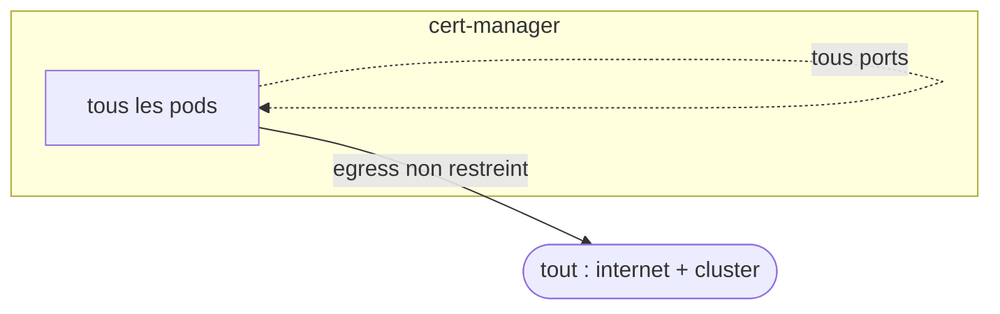
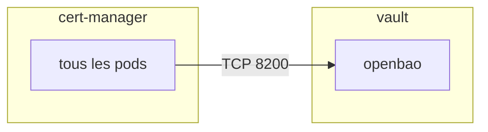

{/* Généré par `task docs:netflow` (0.task/scripts/netflow.py). Ne pas éditer à la main. */}

Les flux que les politiques de l'application Argo CD `ingress` autorisent. Namespaces : `cert-manager`.

## Légende

- Une **flèche pleine** est un flux autorisé par une politique déployée aujourd'hui.
- Une **flèche pointillée** est un flux qu'une politique `weebo-base` encore désactivée (`ciliumNetworkPolicies.enabled: false`) autoriserait.
- Un cadre est un namespace, une boîte un ensemble de pods (« tous les pods » = sélecteur vide).
- Une **flèche épaisse** « via Traefik » relie un workload au backend qu'il atteint par un nom `*.weebo.poc` (annotation `weebo.io/reaches`, backend tiré des IngressRoute/Ingress du dépôt, ou du bloc `ingress` des values d'un chart upstream). C'est une relation applicative : la politique ne contrôle que le saut vers Traefik, c'est Traefik qui ouvre la connexion vers le backend.
- `tout : internet + cluster` marque des pods qu'aucune politique déployée ne restreint en sortie : ils peuvent joindre n'importe quelle destination, IP directe comprise. « autres pods » désigne ceux du namespace qu'aucune politique d'egress ne sélectionne, et un pod visé par une politique proposée reste ouvert tant qu'elle est désactivée.
- L'entité `host` sans port n'est pas dessinée : chaque politique `weebo-base` la laisse entrer (sondes kubelet, apiserver vers les webhooks).
- Une politique qui ne liste que de l'ingress laisse l'egress ouvert, et inversement.

## Flux

## Flux ouverts par d'autres applications

Les politiques d'autres applications qui touchent les namespaces de `ingress`.

## Politiques

| Namespace | Politique | Type | État | Chart |
|---|---|---|---|---|
| cert-manager | `cert-manager-ingress` | Cilium | proposée | `2.argo/helm/ingress/sub` |

