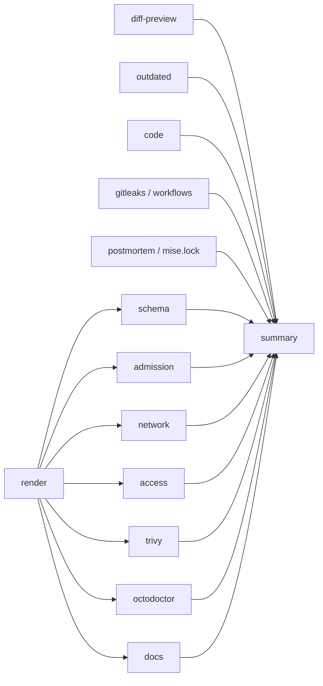

# Proposition de CI pour weebo-si

Proposition du 2026-11-21. Rien n'est en place. Le but : qu'une PR (la
tienne ou celle de Renovate) ne puisse pas partir en prod sans qu'on sache ce
qu'elle change, en particulier sur le réseau et les habilitations.

Contexte qui oriente tout :

- une PR fusionnée sur `develop` **est** un déploiement : ArgoCD synchronise
  automatiquement, et `develop` n'a aujourd'hui **aucune protection de
  branche** ;
- le dépôt est **public** sur GitHub : tout ce qu'on poste dans une PR est
  lisible par tous ;
- la CI n'a **pas accès au cluster**, et n'en aura pas : tout se calcule
  depuis Git ;
- on a déjà les briques : `argorender.py` rend les 25 apps comme ArgoCD,
  `netflow.py` calcule les flux réseau autorisés, `authflow.py` la chaîne
  d'authentification et les habilitations, gitleaks tourne en pre-commit.

## 1. Les principes

1. **Rendre une fois, vérifier partout.** Un job produit les manifestes rendus
   (apps du dépôt et charts upstream), les autres les lisent en artefact.
2. **Les faits de sécurité sont verrouillés dans des lockfiles.** Les flux
   réseau autorisés et les habilitations sont écrits dans
   `security/network.lock.yaml` et `security/access.lock.yaml`. La CI
   recalcule et compare : tout ce qui s'ajoute doit apparaître dans le diff
   du lockfile, dans la même PR. Une PR Renovate qui ouvre un flux ou donne
   un droit échoue donc forcément, parce que Renovate ne touche pas aux
   lockfiles : il faut un humain.
3. **Un seul commentaire de synthèse**, mis à jour à chaque push, avec un
   tableau par check et le détail replié. Les détails sensibles (CVE des
   images qui tournent) restent en artefact, pas dans le commentaire public.
4. **Avertir d'abord, bloquer ensuite.** Chaque check démarre en
   avertissement et passe bloquant une fois son bruit nettoyé.
5. **Portable vers Forgejo Actions.** Même syntaxe de workflow : GitHub
   Actions maintenant, le runner interne plus tard (`todo/dev-env.md`).

## 2. Le schéma des jobs



Cible : moins de 10 minutes par PR. `diff-preview` est le plus long (un
cluster kind avec ArgoCD), il tourne en parallèle du reste.

## 3. Les checks

Légende : 🔴 bloquant visé, 🟠 avertissement, ⚪ informatif.

### 3.1 `render` : rendu correct des charts 🔴

- `argorender.walk()` sur toute l'app of apps : la moindre erreur de
  `helm template` (dont les `required` et les `fail` de weebo-base) bloque.
- **Charts upstream aussi** : aujourd'hui `argorender` ignore les
  Applications qui pointent hors du dépôt (traefik, cert-manager,
  authentik...). À ajouter : `helm pull <repo> <chart> --version
  <targetRevision>` puis le rendu avec le `valuesObject` de l'Application.
  Sans ça, `schema`, `trivy` et `octodoctor` ne voient que la moitié du
  cluster.
- `helm lint --strict` sur les charts du dépôt (`2.argo/helm/*`, `2.helm/*`).
- Sortie : `rendered/<app>/*.yaml`, plus la liste des images.

### 3.2 `schema` : manifestes valides pour le cluster 🔴

- `kubeconform -strict` contre les schémas Kubernetes 1.36.
- Les CRD : convertir en schémas JSON les CRD trouvées **dans le rendu
  lui-même** (les opérateurs les installent) avec `openapi2jsonschema`, plus
  le catalogue CRDs-catalog pour les autres. Un champ mal orthographié dans
  un `WeeboSiConfig` ou une `CiliumNetworkPolicy` est alors vu avant le sync.
- `pluto` : API dépréciées ou retirées en 1.36 (utile avant chaque montée de
  version de Kubernetes).

### 3.3 `admission` : ce que le cluster refuserait 🟠

- `kyverno apply` avec les politiques rendues du chart `hook` sur tous les
  manifestes rendus : on sait en PR qu'un pod sera refusé à l'admission.
- PSA simulé : les namespaces portent leur niveau en label ; une règle
  Kyverno `podSecurity` par niveau vérifie les pods rendus contre le niveau
  de leur namespace.
- Limite : les webhooks des opérateurs maison (hardening, forgejo...) ne
  sont pas rejouables hors cluster. À voir si `weebo-si-operator` peut
  auditer des fichiers (comme `pods audit`, mais sur un dossier).

### 3.4 `network` : moindre privilège réseau 🔴

`netflow.py --check`, qui réutilise `all_edges` et `open_egress`.

| Règle | Ce qui est vérifié | Niveau |
| --- | --- | --- |
| N1 couverture | Chaque namespace rendu a une politique qui sélectionne tous ses pods en entrée, sauf liste d'exemption explicite (`kube-system`...) | 🔴 |
| N2 sources ouvertes | Pas de `fromEntities: [world]` ou `[all]`, pas de `fromCIDR 0.0.0.0/0` ou `::/0`, sauf liste blanche | 🔴 |
| N3 sortie ouverte | `toEntities: [world]`, `toCIDR 0.0.0.0/0`, `toFQDNs matchPattern: "*"` signalés, liste blanche justifiée (angos, workspaces `weebo-net-internet`) | 🟠 puis 🔴 |
| N4 ports | Règle d'un autre namespace sans `toPorts` (tous les ports ouverts) | 🟠 |
| N5 lockfile | Tout nouveau flux (`batlehub → s3:9000`) doit figurer dans `security/network.lock.yaml` | 🔴 |
| N6 garde-fous | `traefik-ingress` présente et sans `world` ; Services `LoadBalancer`/`NodePort` réservés à Traefik ; `hostNetwork`/`hostPort` seulement pour la liste connue (cilium, kubearmor, obi, otel-controlplane) | 🔴 |
| N7 exposition | Tout host d'Ingress ou d'IngressRoute est en `*.weebo.poc` (en attendant RFC 0006) ; une app sans auth native passe par un forwardAuth | 🟠 |
| N8 pare-feu Talos | Test Go sur le constructeur de règles de `1.pulu-init` : `ADMIN_CIDRS` obligatoire, aucune règle ouverte à `0.0.0.0/0` | 🔴 |

Le commentaire de PR montre le diff des flux en clair :

```text
Réseau : 2 flux ajoutés, 0 retiré
+ batlehub/batlehub      → s3/main:9000/TCP
+ eclipse-che/che        → traefik/traefik:8443/TCP (git.weebo.poc)
```

### 3.5 `access` : anomalies d'habilitation 🔴

`authflow.py --check`, qui a déjà le modèle complet.

| Règle | Ce qui est vérifié | Niveau |
| --- | --- | --- |
| A1 sujets interdits | Aucun binding vers `system:authenticated`, `system:unauthenticated`, `system:anonymous` | 🔴 |
| A2 cluster-admin | Les bindings à `cluster-admin` sont verrouillés (aujourd'hui : `system:masters`, `longhorn-support-bundle`, `weebo-admin-crb` → `labsso:weebo_admin`) | 🔴 |
| A3 rôles dangereux | Nouveau rôle avec `*` en verbe ou ressource, `secrets` en lecture à l'échelle du cluster, `escalate`/`bind`/`impersonate`, `pods/exec` à l'échelle du cluster | 🟠 |
| A4 Authentik | Application sans binding de politique (ouverte à tout compte Authentik) ; redirect URI en `http` ou avec joker ; forwardAuth en `mode: proxy` (le piège connu) ; groupe `is_superuser` | 🔴 |
| A5 Argo CD | AppProject avec `*` en destination, source ou `clusterResourceWhitelist` ; rôle par défaut de `policy.csv` ; groupes des rôles de projet verrouillés | 🔴 |
| A6 Vault | Policies terraform (`2.terra`, lues en HCL) avec `path "*"` ou des droits sur `sys/` et `auth/` : verrouillées (aujourd'hui `weebo_admin` et `mv_policy`) ; rôle Kubernetes lié à `*` | 🔴 |
| A7 opérateurs | `ForgejoNamespacePolicy` qui nomme un admin du site (la règle `@instance-admin` d'aujourd'hui), `*` en namespace ; grants OpenBao | 🔴 |
| A8 Dex | Clients statiques et connecteurs verrouillés | 🟠 |
| A9 lockfile | `security/access.lock.yaml` : « qui obtient quoi », par groupe et par compte de service | 🔴 |

Exemple de sortie :

```text
Habilitations : 1 changement
+ groupe weebo_moderator → application batlehub (Authentik)
```

### 3.6 `trivy` : qualité et vulnérabilités, apps externes comprises 🟠

- `trivy image` sur les images **ajoutées ou changées** par la PR (diff des
  listes d'images base/PR) : bloquant sur un CRITICAL corrigeable, sinon
  avertissement. Base de données en cache entre les runs.
- Scan complet de toutes les images chaque semaine (cron), résultat en
  artefact et en issue privée : une image qui ne bouge pas peut quand même
  gagner une CVE.
- `trivy config` sur les manifestes rendus (privilégié, root, sans limites)
  : informatif, exceptions justifiées dans `.trivyignore.yaml`.
- `trivy fs` sur les modules Go (`1.pulu-*`, `requestid`) et les `yarn.lock`
  (`0.docs`, `3.custo`).
- Le détail des CVE va en artefact et en SARIF, pas dans le commentaire
  public (voir §5).

### 3.7 `octodoctor` ⚪ puis 🟠

- Sur les manifestes ArgoCD rendus (Applications, AppProjects, ConfigMaps
  argocd). Rapport HTML en artefact.
- Comparé à la base : seules les règles **nouvellement** en échec remontent.

### 3.8 `docs` : documentation à jour 🔴

- `task docs:netflow` et `task docs:authflow`, puis `git diff --exit-code` :
  le pre-commit local peut être contourné, pas la CI.
- Build du site `0.docs` (`yarn build`) et vérification des liens internes.
- Chaque pin de version porte son commentaire `# renovate:` (sans lui,
  Renovate ne voit pas la dépendance, ton `renovate.json5` le dit).
- Chaque Application de `2.argo/app` a une page de doc ou est dans une liste
  d'exemption.
- En-tête des RFC valide (statut, dates).

### 3.9 `diff-preview` : ce que ArgoCD va changer ⚪

- `argocd-diff-preview` lance un kind avec ArgoCD, rend la branche de base et
  celle de la PR, et poste le diff par application. Aucun accès au cluster.
- **À vérifier** : nos Applications sont produites par un chart Helm
  (`2.argo/app`), pas écrites en YAML. Soit l'outil sait parcourir l'app of
  apps dans sa version actuelle, soit `argorender` écrit les Applications
  rendues (avec `targetRevision` = la branche de la PR) dans un dossier
  qu'on lui donne.
- Diff replié par application dans le commentaire, complet en artefact.

### 3.10 `outdated` : versions en retard ⚪

- `renovate --platform=local --dry-run=lookup --report-type=file` sur le
  checkout : la liste des dépendances en retard (actuelle, dernière, âge),
  sans créer de branche.
- Le commentaire met en avant celles que la PR touche, avec un lien vers le
  Dependency Dashboard pour le reste.
- Sur une PR Renovate : rappel du `minimumReleaseAge` et des notes de
  version, déjà fournies par Renovate.

### 3.11 `code` et hygiène 🔴

- `go vet`, `go test`, `go build` pour `1.pulu-init` et `1.pulu-conf` ;
  tests du plugin `requestid` (déjà dans `traefik-request-id.yml`).
- `terraform fmt -check` et `terraform validate` (`init -backend=false`) pour
  `2.terra`.
- `gitleaks` sur la PR (le pre-commit se contourne).
- `actionlint` et `zizmor` sur les workflows eux-mêmes.
- `cog check` sur les messages de commit de la PR.

### 3.12 `postmortem` (mlab.sh) : outillage et dépendances 🟠

Constat du 2026-11-21 avec postmortem 2.9.2, la dernière version :

- **postmortem ne lit pas `mise.lock`** : mise n'est pas dans ses
  écosystèmes (Node, Python, Rust, Go, Java...), et `postmortem scan .` à la
  racine répond `no supported ecosystem detected`.
- **Le dépôt n'a pas de `mise.lock`**, et `mise.toml` met presque tout en
  `latest` (helm, kubectl, talosctl, pulumi, gitleaks...) : chaque poste et
  chaque runner installe ce qui sort le jour même, sans checksum. C'est le
  premier trou à boucher, avant tout scanner.

Proposition en trois temps :

1. **Verrouiller mise** : `[settings] lockfile = true` dans `mise.toml`,
   versions explicites (Renovate sait les monter : manager `mise`), puis
   `mise lock` pour les plateformes utilisées (`linux-x64`, plus celles des
   runners). `mise.lock` porte alors versions et checksums ; la CI fait
   `mise install --locked` et échoue si un binaire ne correspond plus.
2. **postmortem sur ce qu'il sait lire**, depuis un checkout propre (sans
   `node_modules`, sinon les bundles minifiés de mermaid, prettier ou vite
   remontent en faux « obfuscation » CRITICAL, vu en local) :
   `postmortem scan 0.docs 3.custo/batlehub-theme 1.pulu-init 1.pulu-conf
   2.argo/helm/ingress/main/files/requestid`, plus `postmortem diff` contre
   la branche de base pour ne montrer que ce que la PR fait entrer.
   `postmortem harden` (contrôles CIRSEC : délai de publication, installs
   figées, scripts d'installation) en informatif. `postmortem ci github`
   génère le squelette du job.
3. **`mise.lock` dans postmortem** : demander le support upstream
   (mlab-sh/postmortem, aucune issue ouverte sur le sujet). En attendant, un
   petit script lit `mise.lock` et signale : un outil nouveau ou qui change
   de source (`github:`, `cargo:`, `pipx:`...), une version publiée depuis
   moins de `minimumReleaseAge` (3 jours, comme Renovate), une entrée sans
   checksum.

Faux positif connu à mettre en allowlist : la page de runbook
`bascule-weebo-si` cite `/etc/shadow` (règle KubeArmor), ce qui déclenche
`sensitive_api` sur le build du site.

## 4. La synthèse

Maquette (chiffres inventés) :

```text
weebo-si CI — PR #123 (renovate: traefik 42.4.1 → 42.5.0)

| Check        | Résultat                                  |
| ------------ | ----------------------------------------- |
| render       | ✅ 25 apps, 41 charts upstream            |
| schema       | ✅                                        |
| admission    | ⚠️ 1 pod refusé (traefik: hostPort)       |
| network      | ✅ aucun flux ajouté                      |
| access       | ✅ aucun droit ajouté                     |
| trivy        | ⚠️ 2 HIGH sur l'image ajoutée (artefact)  |
| octodoctor   | ✅ aucune nouvelle règle en échec         |
| docs         | ✅                                        |
| diff-preview | 1 app modifiée (ingress-app) ▸ détail     |
| outdated     | 3 dépendances en retard ▸ détail          |
```

## 5. Sécurité de la CI elle-même

- Dépôt public : les PR de fork tournent en `pull_request` (jeton en lecture
  seule, aucun secret). Le commentaire est posté par un second workflow
  `workflow_run`, qui ne lit que l'artefact de synthèse, jamais le code de la
  PR. Jamais de `pull_request_target` avec checkout du code de la PR.
- Aucun secret nécessaire aux checks : tout est rendu depuis Git, les charts
  et images upstream sont publics.
- Actions épinglées par digest (déjà fait par `helpers:pinGitHubActionDigests`).
- Les CVE des images qui tournent sont une carte des faiblesses du lab :
  artefacts et SARIF, pas commentaire public. À vérifier : qui voit les
  alertes code scanning sur un dépôt public.
- Protection de `develop` : checks bloquants requis. Sans ça, la CI ne fait
  qu'informer.

## 6. Le déploiement par phases

| Phase | Contenu | Effort estimé |
| --- | --- | --- |
| 1 | `render` (dépôt seul), `schema`, `docs`, `code`, `gitleaks`, synthèse ; tout en avertissement | ~1 jour |
| 2 | `network` et `access` avec les lockfiles initiaux (générés depuis l'état actuel, relus une fois) | 2 à 3 jours |
| 3 | Charts upstream dans `render`, `trivy`, `octodoctor`, `diff-preview`, `outdated`, `admission`, `mise.lock` + `postmortem` | 2 à 3 jours |
| 4 | Passage en bloquant, protection de `develop`, scan hebdomadaire, portage Forgejo Actions | ~1 jour |

## 7. Questions ouvertes

1. GitHub Actions seulement, ou dès le départ un workflow compatible Forgejo
   Actions ?
2. Les lockfiles : un fichier par domaine (réseau, accès) ou un par app ?
   Un seul fichier = un seul endroit à relire, mais des conflits entre PR.
3. Le scan hebdomadaire : issue privée, notification ntfy, ou dashboard
   ClickStack ?
4. Faut-il que `access` lise aussi l'état Authentik réglé hors Git
   (rétention des événements) ? Hors cluster, ce n'est pas possible : le
   documenter comme limite.
